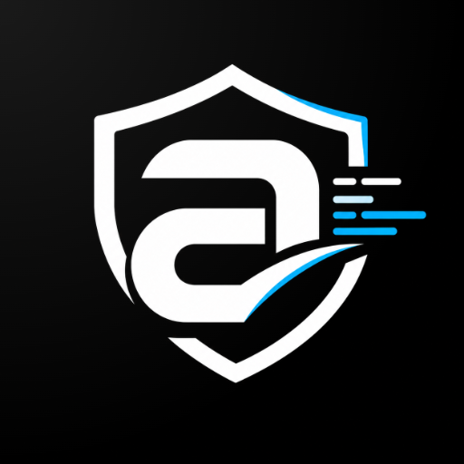
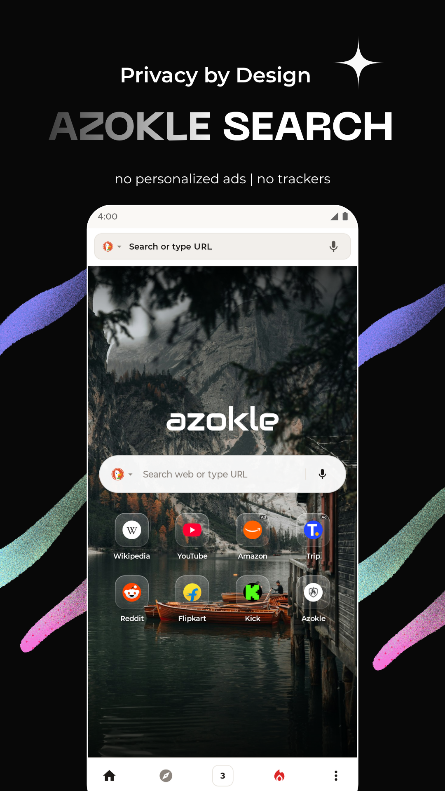
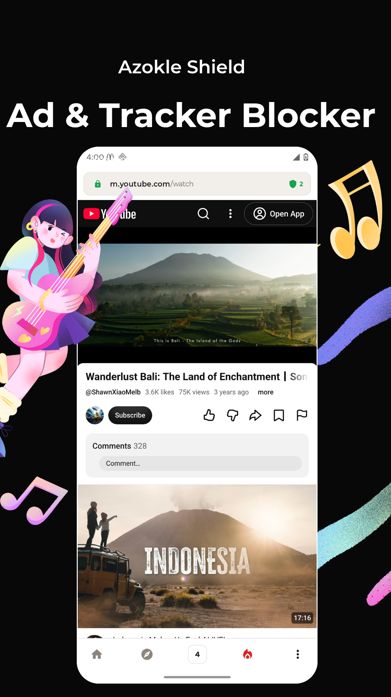
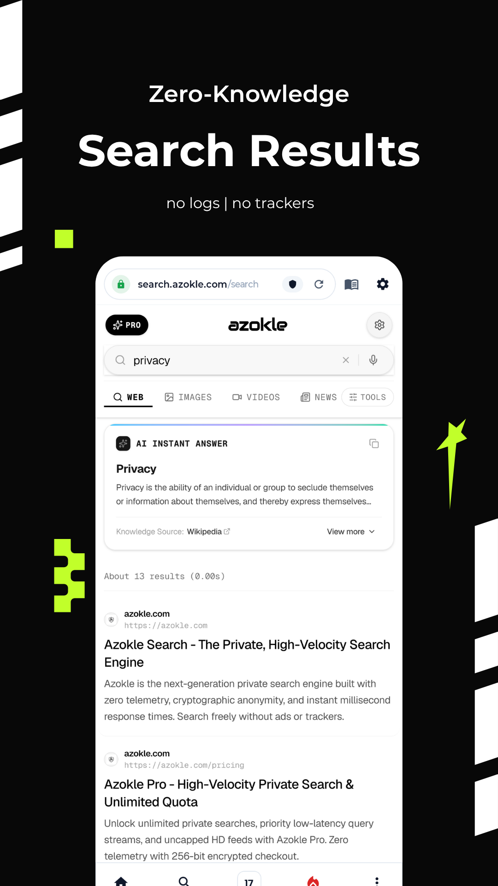
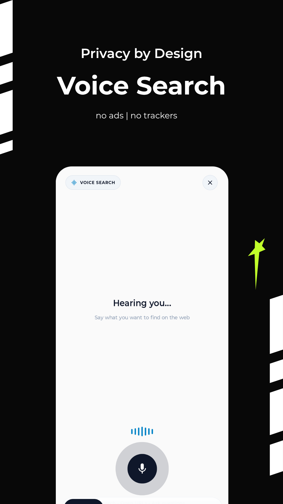
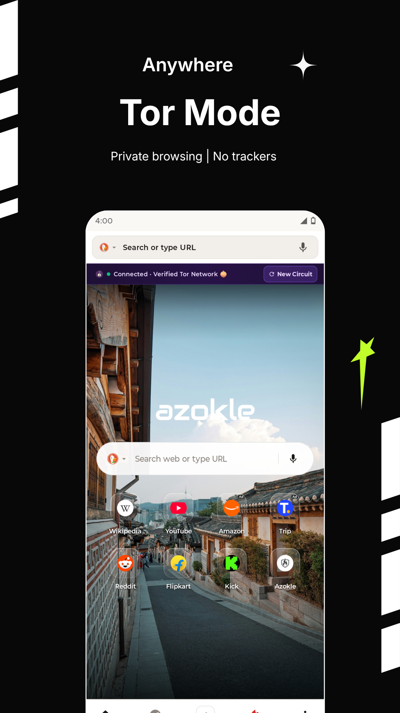
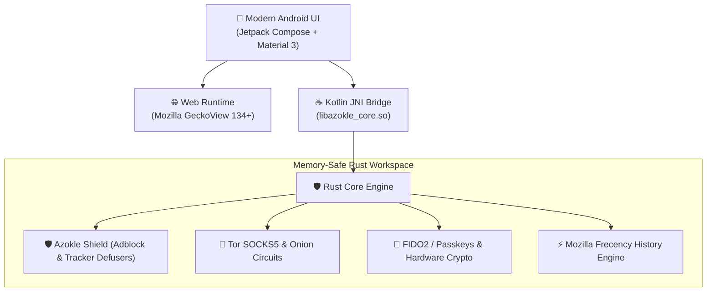

<div align="center">



# 🛡️ Azokle Browser

### *The Super-Fast, Ad-Free & Truly Private Web Browser*

**Browse freely. No creepy trackers. No annoying popups. Just pure, joyful internet.**

[](LICENSE)
[](https://developer.android.com)
[](https://www.rust-lang.org)
[](fastlane/metadata/android/en-US)
[](#-why-youll-love-azokle-browser-)

---

<p align="center">
  <a href="#-sneak-peek">📸 Screenshots</a> •
  <a href="#-why-youll-love-azokle-browser-">💖 Why Azokle?</a> •
  <a href="#-get-the-app">📲 Download</a> •
  <a href="#-under-the-hood-for-developers">🛠️ Under The Hood</a> •
  <a href="#-join-the-fun--contribute">🤝 Contribute</a>
</p>

---

</div>

## 📸 Sneak Peek

See Azokle Browser in action — smooth, stylish, and built to keep your personal life personal!

<div align="center">
<table>
  <tr>
    <td align="center" width="20%">
      <br/>
      <b>✨ Zero Clutter Home</b><br/>
      <sub>Clean bookmarks & private search</sub>
    </td>
    <td align="center" width="20%">
      <br/>
      <b>🛡️ Azokle Shield</b><br/>
      <sub>Block ads & enjoy video uninterrupted</sub>
    </td>
    <td align="center" width="20%">
      <br/>
      <b>⚡ Instant Answers</b><br/>
      <sub>Zero-knowledge search with no logs</sub>
    </td>
    <td align="center" width="20%">
      <br/>
      <b>🎙️ Private Voice</b><br/>
      <sub>Search by voice without eavesdropping</sub>
    </td>
    <td align="center" width="20%">
      <br/>
      <b>🧅 One-Tap Tor</b><br/>
      <sub>Triple-layer encryption anywhere</sub>
    </td>
  </tr>
</table>
</div>

---

## 💖 Why You'll Love Azokle Browser 

Most browsers spy on you, sell your search history, and let websites flood your screen with flashing ads. **Azokle Browser changes the game!**

### 🚫 1. Bye-Bye, Annoying Ads! (Azokle Shield)
No banners, no video interruptions, no popup traps. Azokle Shield stops ads before they even download, which saves your battery and keeps your mobile data light and fast.

### 🕵️ 2. Zero Creepy Trackers (Zero Telemetry)
We don't know who you are, what you search, or what you click — and we like it that way! We have **zero analytics SDKs**, zero tracking pixels, and zero background telemetry.

### 🧅 3. Secret Agent Stealth (One-Tap Tor)
Need next-level privacy? Flip on **Tor Mode** to bounce your connection across three encrypted hops across the globe. Seamlessly explore `.onion` sites with total anonymity!

### ⚡ 4. Supercharged Speed
Powered by Mozilla's high-octane **GeckoView** engine and ultra-fast **Rust** under the hood. Heavy websites load in the blink of an eye with buttery smooth scrolling.

### 🔥 5. The Magic Incinerator Button
Done with a private session? Tap the flame button and watch cookies, tabs, history, and cache vanish into thin air. Poof! Not a single trace left behind.

### 🔐 6. Hardware-Grade Password & Passkey Vault
Ditch weak passwords! Save passkeys and credentials locked safely behind your phone's biometric hardware (fingerprint & face unlock).

---

## 📲 Get The App

| Channel | Status | How to install |
| :--- | :--- | :--- |
| **GitHub Releases** | Available Now | Grab the latest `.apk` from the [Releases](https://github.com/azoklesoftware/azokle-browser/releases) tab. |
| **F-Droid Store** | Publishing | Built directly from 100% open-source code via our automated [F-Droid Pipeline](.github/workflows/fdroid.yml). |
| **Build from Source** | Always Available | Clone the repo and run `./gradlew assembleDebug` in 2 minutes! |

---

## 🛠️ Under The Hood (For Developers & Curious Geeks)

Azokle is engineered with clean boundaries: high-performance Rust core, Kotlin Jetpack Compose for the UI, and Mozilla GeckoView for the web runtime.



<details>
<summary><b>📂 Repository Blueprint (Click to expand)</b></summary>

```text
azokle-browser/
├── apps/
│   ├── android/             # Android app (Jetpack Compose + GeckoView)
│   │   ├── app/src/main/
│   │   │   ├── java/        # UI, Tab Management, Incinerator, Settings
│   │   │   ├── jniLibs/     # Pre-compiled Rust binaries (arm64, v7a, x86_64)
│   │   │   └── assets/      # Adblock filters & WebExtensions
│   │   └── fastlane/        # F-Droid store listings, screenshots & icons
│   └── linux/               # Native Linux GTK desktop application
├── bindings/
│   ├── kotlin/              # Rust JNI bindings (azokle-jni)
│   └── c/                   # C-ABI static library for desktop (azokle-c-bridge)
├── crates/                  # 17 Modular, Memory-Safe Rust crates
│   ├── privacy/             # Adblocking Flatbuffers & tracker defusers
│   ├── crypto/              # FIDO2 Passkeys & ChaCha20-Poly1305 storage
│   ├── tor/                 # Native SOCKS5 daemon & onion routing
│   └── services/            # History, Bookmarks, Downloads, Search bangs
└── .github/workflows/       # Automated CI, Security scans & F-Droid builds
```

</details>

<details>
<summary><b>💻 Quick Build Guide (Click to expand)</b></summary>

### 1. Requirements
- **Rust 1.75+** (`curl --proto '=https' --tlsv1.2 -sSf https://sh.rustup.rs | sh`)
- **Android SDK & NDK 27+**
- **Cargo NDK**: `cargo install cargo-ndk`

### 2. Testing the Rust Core
```bash
cargo check --workspace
cargo test --workspace
```

### 3. Building the Android App
```bash
# Build Rust native libraries for Android:
cargo ndk -t arm64-v8a -t x86_64 -o apps/android/app/src/main/jniLibs build --release -p azokle-jni

# Build the Debug APK:
cd apps/android
./gradlew assembleDebug
```

</details>

---

## 🔒 Privacy & Security Guarantees

We take safety seriously so you don't have to worry:

- **100% Rust Core**: Untrusted network filters and data parsers run in memory-safe Rust with `#![forbid(unsafe_code)]`.
- **Sandboxed Downloads**: Files downloaded in Private and Tor modes stay locked in private vaults and never leak to public storage.
- **No Anti-Features**: Zero proprietary analytics, zero tracking SDKs, and zero bloat.
- **Security Audited**: Verified against 80+ security benchmarks (XSS, intent sanitization, DNS leak prevention). See our full [Security Audit Report](docs/operations/azokle_browser_implementation_report.md).

---

## 🤝 Join The Fun & Contribute!

Azokle Browser is 100% open source and made with ❤️ for the community. We'd love your help making it even better!

- 🐛 **Found a bug?** Open an [Issue](https://github.com/azoklesoftware/azokle-browser/issues).
- 💡 **Got a cool idea?** Start a discussion!
- 👩‍💻 **Want to write code?** Check out our [Contributing Guide](CONTRIBUTING.md) and submit a Pull Request.
- ⭐ **Love what we're building?** Don't forget to **Star this repository** — it helps more people discover private browsing!

---

## 📜 License

Azokle Browser is proudly open-source, dual-licensed under both the **MIT License** and the **Apache License (Version 2.0)**. See the [LICENSE](LICENSE) file for details.

<div align="center">

**Made with 💜 for a free, open, and private internet.**

</div>
