<div align="center">

# 🛡️ Azokle Browser

### *The High-Performance, Privacy-First, Cross-Platform Web Browser*

[](https://www.rust-lang.org)
[](https://isocpp.org)
[](https://developer.android.com)
[](https://developer.android.com/jetpack/compose)
[](https://www.gtk.org)
[](https://www.torproject.org)
[](LICENSE)

*Built around a shared, memory-safe Rust Core engine, GeckoView & WebKit browser-engine runtimes, FIDO2 WebAuthn Passkeys, 3-Hop Tor Onion Circuits, Binary Flatbuffer AdBlock filtering, and zero third-party telemetry.*

---

</div>

## 📖 Table of Contents

1. [Executive Summary & Core Principles](#-executive-summary--core-principles)
2. [Complete System Architecture](#-complete-system-architecture)
3. [Repository Directory Blueprint](#-repository-directory-blueprint)
4. [Rust Workspace & Subsystem Deep-Dive](#-rust-workspace--subsystem-deep-dive)
5. [Cross-Platform Bindings Layer (`azokle-jni`, `azokle-c-bridge`, `azokle-uniffi`)](#-cross-platform-bindings-layer)
6. [Client Applications Architecture](#-client-applications-architecture)
   - [Android Application (`apps/android`)](#-android-application-appsandroid)
   - [Linux Desktop Application (`apps/linux`)](#-linux-desktop-application-appslinux)
7. [Comprehensive Build & Compilation Guide](#-comprehensive-build--compilation-guide)
   - [Prerequisites for All Platforms](#prerequisites-for-all-platforms)
   - [1. Building the Rust Core Workspace](#1-building-the-rust-core-workspace)
   - [2. Building Android JNI Binaries (`libazokle_core.so`)](#2-building-android-jni-binaries-libazokle_coreso)
   - [3. Building and Installing the Android App](#3-building-and-installing-the-android-app)
   - [4. Building the Linux Desktop App (CMake / GTK)](#4-building-the-linux-desktop-app-cmake--gtk)
   - [5. macOS & Windows Development Guide](#5-macos--windows-development-guide)
8. [Advanced Diagnostics, Debugging & Profiling](#-advanced-diagnostics-debugging--profiling)
9. [Security, Privacy & Threat Mitigations](#-security-privacy--threat-mitigations)
10. [Testing & Quality Verification](#-testing--quality-verification)
11. [License & Community](#-license--community)

---

## 🧭 Executive Summary & Core Principles

**Azokle Browser** is engineered from the ground up to protect user privacy, eliminate tracking, and deliver desktop-grade web performance on mobile and desktop platforms. Unlike traditional browsers that bundle third-party telemetry, ad-networks, or fragile JavaScript monkey-patching, Azokle enforces strict browser-engine boundaries:

1. **Native Engine Boundaries**: Browser responsibilities belong to the browser engine (GeckoView / WebKit). Ad-blocking and privacy filtering operate strictly at the native network/Rust layer before bytes reach the layout renderer.
2. **Zero Telemetry Guarantee**: No analytics SDKs, no tracking pings, no unique hardware identifiers, and no telemetry pings.
3. **Memory Safety by Construction**: All filter parsing, cryptographic vaults, URL sanitizers, Tor SOCKS5 sockets, and download pipelines are written in memory-safe Rust with `#![forbid(unsafe_code)]` boundaries.
4. **Resilience & Fault Isolation**: Every JNI and C-ABI boundary implements explicit exception and `Throwable` safety barriers, preventing native crashes from crashing user interfaces.
5. **Decentralized & Multi-Hop Privacy**: Native Tor 3-Hop Onion routing with circuit node visualizer and `.onion` hidden service resolution out of the box.

---

## 🏛️ Complete System Architecture

```mermaid
graph TD
    subgraph ClientApps ["Client Applications Layer (apps/)"]
        ANDROID["📱 apps/android<br/>• Jetpack Compose & Material 3<br/>• Mozilla GeckoView 134+ Engine<br/>• Anti-Flash Surface Compositor<br/>• Fast Tab & Group Manager<br/>• Biometric Keystore Vault"]
        LINUX["🐧 apps/linux<br/>• C++20 & GTK 3/4 Chrome<br/>• Embedded WebKitGTK / GeckoEngine<br/>• Internal Pages: azokle://*<br/>• Custom Omnibar & Fast Tabs"]
    end

    subgraph EngineLayer ["Engine Abstraction Layer (engine/)"]
        ENG["⚙️ engine/include/azokle/engine<br/>• IBrowserEngine / IGeckoEngine<br/>• IGeckoSession & IGeckoDelegate<br/>• Platform Web Engine Bridges"]
    end

    subgraph BindingsLayer ["Bindings Layer (bindings/)"]
        JNI["☕ bindings/kotlin (azokle-jni)<br/>• JNI Native Bridge (libazokle_core.so)<br/>• Targets: arm64-v8a, armeabi-v7a, x86_64, x86<br/>• Safe Throwable Exception Boundaries"]
        CABI["🔌 bindings/c (azokle-c-bridge)<br/>• Stable C-ABI Headers (azokle.h)<br/>• Static Library (libazokle_c.a)"]
        UNIF["🌐 bindings/uniffi (azokle-uniffi)<br/>• Multi-language FFI (Swift/iOS, Python, C#)"]
    end

    subgraph RustCore ["Rust Core Workspace (crates/)"]
        CORE["🛡️ crates/core (azokle-core facade)<br/>Central Orchestrator Singleton"]
        
        subgraph PrivacySubsystem ["Privacy & Shield Subsystem"]
            AD["privacy/adblock<br/>• Flatbuffers Binary Filter Cache<br/>• Brave Surrogates & Defusers"]
            ADR["privacy/adblock-rust<br/>• uBlock & Brave syntax parser"]
            TB["privacy/tracker-block<br/>• Bounce Tracking Redirect Defuser<br/>• URL Query Tracker Stripper"]
        end

        subgraph CoreServices ["Core Browser Services"]
            HIST["services/history<br/>• Mozilla Frecency Engine<br/>• Chronological Grouped Timeline<br/>• SQLite FTS Search"]
            PERM["services/permissions<br/>• Per-Origin Permission Controller"]
            DOWN["services/downloads<br/>• Resumable Range-206 Engine<br/>• Sandboxed Private/Tor Vault"]
            TABS["services/tabs<br/>• Tab Containers (Standard, Private, Tor)"]
            BOOK["services/bookmarks<br/>• Encrypted Bookmark Tree"]
            SYNC["services/sync<br/>• E2EE Multi-Device Sync Protocol"]
            SRCH["services/search<br/>• Bangs (!g, !yt, !w) & Suggest"]
        end

        subgraph SecurityCrypto ["Security & Cryptography"]
            CRYP["crypto<br/>• FIDO2 / WebAuthn P-256 Passkeys<br/>• ChaCha20-Poly1305 & Argon2id"]
            SEC["security<br/>• TLS Cert Inspector & Host Sanitizer"]
            STOR["storage<br/>• Encrypted SQLite & Atomic JSON Engine"]
            TOR["tor<br/>• SOCKS5 Proxy Daemon & Onion Circuits"]
            NET["networking<br/>• DNS-over-HTTPS (DoH) Client"]
            PROT["protocol<br/>• Custom Schemes (azokle://, about:*)"]
        end
    end

    AD --> CORE
    ADR --> CORE
    TB --> CORE
    HIST --> CORE
    PERM --> CORE
    DOWN --> CORE
    TABS --> CORE
    BOOK --> CORE
    SYNC --> CORE
    SRCH --> CORE
    CRYP --> CORE
    SEC --> CORE
    STOR --> CORE
    TOR --> CORE
    NET --> CORE
    PROT --> CORE

    CORE --> JNI
    CORE --> CABI
    CORE --> UNIF
    JNI --> ANDROID
    CABI --> ENG
    ENG --> LINUX
```



---

## 📂 Repository Directory Blueprint

```text
azokle-browser/
├── Cargo.toml                         # Cargo workspace root definition
├── CMakeLists.txt                     # CMake root configuration for C++20 and GTK
├── README.md                          # Master architectural documentation and guide
│
├── apps/                              # Client applications
│   ├── android/                       # Native Android application
│   │   ├── app/
│   │   │   ├── build.gradle.kts       # Android build script (GeckoView, Compose, NDK)
│   │   │   ├── src/main/
│   │   │   │   ├── AndroidManifest.xml
│   │   │   │   ├── java/com/azokle/search/
│   │   │   │   │   ├── core/          # AzokleCore Kotlin JNI bridge
│   │   │   │   │   ├── engine/        # GeckoEngineManager, GeckoBrowserView, Delegates
│   │   │   │   │   ├── engine/ui/     # BrowserScreen, Omnibar, UrlEditSheet, Anti-Flash
│   │   │   │   │   ├── tabs/          # TabManager, TabSession, TabThumbnailCache
│   │   │   │   │   ├── history/       # AzokleHistoryDatabase & HistoryManager
│   │   │   │   │   ├── downloads/     # DownloadManager & Sandboxed Download Vault
│   │   │   │   │   ├── vault/         # EncryptedVaultManager (Passkeys, Bookmarks)
│   │   │   │   │   ├── tor/           # TorCircuitManager & Visualizer
│   │   │   │   │   └── search/        # SearchBarCapsule, EngineSelector, VoiceModal
│   │   │   │   ├── jniLibs/           # Pre-compiled native libraries (.so) per ABI
│   │   │   │   │   ├── arm64-v8a/     # 64-bit ARM (aarch64-linux-android)
│   │   │   │   │   ├── armeabi-v7a/   # 32-bit ARM (armv7-linux-androideabi)
│   │   │   │   │   ├── x86_64/        # 64-bit x86 (x86_64-linux-android)
│   │   │   │   │   └── x86/           # 32-bit x86 (i686-linux-android)
│   │   │   │   └── assets/            # Flatbuffers rule cache, WebExtensions, configs
│   │   │   └── src/test/              # JUnit & Security Unit Test Suite
│   │   └── build.gradle.kts           # Root Gradle build script
│   │
│   └── linux/                         # Native Linux desktop application
│       ├── CMakeLists.txt             # Linux app CMake configuration
│       ├── resources/                 # Web assets for internal pages (HTML/CSS/JS)
│       │   ├── newtab/                # Brave-style New Tab dashboard
│       │   └── pages/                 # Settings, History, Downloads, Bookmarks
│       └── src/                       # C++20 GTK Window, Omnibar, Tabs, Engine bridge
│
├── bindings/                          # Native language bindings
│   ├── kotlin/                        # Rust JNI crate (azokle-jni -> libazokle_core.so)
│   │   ├── Cargo.toml
│   │   └── src/lib.rs                 # JNI export functions
│   ├── c/                             # C-ABI bridge crate (azokle-c-bridge -> libazokle_c.a)
│   │   ├── Cargo.toml
│   │   └── src/lib.rs                 # C-ABI extern "C" functions
│   └── uniffi/                        # UniFFI interface definitions for iOS/macOS
│
├── crates/                            # 17 Modular Rust workspace crates
│   ├── common/                        # Common utilities, errors, and URL helpers
│   ├── core/                          # Central AzokleCore singleton facade
│   ├── privacy/
│   │   ├── adblock/                   # Network filter matcher, Flatbuffers compiler
│   │   ├── adblock-rust/              # Brave/uBlock syntax rule parser
│   │   └── tracker-block/             # Bounce tracker defusal, Query stripper
│   ├── services/
│   │   ├── history/                   # Mozilla Frecency scoring & timeline engine
│   │   ├── permissions/               # Per-origin permission controller
│   │   ├── downloads/                 # Resumable Range-206 download engine
│   │   ├── tabs/                      # Tab container & snapshotting manager
│   │   ├── bookmarks/                 # Hierarchical bookmark tree
│   │   ├── search/                    # Search providers & bangs (!g, !yt, !w)
│   │   └── sync/                      # E2E encrypted device sync
│   ├── crypto/                        # FIDO2 / WebAuthn P-256 & Argon2id vault
│   ├── security/                      # TLS inspector, Anti-spoofing host validator
│   ├── storage/                       # Encrypted SQLite storage & atomic backups
│   ├── tor/                           # SOCKS5 proxy daemon & Onion routing
│   ├── networking/                    # DNS-over-HTTPS (DoH) & connection pooling
│   └── protocol/                      # Custom scheme router (azokle://, about:*)
│
└── engine/                            # Abstract C++20 Browser Engine interface
    ├── CMakeLists.txt
    └── include/azokle/engine/
        ├── IBrowserEngine.hpp         # Abstract browser engine interface
        └── IGeckoEngine.hpp           # Gecko / WebKit session delegates
```

---

## 🔬 Rust Workspace & Subsystem Deep-Dive

### 1. Privacy & Shield Engine (`crates/privacy/`)
- **Flatbuffer Binary Filter Cache**: Compiles hundreds of thousands of EasyList, EasyPrivacy, and uBlock filter rules into a memory-mapped binary Flatbuffer cache, enabling sub-millisecond network request matching.
- **Brave Surrogates & Defusers**: Injects neutral mock objects for tracking scripts (`google-analytics.js`, `fbevents.js`, `tagmanager.js`) to prevent website breakages while stopping telemetry.
- **Bounce-Tracking Interceptor**: Detects intermediate bounce-tracking domains and defuses redirects directly to clean target URLs.
- **Query Parameter Stripper**: Strips surveillance query tokens (`utm_source`, `utm_medium`, `fbclid`, `gclid`, `msclkid`, `mc_eid`, `_ga`, etc.) from all clicked links.

### 2. Mozilla-Standard Frecency History (`crates/services/history/`)
Azokle calculates destination relevance using Mozilla's proven **Frecency** algorithm:
$$\text{Frecency Score} = \sum (\text{Visit Weight} \times \text{Recency Bucket Factor}) + (\text{Typed Count} \times 2000)$$
- Results are ranked in real time to power the Top Sites grid and Omnibar autosuggestions with zero disk latency.

### 3. FIDO2 / WebAuthn Passkeys (`crates/crypto/`)
- Generates hardware-backed ECDSA P-256 keypairs with CBOR encoding for passwordless FIDO2 authentication.
- Securely stores credentials encrypted via ChaCha20-Poly1305 with Argon2id-derived key encryption keys (KEK).

### 4. Tor Onion Multi-Hop Routing (`crates/tor/`)
- Native SOCKS5 daemon routing traffic across 3-Hop Tor onion circuits (`Entry Guard` &rarr; `Middle Relay` &rarr; `Exit Node`).
- Seamlessly resolves `.onion` hidden service domains with end-to-end cryptographic isolation.

---

## 🔌 Cross-Platform Bindings Layer

### `azokle-jni` (`bindings/kotlin/`)
The Android application communicates with the Rust engine through high-performance JNI bindings compiled into `libazokle_core.so`:
- **Safe Throwable Error Boundaries**: All JNI invocations in [`AzokleCore.kt`](apps/android/app/src/main/java/com/azokle/search/core/AzokleCore.kt) are enclosed in `catch (e: Throwable)` blocks, ensuring that even link errors or missing native methods fallback gracefully without crashing the app.
- **Direct String & Flatbuffer Streaming**: Native buffers pass directly between JNI and Kotlin memory without unnecessary JSON allocations.

### `azokle-c-bridge` (`bindings/c/`)
Exposes C-compatible symbol definitions (`azokle_core_init`, `azokle_adblock_matches`, `azokle_history_record_visit`) compiled into static library `libazokle_c.a` for C++20 and GTK applications.

### `azokle-uniffi` (`bindings/uniffi/`)
UniFFI interface definitions for cross-platform expansion (Swift / iOS, Python CLI, C# bindings).

---

## 📱 Client Applications Architecture

### 📱 Android Application (`apps/android/`)
- **GeckoView 134+ Runtime**: Embedded Mozilla Gecko engine with full WebExtension APIs, sandboxed cookie jars, and hardware-accelerated WebGL.
- **Anti-Flash Compositor**:
  - `PageLoadingTransitionSurface` completely masks stale framebuffers and viewport reflow jumps during URL navigations and Desktop/Mobile mode toggles.
  - Smooth 180ms crossfade on `onProgressChange >= 20` or `onPageStop`.
- **Sandboxed Download Vault**:
  - Private Mode and Tor downloads are saved into isolated, application-private directories without leaking to the public MediaStore.
  - One-tap Fire Incinerator shreds and deletes all private downloads and browsing state atomically.
- **Interactive Omnibar Sheet**:
  - Live search engine switching (Azokle Search, DuckDuckGo, Brave, Startpage, Mojeek).
  - One-tap "Paste & Go" clipboard pill with domain validation.
  - Frecency history suggestions and live search queries.

### 🐧 Linux Desktop Application (`apps/linux/`)
- **C++20 & GTK 3/4**: Ultra-lightweight native Linux desktop shell.
- **Internal Scheme Pages**:
  - `azokle://newtab`: Local dashboard with live privacy metrics.
  - `azokle://settings`: Comprehensive Shield, Passkey, Search, and Tor controls.
  - `azokle://history`: Instant queryable chronological history timeline.
  - `azokle://downloads` & `azokle://bookmarks`: Built-in management surfaces.

---

## 🛠️ Comprehensive Build & Compilation Guide

### Prerequisites for All Platforms

1. **Rust Toolchain (1.75.0+)**:
   ```bash
   curl --proto '=https' --tlsv1.2 -sSf https://sh.rustup.rs | sh
   rustup default stable
   rustup target add aarch64-linux-android armv7-linux-androideabi x86_64-linux-android i686-linux-android
   ```
2. **Cargo NDK (for Android builds)**:
   ```bash
   cargo install cargo-ndk
   ```
3. **Android SDK & NDK (for Android builds)**:
   - Android SDK API Level 34+ (Android 14)
   - Android NDK Version `27.0.12077973` or `28.x`
   - Set environment variables in your shell configuration (`~/.bashrc` / `~/.zshrc`):
     ```bash
     export ANDROID_HOME=$HOME/Android/Sdk
     export ANDROID_NDK_HOME=$ANDROID_HOME/ndk/27.0.12077973
     export PATH=$PATH:$ANDROID_HOME/platform-tools:$ANDROID_HOME/cmdline-tools/latest/bin
     ```
4. **Linux Build Dependencies (for Linux desktop builds)**:
   ```bash
   sudo apt update && sudo apt install -y \
       build-essential gcc g++ clang cmake pkg-config ninja-build \
       libgtk-3-dev libgtk-4-dev libwebkit2gtk-4.1-dev \
       libssl-dev libsqlite3-dev
   ```

---

### 1. Building the Rust Core Workspace

```bash
# Clone the repository
git clone https://github.com/azokle/azokle-browser.git
cd azokle-browser

# Verify and check entire workspace
cargo check --workspace

# Run all unit tests across all 17 crates
cargo test --workspace

# Run tests with live stdout
cargo test --workspace -- --nocapture

# Build release desktop libraries
cargo build --workspace --release
```

---

### 2. Building Android JNI Binaries (`libazokle_core.so`)

Compile the native JNI libraries for all Android architectures using `cargo ndk`:

```bash
# From the repository root:
ANDROID_NDK_HOME=$ANDROID_HOME/ndk/27.0.12077973 cargo ndk \
    -t arm64-v8a \
    -t armeabi-v7a \
    -t x86_64 \
    -o apps/android/app/src/main/jniLibs \
    build --release -p azokle-jni
```

*Verify that native symbols are properly exported:*
```bash
nm -D apps/android/app/src/main/jniLibs/arm64-v8a/libazokle_core.so | grep -i historyGetTopFrecency
```

---

### 3. Building and Installing the Android App

```bash
cd apps/android

# Run unit tests
./gradlew testDebugUnitTest

# Build Debug APK
./gradlew assembleDebug

# Build Release APK
./gradlew assembleRelease

# Install directly to connected device / emulator
./gradlew installDebug
```

---

### 4. Building the Linux Desktop App (CMake / GTK)

```bash
# 1. Build the C-Bridge static library
cargo build -p azokle-c-bridge --release

# 2. Configure and build CMake project
cmake -B build_linux -S . -DCMAKE_BUILD_TYPE=Release
cmake --build build_linux --parallel $(nproc)

# 3. Run Linux Desktop App
./build_linux/apps/linux/azokle-browser-linux

# Run with GTK debug logs
G_MESSAGES_DEBUG=all ./build_linux/apps/linux/azokle-browser-linux
```

---

### 5. macOS & Windows Development Guide

- **macOS**:
  ```bash
  cargo test --workspace
  cargo build -p azokle-uniffi
  ```
- **Windows (MSVC)**:
  - Requires Visual Studio 2022 with C++20 toolset and `x86_64-pc-windows-msvc` target.
  ```powershell
  cargo test --workspace
  ```

---

## 🔍 Advanced Diagnostics, Debugging & Profiling

### Android Logcat & Crash Inspection
```bash
# Live filter for Azokle runtime events, crashes, and GeckoView engine logs
adb logcat -v color | grep -E "(Azokle|Gecko|FATAL EXCEPTION|AndroidRuntime)"

# Inspect crash buffer immediately
adb logcat -d -b crash
```

### AddressSanitizer & Memory Leak Analysis (Desktop)
```bash
# Run Rust tests under AddressSanitizer (nightly)
RUSTFLAGS="-Zsanitizer=address" cargo +nightly test --target x86_64-unknown-linux-gnu

# Build Linux desktop app with ASan
cmake -B build_asan -S . -DCMAKE_BUILD_TYPE=Debug -DENABLE_ASAN=ON
cmake --build build_asan
```

---

## 🔒 Security, Privacy & Threat Mitigations

| Security Domain | Mitigation Architecture |
| :--- | :--- |
| **Memory Safety** | 100% Rust core with `#![forbid(unsafe_code)]` on untrusted parsers and network filters. |
| **Zero Telemetry** | Absolute zero third-party telemetry, metrics, or identifier collection. |
| **Download Security** | Sandboxed Private/Tor downloads isolated from public MediaStore; HTTP Range-206 safety checks. |
| **Passkey Protection** | Hardware Keystore-backed ECDSA P-256 WebAuthn keys encrypted with ChaCha20-Poly1305. |
| **Tor Isolation** | Strict SOCKS5 socket isolation per tab container with zero local IP leakage. |
| **Anti-Spoofing** | Unicode homoglyph detection and strict domain extraction preventing URL bar phishing. |
| **Nuclear Incinerator** | One-tap atomic destruction of cookies, local storage, private downloads, and SQLite history. |

---

## 🧪 Testing & Quality Verification

- **Rust Workspace Unit Tests**: `cargo test --workspace` (100% passing across all 17 crates).
- **Android Unit Tests**: `./gradlew testDebugUnitTest` (Comprehensive JUnit test coverage).
- **Android Assembly**: `./gradlew assembleDebug` (Clean compilation & packaging).

---

## 📄 License & Community

Azokle Browser is licensed under the **MIT License** and the **Apache 2.0 License**. See [LICENSE](LICENSE) for full details.

<div align="center">

**Azokle Browser — Built for Uncompromised Speed and Privacy.**

</div>
