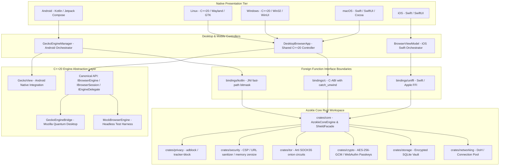
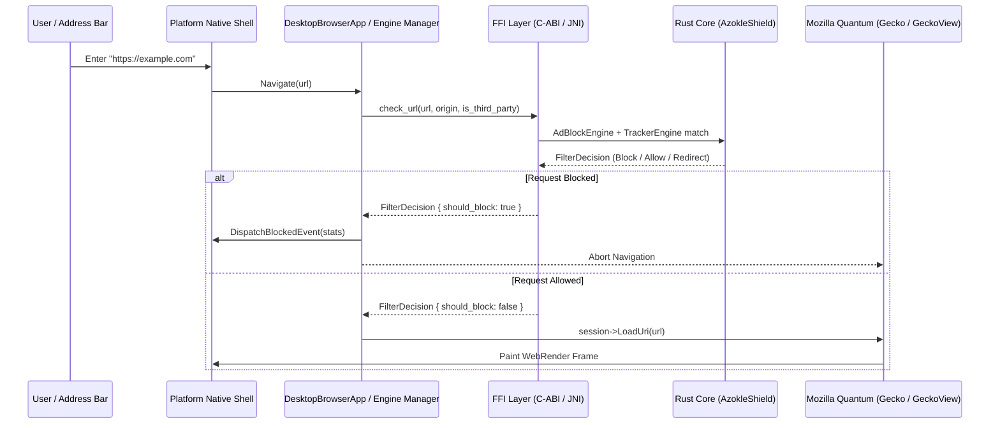

# System Architecture Overview

The Azokle Browser architecture is designed around four strict foundational principles:
1. **Core Domain Isolation**: All security logic, cryptography, ad/tracker blocking, network proxies, and protocol rules are strictly encapsulated within a pure Rust workspace (`crates/`), completely isolated from UI code.
2. **Engine Abstraction Layer**: The rendering pipeline is decoupled from platform frameworks via a modern C++20 engine contract (`azokle::engine`), enabling Mozilla Quantum (Gecko/GeckoView) embedding across Linux, Android, Windows, macOS, and iOS without leaking engine-specific quirks into the UI.
3. **Panic-Proof FFI Boundaries**: All foreign function interactions (C-ABI, JNI, UniFFI) enforce unconditional panic-isolation barriers (`std::panic::catch_unwind`), zero-cost bitmask status flags, and deterministic memory ownership.
4. **Thin Native Presentation**: Client applications in `apps/` maintain zero business or privacy logic; they act strictly as presentation shells rendering the browser surface and forwarding user interactions to the core.

---

## Component Topology

---

## Dataflow Pipeline

### 1. URL Navigation & Interception Flow

### 2. Ephemeral vs Normal Storage Segregation
The browser maintains two distinct operational profiles:
- **Normal Profile**: Persistent cookies, cache, local storage, encrypted history, and bookmark databases stored in AES-256-GCM encrypted vaults on disk.
- **Private / Ephemeral Profile**: Strictly memory-backed (RAM disk), zero write activity to persistent storage. Upon tab or window closure, all cryptographic keys, cache blocks, and session histories are zeroized using `zeroize::Zeroize`.
