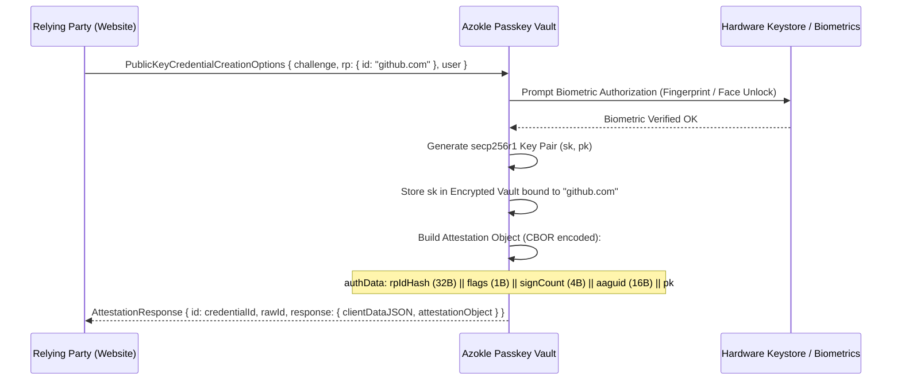
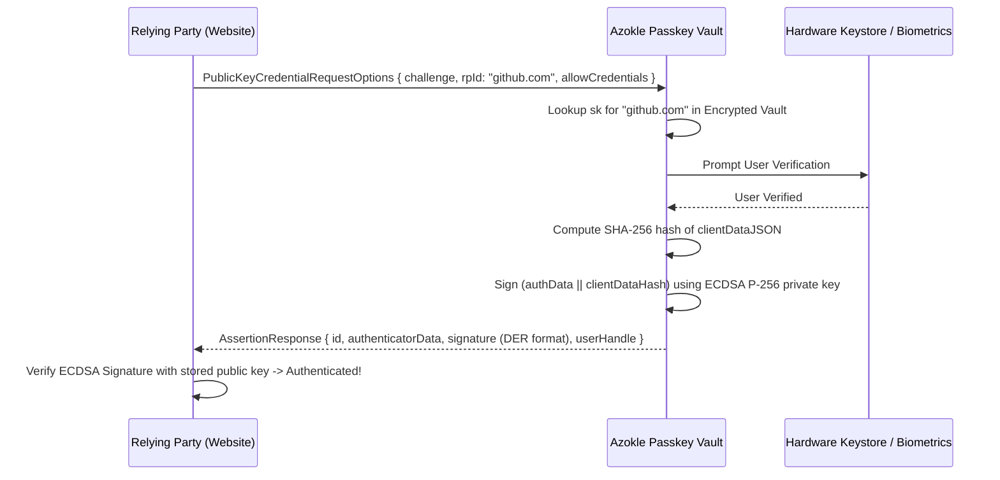

# Deep Dive: Sovereign Passkey & WebAuthn Implementation

This document details the cryptographic flow, CBOR encoding, and hardware binding of the **Sovereign Passkey** subsystem in `crates/crypto/src/passkey.rs`.

---

## 1. FIDO2 / CTAP2 Architecture

Azokle acts as an in-process **FIDO2 Authenticator** compliant with the W3C WebAuthentication Level 3 specification:

```
[Relying Party (Website)] <--- HTTPS ---> [Gecko Engine]
                                               |
                                     (WebAuthn JS API)
                                               v
                                    [Azokle Native Passkey]
                                               |
                              +----------------+----------------+
                              |                                 |
                     [Software Vault]                 [Hardware Keystore]
                     (Argon2id / AES)                 (Secure Enclave / TPM)
```

---

## 2. Passkey Creation (`navigator.credentials.create`)



### CBOR Attestation Structure
The attestation object is serialized using binary CBOR with the following dictionary keys:
- `fmt`: `"none"` (sovereign privacy format; prevents device serial tracking).
- `authData`: Concatenation of:
  - `rpIdHash` (32 bytes): SHA-256 hash of the relying party domain.
  - `flags` (1 byte): User Present (UP=1), User Verified (UV=1), Attested Credential Data (AT=1).
  - `signCount` (4 bytes, big-endian): Monotonically increasing signature counter.
  - `attestedCredentialData`: AAGUID (16 bytes) + Credential ID Length (2 bytes) + Credential ID + COSE-encoded Public Key.

---

## 3. Passkey Assertion (`navigator.credentials.get`)


