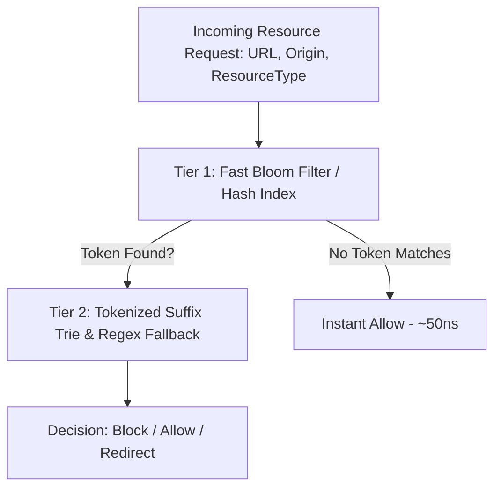

# Deep Dive: Azokle Shield Filter Engine

This document details the internal data structures, compilation algorithms, and matching mechanics of the **Azokle Shield** filtering engine located in `crates/privacy/adblock` and `crates/privacy/tracker-block`.

---

## 1. Rule Parsing & Tokenization Pipeline

```
Raw Filter Rule: ||ads.example.com/banner/*$image,third-party,domain=publisher.com
                                   |
                               [Parser]
                                   v
+---------------------------------------------------------------------------------+
| Parsed Rule Structure:                                                          |
| - Filter Type: Network Block                                                    |
| - Hostname Pattern: "ads.example.com"                                           |
| - Path Pattern: "/banner/*"                                                     |
| - Type Mask: RequestType::Image (0x0002)                                        |
| - Third-Party Mask: ThirdPartyOnly (0x0001)                                     |
| - Domain Allowlist: ["publisher.com"]                                           |
+---------------------------------------------------------------------------------+
```

---

## 2. Fast Path Matching Data Structures

Matching millions of HTTP requests per second against 200,000+ rules cannot rely on naive linear scanning or non-deterministic finite automaton (NFA) regular expressions.

### Two-Tier Matching Hierarchy:



1. **Tier 1: Bloom Filter / Token Extraction**:
   - The candidate URL is split into 4-character n-grams (tokens).
   - Only rules sharing matching tokens with the candidate URL are shortlisted.
   - For 98% of clean resource requests, matching terminates at Tier 1 in under 100 nanoseconds.
2. **Tier 2: Suffix Trie & Bitmask Evaluation**:
   - Hostnames are checked against an eTLD+1 suffix trie.
   - Resource type flags (`script`, `image`, `stylesheet`, `xmlhttprequest`, `subdocument`) are evaluated via single-cycle bitwise AND operations:
     ```rust
     if (rule.content_types & request_content_type) == 0 {
         continue; // Rule does not apply to this asset type
     }
     ```

---

## 3. CNAME Uncloaking Architecture

Trackers often disguise third-party tracking endpoints under first-party subdomains (e.g. `analytics.publisher.com` pointing via CNAME to `tracking.vendor.net`).

### Uncloaking Flow
1. When a first-party resource request matches suspicious subdomains (`metrics.*`, `track.*`, `telemetry.*`), `crates/privacy/tracker-block` performs an in-memory CNAME table lookup.
2. If the CNAME canonical name resolves to a known tracking domain in `data/filters/cname.txt`, the request is classified as **Third-Party Tracker** and terminated immediately.
3. The true destination is logged in `ShieldStatsSummary::trackers_blocked`.

---

## 4. Cosmetic Filter Compilation & Selector Injection

Cosmetic filters hide elements directly within the webpage:
- **Rule Syntax**: `example.com##.sponsored-post` or `###ad-banner`
- **Compiler Pass**:
  - Domain-specific cosmetic rules are grouped into a hash map indexed by eTLD+1.
  - Generic rules (applicable across all sites) are compiled into a deduplicated CSS stylesheet string.
- **DOM Injection**:
  - Injected via `IBrowserSession::InjectCss` prior to `DOMContentLoaded`.
  - Injected styles use CSS priority `!important` and `display: none !important; visibility: hidden !important;`.
